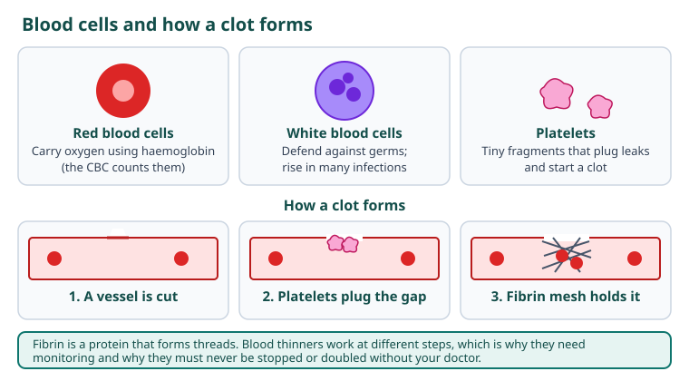

# Blood: Cells, Clotting and Blood Groups

*Status: Draft. A doctor has not reviewed it yet. Last checked: November 2026.*

> [!NOTE]
> **Quick summary**
> - Blood is a liquid organ: about 55% plasma (fluid) and 45% cells. An adult has roughly 5 litres. `⚠ verify`
> - All blood cells start as stem cells in the bone marrow. Red cells carry oxygen, white cells defend, platelets plug leaks.
> - Making blood needs raw materials (iron, B12, folate) and a signal from the kidney (EPO). Lack of any one shows up on a blood count.
> - Clotting is a two-stage process: a platelet plug, then a protein mesh. The liver makes most of the clotting proteins.

---

## 1. Where blood comes from: the bone marrow

**Bone marrow** is the soft tissue inside bones (in adults mostly in the pelvis, spine, ribs and breastbone). It holds **haematopoietic stem cells**, parent cells that can become any blood cell.

```
                 Stem cell
              /              \
      Myeloid line         Lymphoid line
   (red cells, platelets,   (lymphocytes:
    neutrophils, monocytes,  T cells, B cells)
    eosinophils, basophils)

 Figure 1: All blood cells come from one parent in the marrow.
```

The marrow produces millions of cells every second, because cells wear out. Anything that damages the marrow or starves it of materials changes the blood count.



## 2. Red blood cells and haemoglobin

### The cell

A red cell is a flexible, disc-shaped cell with a **dent in the middle** (biconcave), which gives a large surface for gas exchange. It has **no nucleus**, leaving more room for **haemoglobin**. It lives about **120 days**, then the spleen removes it and recycles the iron. The haem part becomes bilirubin (see [Liver and gallbladder](liver-and-gallbladder.md)).

### Haemoglobin

Haemoglobin is a protein made of **four chains**, each wrapped around a **haem** group that contains one **iron** atom. Each iron atom holds one oxygen molecule, so one haemoglobin carries four.

- In the lungs, where oxygen is plentiful, haemoglobin **loads** oxygen.
- In tissues, where oxygen is low and carbon dioxide and acid are higher, it **releases** oxygen.
- Adult haemoglobin (HbA) has two **alpha** and two **beta** chains. Fetal haemoglobin (HbF) has gamma chains in place of beta.

Inherited problems with these chains explain common Indian blood conditions:

| Condition | What is wrong |
|---|---|
| Thalassaemia | The body makes too little of one chain (alpha or beta), so red cells are small, pale and fragile. Thalassaemia trait (a carrier) is common in India and usually causes mild anaemia that is mistaken for iron deficiency. |
| Sickle cell disease | A change in the beta chain makes the cell stiff and sickle-shaped |
| Haemoglobin variants (HbE, HbS and others) | Different chains; some interfere with HbA1c testing (see [Diabetes](../02-diseases/diabetes.md)) |

### Making red cells: what the marrow needs

| Needed | Role | If missing |
|---|---|---|
| Iron | The core of haem | Small, pale red cells (microcytic anaemia) |
| Vitamin B12 and folate | Needed for cells to copy their DNA when dividing | Large, immature red cells (macrocytic anaemia) |
| EPO (erythropoietin) from the kidney | The "make more" signal | Low in kidney disease, causing anaemia |
| Healthy marrow | The factory | Damage causes low counts of several cell types |

**Anaemia** means too little haemoglobin. A commonly used definition (WHO) is below about 13 g/dL in men, 12 g/dL in non-pregnant women and 11 g/dL in pregnancy. `⚠ verify` In India, anaemia is very common, especially in women and children. In NFHS-5 (2019-21), about 57% of women aged 15-49 and 67% of children aged 6-59 months were anaemic (figures from secondary reports). `⚠ verify NFHS-5`

## 3. Reading the red cell numbers (CBC)

A **complete blood count (CBC)** reports these numbers:

| Marker | What it measures | Raised / lowered by |
|---|---|---|
| Haemoglobin (Hb) | Oxygen-carrying protein concentration | Low: anaemia. High: dehydration, smoking, living at altitude, some marrow diseases |
| RBC count | Number of red cells | Often low in anaemia; can be normal or high in thalassaemia trait |
| Haematocrit (PCV) | Share of blood volume taken by red cells | Moves with Hb |
| MCV | Average size of a red cell | Low (small): iron deficiency, thalassaemia trait. High (large): B12 or folate deficiency, alcohol, an underactive thyroid, some medicines |
| MCH, MCHC | Haemoglobin per cell, haemoglobin concentration | Low in iron deficiency |
| RDW | How varied the cell sizes are | High in mixed problems, such as early iron deficiency |
| Ferritin (separate test) | Iron stores | Low: iron deficiency. But ferritin also rises with inflammation, infection and liver disease, so a "normal" ferritin does not always exclude iron deficiency. |

Size sorts the causes:
- Small cells (low MCV): iron deficiency or thalassaemia trait.
- Normal-size cells: blood loss, long-term disease, kidney disease.
- Large cells (high MCV): B12 or folate deficiency, alcohol, thyroid problems.

This is why a low haemoglobin alone never tells you the cause. You need the cell size, ferritin and sometimes B12, folate or a haemoglobin analysis.

## 4. White blood cells: the defenders

White cells are fewer than red cells but vital. A CBC reports a total count and a **differential** (the share of each type).

| Cell | Main job | Raised in | Lowered in |
|---|---|---|---|
| Neutrophils | First responders; eat bacteria and fungi | Bacterial infection, stress, steroids | Some viral infections, some drugs, marrow problems |
| Lymphocytes | T cells coordinate and kill infected cells; B cells make antibodies | Viral infection | Severe illness, some drugs, HIV |
| Monocytes | Become macrophages that eat debris and germs | Long-term infection | Rare |
| Eosinophils | Parasites and allergy | Allergy, asthma, worm infection | Steroids |
| Basophils | Allergic reactions | Rare | Rare |

A raised total white count is **non-specific**. It points to infection, inflammation or stress but not which. The immune response is covered in more detail in the immune system chapter when written.

## 5. Platelets and clotting

### Platelets

Platelets are tiny cell fragments made by large marrow cells called **megakaryocytes**. They last roughly 7 to 10 days. `⚠ verify` A typical count is roughly 150,000 to 400,000 or 450,000 per microlitre of blood (lab ranges vary). `⚠ verify` Counts fall in **dengue**, some drugs and marrow diseases, and bleeding risk depends on how low they go.

### The two stages of clotting (haemostasis)

When a vessel is cut:

1. Primary stage (seconds): the platelet plug. The vessel narrows. Platelets stick to the damaged wall (helped by a protein called von Willebrand factor) and to each other, plugging the hole.
2. Secondary stage (minutes): the coagulation cascade. A chain of **clotting factors**, proteins that activate one another in order, converts a blood protein (**fibrinogen**) into **fibrin** threads. These form a mesh that reinforces the plug into a firm clot.
3. **Cleanup (days): fibrinolysis.** An enzyme system dissolves the clot as the wound heals.

The liver makes most clotting factors, and several of them (factors II, VII, IX and X) need **vitamin K** to work. That is why liver disease, vitamin K deficiency and the blood thinner **warfarin** all prolong clotting.

| Test | What it measures | Used for |
|---|---|---|
| PT / INR (prothrombin time) | Time for blood to clot via the "extrinsic" route | Liver function; monitoring warfarin |
| aPTT | Time via the "intrinsic" route | Monitoring heparin; some inherited bleeding disorders |
| Platelet count | Number of platelets | Bleeding risk |
| D-dimer | A fragment released when clots dissolve | Screening for abnormal clots (it is raised in many conditions, so a normal value rules out clots more reliably than a high value rules them in) |

Clots that form when they should not (in leg veins, lungs, heart or brain) are dangerous. That is why some people take **anticoagulants** (blood thinners) or **antiplatelet drugs** (such as aspirin), always under medical supervision.

## 6. Plasma: the liquid part

Plasma is mostly water with dissolved proteins, salts, sugar, fats, hormones and waste.

| Plasma protein | Made by | Job |
|---|---|---|
| Albumin | Liver | Keeps fluid inside vessels (oncotic pressure); carries hormones, drugs and bilirubin |
| Globulins | Liver and immune cells | Include antibodies (immunoglobulins) and transport proteins |
| Fibrinogen and clotting factors | Liver | Clotting |

When albumin is low, fluid leaks out of vessels into tissues (swollen ankles, fluid in the belly).

## 7. Blood groups

Red cells carry surface markers (**antigens**).

- ABO system: group A has A markers, B has B markers, AB has both, O has neither. Your plasma carries antibodies against the markers you lack. So group O can give red cells to anyone (no markers to attack), and group AB can receive from anyone.
- Rh system: you are **Rh positive** if your cells carry the Rh (D) marker, **Rh negative** if not.

A mismatched transfusion makes the receiver's antibodies attack the donated cells, which is dangerous, so blood is always **cross-matched**.

Rh and pregnancy: if an Rh-negative mother carries an Rh-positive baby, her immune system can form antibodies that may harm later Rh-positive pregnancies. This can be prevented with a medicine (anti-D) given at the right times, so Rh-negative women should tell their doctor early in pregnancy. `⚠ verify`

## 8. Why this matters for your reports

- Haemoglobin is only the headline. MCV, ferritin, B12 and folate tell the cause.
- **Thalassaemia trait** can look like iron deficiency. Giving iron to someone who is not iron-deficient is not helpful, so ask whether iron studies and a haemoglobin analysis are needed before long iron courses.
- A **platelet count** matters in dengue and before surgery.
- A **prolonged INR** can come from liver disease, vitamin K lack or blood-thinner use.
- The same blood sample is used for many tests because blood visits every organ.

## Key terms

**Bone marrow** the blood factory · **Stem cell** a parent cell · **Haemoglobin** the iron-containing oxygen protein · **Haem** the iron-holding part · **Erythropoietin (EPO)** the red-cell signal from the kidney · **Anaemia** too little haemoglobin · **Microcytic / macrocytic** small / large red cells · **MCV** average red-cell size · **Ferritin** iron-store marker · **Neutrophil / lymphocyte** types of white cell · **Platelet** a clotting cell fragment · **Fibrin** the protein mesh in a clot · **Clotting factor** one protein in the clotting chain · **INR** a standardised clotting time · **Plasma** the liquid part · **Albumin** the main plasma protein · **Antigen** a surface marker · **Rh** a blood group marker.

## Sources and not verified

1. OpenStax. *Anatomy and Physiology 2e* (openstax.org): the cardiovascular system and blood.
2. WHO. Haemoglobin concentrations for the diagnosis of anaemia (2011, reaffirmed), for the cut-offs. `⚠ verify`
3. National Family Health Survey 5 (NFHS-5) for anaemia in India. `⚠ verify`
4. Guyton and Hall, *Textbook of Medical Physiology* (edition to be named). `⚠ verify`

Not verified: total blood volume, platelet life span and range, the WHO cut-offs as quoted, the NFHS-5 claim, and the anti-D statement are standard figures to confirm against the cited sources.
