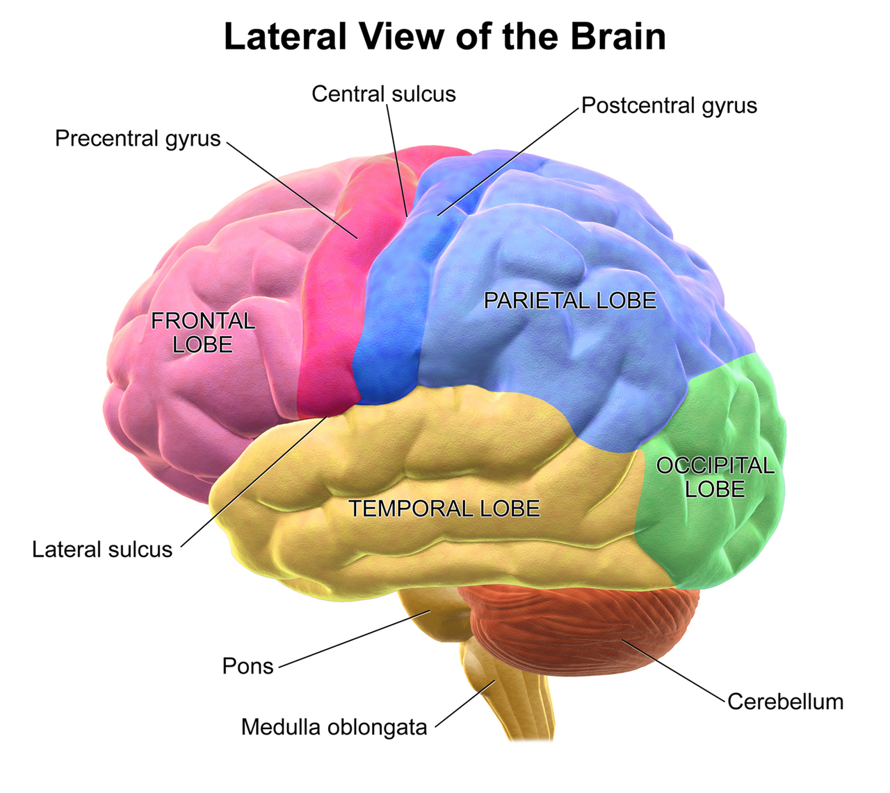

# The Brain and Nervous System

*Status: Draft. A doctor has not reviewed it yet.*

> [!NOTE]
> **Quick summary**
> - The nervous system is the body's fast communication network: billions of nerve cells (neurons) pass electrical signals and chemical messages.
> - The brain stores almost no energy. It needs a constant flow of oxygen and glucose, which is why low sugar causes confusion and a blocked artery causes a stroke within minutes.
> - Each side of the brain mostly controls the **opposite** side of the body.
> - Many medicines for mood, sleep, seizures and pain work at the junctions between neurons (synapses).

---

## 1. Structure



*Figure 1: The brain, seen from the side. Image: Blausen.com staff, CC BY 3.0 (see [IMAGE-CREDITS](../IMAGE-CREDITS.md)).*

The adult brain weighs about 1.3 to 1.4 kg and holds on the order of 86 billion neurons. `⚠ verify` It is about 2% of body weight but uses roughly a fifth of the body's oxygen and energy at rest. `⚠ verify`

### The two divisions

| Division | Parts | Job |
|---|---|---|
| Central nervous system (CNS) | Brain and spinal cord | Processing and decisions |
| Peripheral nervous system (PNS) | All nerves outside the brain and spinal cord | Carry signals to and from the body |

### The neuron: the basic cell

```
 dendrites --> CELL BODY --> AXON (wrapped in myelin) --> synapse
 (receive)     (decides)     (carries signal away)        (passes it on)

 Figure 2: A neuron.
```

- **Dendrites** receive signals.
- The **cell body** adds them up and decides whether to fire.
- The **axon** is a long cable carrying the signal. It is wrapped in **myelin**, a fatty insulating sheath that makes signals travel much faster. In diseases that damage myelin (such as multiple sclerosis) signals slow or fail.
- The **synapse** is the tiny gap between one neuron and the next.

### The main regions

| Region | Where | Main jobs |
|---|---|---|
| Cerebrum (two hemispheres) | The large upper part | Thinking, memory, language, voluntary movement, senses |
| Frontal lobe | Front | Planning, judgement, personality, voluntary movement |
| Parietal lobe | Top and middle | Touch and body position |
| Temporal lobe | Side | Hearing, memory, language understanding |
| Occipital lobe | Back | Vision |
| Cerebellum | Back and below | Coordination, balance, smooth movement |
| Brainstem (midbrain, pons, medulla) | Joins brain to spinal cord | Breathing, heart rate, blood pressure, consciousness, swallowing; damage here is life-threatening |
| Thalamus | Deep | Relay station for senses |
| Hypothalamus | Deep, just above the pituitary | Controls temperature, hunger, thirst, sleep and the pituitary hormones (see [The endocrine system](endocrine-system.md)) |
| Hippocampus | Deep in the temporal lobe | Forming new memories |
| Basal ganglia | Deep | Smooth control of movement (affected in Parkinson's disease) |

Crossed control: the left hemisphere mainly controls the **right** side of the body and vice versa. So a stroke on the left side of the brain typically weakens the right arm and leg. Language is usually handled by the left hemisphere.

### Protection

| Layer | What it does |
|---|---|
| Skull and vertebrae | Bony armour |
| Meninges | Three membranes (dura, arachnoid, pia) around the brain and cord. Meningitis is infection of them. |
| Cerebrospinal fluid (CSF) | A clear fluid made in cavities inside the brain (ventricles); cushions the brain and clears waste. Roughly 150 mL in total. `⚠ verify` |
| Blood-brain barrier | Tightly joined cells lining brain capillaries that block most germs, toxins and many medicines from entering. |

## 2. How it works, step by step

### How one neuron passes a message

1. A neuron receives enough input and fires an **action potential**, a wave of electrical charge that races down the axon.
2. At the end of the axon, the signal makes **calcium** enter, which releases chemical messengers (**neurotransmitters**) into the synapse.
3. The neurotransmitter crosses the gap and binds **receptors** on the next neuron, which then becomes more (or less) likely to fire.
4. The neurotransmitter is cleared away or recycled.

| Neurotransmitter | Main role |
|---|---|
| Glutamate | Main excitatory (speed-up) messenger |
| GABA | Main inhibitory (slow-down) messenger |
| Dopamine | Movement, motivation, reward; low in Parkinson's disease |
| Serotonin | Mood, sleep, appetite |
| Noradrenaline | Alertness, stress response |
| Acetylcholine | Muscle contraction, memory |

Many medicines work at this step: antidepressants raise serotonin or noradrenaline; anti-epileptic medicines damp excess firing; sedatives boost GABA. That is why stopping some of them suddenly can be dangerous, and why a doctor adjusts them gradually.

### The brain's blood supply

Four arteries (two **carotid** at the front of the neck and two **vertebral** at the back) feed a ring of vessels at the base of the brain, the **circle of Willis**, which spreads blood to all regions and gives some back-up if one artery narrows.

The brain stores almost no oxygen or glucose. If blood flow stops, unconsciousness comes within seconds and permanent damage within minutes. Likewise, low blood sugar starves the brain, causing confusion, sweating, fits or fainting. (See the diabetes chapter for the 15-gram rule.)

### Sensing and moving: the reflex arc

A **reflex** is an automatic response that does not wait for the brain. Touch a hot pan: a **sensory nerve** sends the signal to the spinal cord, which sends a signal straight back through a **motor nerve** to the muscle, and you pull away. The brain learns about it afterwards. Doctors test reflexes (tapping the knee) to check nerves and spinal cord.

### The autonomic nervous system

This runs organs without conscious control.

| Side | Effect |
|---|---|
| Sympathetic ("fight or flight") | Faster heart, widened airways, more sugar released, digestion slowed |
| Parasympathetic ("rest and digest") | Slower heart, digestion active (the vagus nerve is its main route) |

## 3. The senses

### The eye

Light passes through the **cornea** (clear front window) and the **lens** (which focuses), and lands on the **retina**, a layer of light-sensing cells at the back. **Rods** work in dim light; **cones** give colour and sharp detail. The retina turns light into signals sent along the **optic nerve** to the occipital lobe.

Diabetes damages the tiny retinal blood vessels (**diabetic retinopathy**), found early only by an eye exam. Other common eye problems: **cataract** (the lens turns cloudy), **glaucoma** (high eye pressure damages the optic nerve).

### The ear

Sound waves vibrate the **eardrum**, three tiny bones carry the vibration, and the **cochlea** (a snail-shaped organ in the inner ear) turns it into nerve signals. Next to the cochlea, the **semicircular canals** sense head movement and give balance. Trouble here causes **vertigo** (a spinning sensation).

## 4. How the nervous system is tested

| Test | What it shows |
|---|---|
| Neurological examination | Strength, reflexes, sensation, coordination, speech, vision, memory |
| CT scan | Quick scan; excellent for bleeding and stroke in emergencies |
| MRI | More detailed picture of brain tissue, with no radiation |
| EEG (electroencephalogram) | Records brain electrical activity; used in epilepsy |
| Nerve conduction studies and EMG | Speed of nerve signals; muscle electrical activity |
| Lumbar puncture | A sample of CSF, to check for infection or inflammation |
| Blood tests | Sugar, sodium, B12, thyroid, which often cause neurological symptoms |

## 5. When the system fails (summary)

| Problem | What goes wrong |
|---|---|
| Stroke | Blood supply to part of the brain is cut off by a clot (the commoner kind, ischaemic) or a burst vessel (haemorrhagic) |
| Epilepsy | Recurrent bursts of abnormal electrical activity (seizures) |
| Migraine | Recurrent severe headaches, often with nausea and light sensitivity |
| Parkinson's disease | Loss of dopamine-making cells: tremor, stiffness, slow movement |
| Dementia (for example Alzheimer's) | Progressive loss of memory and thinking |
| Neuropathy | Damage to peripheral nerves (diabetes, B12 deficiency, alcohol): numbness, burning, weakness |
| Meningitis | Infection or inflammation of the membranes around the brain |

### Stroke: recognise it fast

Use **FAST**: **F**ace drooping, **A**rm weakness, **S**peech difficulty, **T**ime to call emergency help. Treatments that dissolve or remove a clot work only in the **first hours**, so every minute counts. `⚠ verify the time window per current guidance`

## Headache and epilepsy: what to know

### Headache

The brain itself has no pain nerves. Headache pain comes from the covering of the brain, blood vessels, muscles and nerves around it. Most headaches are **primary**, meaning the headache is the disease itself. The commonest is **tension-type headache**: a dull, pressing band on both sides, mild to moderate. A few headaches are **secondary**, meaning another problem causes them (infection, high blood pressure, head injury, bleeding, or a tumour, an abnormal lump of cells).

**Red flags: get urgent care (112 or 108) for:**
- a sudden, severe "thunderclap" headache (pain that peaks within a minute), "the worst of my life"
- headache with fever and stiff neck, rash or confusion
- headache after a head injury
- headache with weakness, numbness, or speech or vision trouble (see [Stroke](../02-diseases/stroke.md))
- a new headache after age 50, or one that keeps worsening over weeks
- headache in pregnancy or just after delivery

**Migraine** in plain words: repeated attacks of throbbing pain, often on one side, with nausea (feeling sick) and dislike of light and noise, lasting hours to about 3 days. Some people get an **aura** first (flashing lights or zig-zag lines for a few minutes). Migraine runs in families and is more common in women. Triggers differ by person: missed meals, poor sleep, stress, periods, bright light. A diary of triggers helps. Most typical migraine does not need a brain scan (a CT or MRI picture of the brain). Many "sinus headaches" are really migraine.

Medication-overuse headache: taking painkillers on most days can itself keep headaches going. Guidelines usually mean pain medicine on 10 or more days a month (simple painkillers: 15 or more). `⚠ verify` Treatment is to cut down the overused painkiller **under a doctor's guidance**. Headache often gets worse for days before it improves. See [Painkillers, steroids and acidity medicines](../04-medicines/painkillers-steroids-acidity-supplements.md).

### Epilepsy and seizures

A **seizure** is a short burst of abnormal electrical activity in the brain. It can change movement, feeling, awareness or behaviour. **Epilepsy** is a tendency to repeated seizures with no immediate cause. One seizure does not mean epilepsy. About 5 to 6 in 1,000 people in India are estimated to live with it, and many are never treated. `⚠ verify`

- A **tonic-clonic seizure** stiffens and jerks the whole body, then leaves deep sleep or confusion. A **focal seizure** starts in one area (a twitching hand, a strange feeling). **Absence** seizures are a blank stare for seconds, common in children.
- In India, **neurocysticercosis** (brain infection by the young stage of the pork tapeworm) is a recognised cause of epilepsy, as the WHO epilepsy fact sheet lists.
- **Anti-seizure medicines** could let up to 7 in 10 people become seizure-free, says WHO. Missing doses is the commonest cause of breakthrough seizures (seizures that return despite treatment).
- **Never stop epilepsy medicine suddenly.** It can cause severe, repeated seizures. Any slow withdrawal must be planned by the doctor.
- **Do not switch brands casually** and ask a doctor before pregnancy: some medicines (notably valproate) carry a higher risk of birth defects.

Myths that cause harm:
- An iron key, shoe or onion in the hand does **not** stop a seizure. Never put a spoon, cloth or finger in the mouth: it can break teeth or block the airway.
- Epilepsy is not a curse, possession or an infection you can catch.
- A healer cannot replace medicine. Delay means more injuries.
- Epilepsy medicines are not addictive and do not "ruin the brain".

Driving: rules differ by country and state. In India the licence application asks you to declare conditions such as epilepsy. Driving with uncontrolled seizures is unsafe. Ask your neurologist (a brain and nerve doctor) for written advice on when driving is safe. Many doctors advise a seizure-free period first, often a year or more. `⚠ verify`

**Seizure first aid** is in [First aid and emergencies](../10-practical/first-aid-and-emergencies.md). Call 112 or 108 if a seizure lasts over 5 minutes.

## 6. Red flags

Go to emergency care for: sudden weakness, numbness, face droop, speech or vision loss, a sudden severe "worst ever" headache, seizure for the first time, confusion with fever and neck stiffness, or loss of consciousness.

## 7. Why this matters for your reports

- A **normal CT or MRI** does not rule out every cause of symptoms; many problems (migraine, epilepsy between seizures) look normal on scans.
- B12, sugar, thyroid and sodium are cheap blood tests that explain a surprising number of nerve and brain symptoms. They are worth checking before concluding something worse.
- Scans often show **incidental findings** (small harmless changes common with age). Ask whether a finding explains your symptoms before accepting treatment for it.

## Key terms

**Neuron** a nerve cell · **Axon / dendrite** the output cable / input branches · **Myelin** the insulating sheath · **Synapse** the gap between neurons · **Neurotransmitter** a chemical message across a synapse · **Action potential** the electrical wave in a neuron · **CNS / PNS** brain and spinal cord / nerves outside · **Cerebrum / cerebellum / brainstem** the thinking brain / the coordination brain / the life-support stem · **Meninges** the protective membranes · **CSF** cerebrospinal fluid · **Blood-brain barrier** the filter that protects the brain · **Reflex arc** an automatic nerve loop · **Autonomic nervous system** the automatic organ-control system · **Retina** the light-sensing layer of the eye · **Cochlea** the hearing organ.

## Sources and not verified

1. OpenStax. *Anatomy and Physiology 2e* (openstax.org): the nervous system and special senses.
2. Guyton and Hall, *Textbook of Medical Physiology* (edition to be named). `⚠ verify`
3. Stroke guidance (for time windows): to be cited from Indian and international stroke guidelines in the disease chapter. `⚠ verify`
4. International Headache Society, ICHD-3; NICE guidelines on headaches (CG150) and epilepsies (NG217). `⚠ verify`
5. International League Against Epilepsy (ILAE) and WHO fact sheet on epilepsy; ICMR and Indian Academy of Neurology publications on epilepsy burden and neurocysticercosis. `⚠ verify`

Not verified: brain weight, neuron count, the one-fifth oxygen figure, CSF volume and stroke treatment time windows are standard figures or claims to confirm against the cited sources. In the headache and epilepsy section, also confirm the Indian epilepsy prevalence, the medication-overuse day counts, valproate risk wording and current Indian driving rules. Confirmed against the WHO epilepsy fact sheet: seizure-free share (worded as up to 7 in 10; earlier text said two-thirds) and neurocysticercosis as a cause. WHO gives 4 to 10 per 1,000 worldwide; the India figure of 5 to 6 per 1,000 is still unconfirmed. The ICHD-3 text could not be opened, so the medication-overuse day counts (seen only in reviews) stay unconfirmed.
