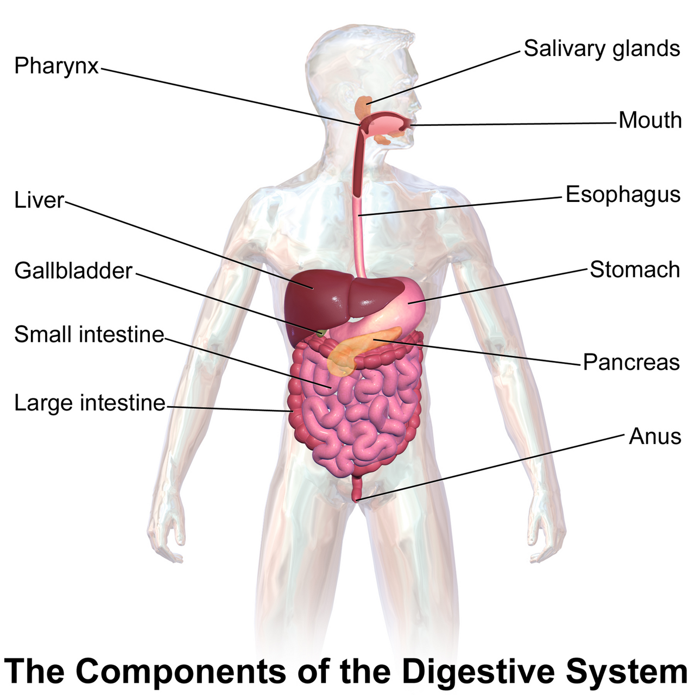

# The Digestive System

*Status: Draft. A doctor has not reviewed it yet. Last checked: November 2026.*

For the liver and gallbladder, see [Liver and gallbladder](liver-and-gallbladder.md). For the pancreas's hormones, see [The endocrine system](endocrine-system.md).

> [!NOTE]
> **Quick summary**
> - Digestion turns food into pieces small enough to cross the gut wall: starch into glucose, protein into amino acids, fat into fatty acids.
> - Most of that happens in the **small intestine**, helped by bile (from the liver) and enzymes (from the pancreas).
> - The **large intestine** reclaims water and houses trillions of helpful bacteria.
> - Many common problems (acidity, ulcers, B12 and iron deficiency, lactose intolerance) trace back to one step in this chain.

---

## 1. Structure: one long tube with helpers

*Figure 1: The digestive system. Image: Blausen.com staff, CC BY 3.0 (see [IMAGE-CREDITS](../IMAGE-CREDITS.md)).*

Food passes through one continuous tube several metres long. `⚠ verify` Its walls have layers of muscle and a lining that absorbs or secretes.

| Part | Main job |
|---|---|
| **Mouth** | Chewing; saliva starts starch digestion |
| **Oesophagus** (gullet) | Squeezes food down by waves of muscle contraction (**peristalsis**) |
| **Stomach** | Stores food, churns it with acid, starts protein digestion |
| **Small intestine** | Finishes digestion; absorbs nearly all nutrients |
| **Large intestine (colon)** | Absorbs water; holds the gut bacteria; forms stool |
| **Rectum and anus** | Store and release stool |

**Helpers outside the tube:** the **liver** (makes bile), **gallbladder** (stores bile), and **pancreas** (makes digestive enzymes).

## 2. How it works, step by step

### Step 1: Mouth and oesophagus

Chewing breaks food into pieces. **Saliva** contains an enzyme, **amylase**, that starts breaking starch into sugars (which is why bread tastes sweeter the longer you chew). Swallowing sends food into the oesophagus, where **peristalsis** carries it to the stomach even if you are upside down. A ring of muscle, the **lower oesophageal sphincter**, closes after food passes. When it is weak or relaxes at the wrong time, acid flows back up: **acid reflux (GERD)**.

### Step 2: The stomach

The stomach holds a litre or more and mixes food with **gastric juice**.

| Cell in the stomach lining | What it releases | Role |
|---|---|---|
| **Parietal cells** | **Hydrochloric acid** and **intrinsic factor** | Acid kills germs and activates pepsin. **Intrinsic factor is needed to absorb vitamin B12 later.** |
| **Chief cells** | **Pepsinogen**, which acid turns into **pepsin** | Begins breaking down protein |
| **Mucus cells** | A thick mucus layer | Protects the stomach wall from its own acid |
| **G cells** | The hormone **gastrin** | Tells parietal cells to make more acid |

Food leaves the stomach as a thick liquid (**chyme**) in small squirts.

**Why this matters:**
- **Ulcers** form when the protective mucus is overcome, most often by the bacterium ***Helicobacter pylori*** or by painkillers (NSAIDs). `⚠ verify`
- **Acid-lowering medicines** called **PPIs** (proton pump inhibitors, such as pantoprazole and omeprazole) switch off the acid-making pump. They are effective, but taken for years they can lower B12 and magnesium levels (shown in drug warnings) and may reduce iron absorption (shown in observational studies). Ask your doctor whether you still need yours. `⚠ verify`
- **Low B12** can come from lack of intrinsic factor (an autoimmune stomach condition), a vegetarian diet, long-term PPIs or metformin (see [Diabetes](../02-diseases/diabetes.md)).

### Step 3: The small intestine

About 3 metres long in a living person (about 6 metres after death, when the muscle relaxes) `⚠ verify` and divided into three parts: **duodenum**, **jejunum** and **ileum**.

**Why it absorbs so well:** its inner surface is folded into millions of finger-like **villi**, each covered with even tinier **microvilli**. Together they give a surface area many times that of a flat tube. Each villus has a blood capillary and a lymph vessel in the middle.

#### What arrives in the duodenum

| Arrives from | What it brings |
|---|---|
| **Stomach** | Acidic chyme |
| **Pancreas** (through the pancreatic duct) | **Bicarbonate** to neutralise acid, plus digestive enzymes |
| **Liver and gallbladder** (through the bile duct) | **Bile** |

The bile duct and pancreatic duct join near the duodenum. A gallstone stuck at that junction can block both, causing jaundice or inflammation of the pancreas (**pancreatitis**).

#### Digesting each food type

| Food | Enzymes | Final pieces | How absorbed |
|---|---|---|---|
| **Carbohydrate** | Amylase (pancreas); brush-border enzymes such as **lactase** and **sucrase** on the villi | **Glucose**, fructose, galactose | Into the villus blood capillary, then the portal vein to the liver |
| **Protein** | Pepsin (stomach); **trypsin** and others (pancreas, made as inactive forms that wake up only in the gut) | **Amino acids** and small chains | Into blood |
| **Fat** | **Bile** breaks big fat drops into tiny ones (emulsifies); **lipase** (pancreas) cuts them | **Fatty acids and glycerol** | Repackaged inside the cell into **chylomicrons** that enter the **lymph** first, then reach the blood |

#### Absorbing vitamins and minerals

| Nutrient | Where | Notes |
|---|---|---|
| **Iron** | Duodenum | Absorbed better with vitamin C and from meat; blocked by tea, calcium, and phytates in grains and pulses. Coeliac disease and PPIs reduce it. |
| **Calcium** | Duodenum and jejunum | Needs vitamin D |
| **Vitamin B12** | End of the ileum | Needs intrinsic factor. Crohn's disease of the ileum or surgery there causes deficiency. |
| **Fat-soluble vitamins (A, D, E, K)** | Small intestine | Need bile and fat |
| **Bile acids** | Ileum | About 95% reabsorbed and returned to the liver, a loop called the **enterohepatic circulation** |

**Lactose intolerance** occurs when the lactase enzyme is low, so milk sugar passes undigested to the colon, where bacteria ferment it, causing gas, bloating and loose stools. Lactase usually falls after childhood in most adults worldwide, and a large share of Indian adults are affected, though many can still take some milk or curd without symptoms. It is a normal variation, not damage. `⚠ verify`

### Step 4: The large intestine (colon)

About 1.5 metres long. `⚠ verify` It absorbs water and salts and compacts the leftover into stool. Passage through the whole gut usually takes one to three days. `⚠ verify`

#### The gut bacteria (microbiota)

The colon holds trillions of bacteria. They:
- ferment fibre into **short-chain fatty acids**, which feed the colon lining
- make some vitamins (for example vitamin K)
- train the immune system and crowd out harmful germs

**Antibiotics** can disturb this community and cause diarrhoea. Rebuilding it is not a matter of buying costly "probiotics"; evidence supports specific products only for specific uses. `⚠ verify`

### Step 5: Stool

Stool is mostly water, fibre, bacteria and shed gut cells. Its brown colour comes from bilirubin changed by bacteria (see [Liver and gallbladder](liver-and-gallbladder.md)). **Pale stool** suggests bile is not reaching the gut. **Black, tarry stool** suggests bleeding high in the gut.

## 3. How digestion is controlled

| Signal | Source | Effect |
|---|---|---|
| **Gastrin** | Stomach | More acid |
| **Secretin** | Duodenum (when acid arrives) | Pancreas releases **bicarbonate** |
| **CCK** (cholecystokinin) | Duodenum (when fat arrives) | Gallbladder squeezes out bile; pancreas releases enzymes |
| **Incretins** (GLP-1, GIP) | Gut (when food arrives) | Boost insulin release (see [The endocrine system](endocrine-system.md)) |
| **Enteric nervous system** | Nerve network inside the gut wall, sometimes called the "second brain" | Runs peristalsis and secretion largely on its own, talking to the brain |

Stress can change gut movement and secretion through this brain-gut link, which is why anxiety can cause loose stools or cramps.

## 4. How the gut is tested

| Test | What it tells you |
|---|---|
| **Stool routine and culture** | Infection, parasites, blood |
| **Stool occult blood** | Hidden blood, used to screen for bowel problems |
| ***H. pylori* tests** (stool antigen, breath test) | Whether the ulcer-causing bacterium is present |
| **Endoscopy** (camera down the gullet and stomach) | Looks at oesophagus, stomach and duodenum; allows a biopsy |
| **Colonoscopy** (camera up the colon) | Looks at the colon; removes polyps; screens for cancer |
| **Ultrasound** | Gallstones, liver, pancreas |
| **Coeliac blood test** (tTG-IgA) | Screens for coeliac disease (immune reaction to gluten) |
| **Faecal calprotectin** | A stool marker of gut inflammation, helping separate inflammatory bowel disease from irritable bowel |

## 5. When the system fails (summary)

| Problem | What goes wrong |
|---|---|
| **GERD** | Acid refluxes into the oesophagus |
| **Gastritis, peptic ulcer** | Stomach or duodenal lining damaged by acid, *H. pylori* or NSAIDs |
| **Irritable bowel syndrome (IBS)** | A functional problem (gut works abnormally but looks normal): cramps, bloating, constipation or diarrhoea |
| **Inflammatory bowel disease (IBD)** | **Crohn's disease** or **ulcerative colitis**: lasting immune inflammation of the gut |
| **Coeliac disease** | Gluten triggers an immune attack on the small-intestine lining, causing poor absorption (iron, B12, calcium) |
| **Gallstones, pancreatitis** | Bile or pancreatic blockage or inflammation |
| **Infective diarrhoea** | Contaminated food or water. The main danger is **dehydration**: oral rehydration solution (**ORS**) is life-saving. |

## 6. Red flags

See a doctor promptly for: **black or bloody stools**, **vomiting blood**, **difficulty or pain swallowing**, **unintended weight loss**, **persistent change in bowel habit**, **severe or persistent belly pain**, signs of dehydration (very little urine, dizziness, dry mouth), or yellow eyes with pale stools.

## 7. Why this matters for your reports

- Digestion links to **nutrient deficiency tests**: low iron, B12, vitamin D or calcium can start in the gut.
- **Liver tests** with raised ALP and GGT may point to a bile-flow problem in the ducts rather than the liver cells.
- A long-term "acidity tablet" is worth reviewing with your doctor.
- Digestion is also where **medicines** are absorbed: food, antacids, iron and calcium can change how much of some drugs reaches the blood.

## Key terms

**Peristalsis** squeezing waves that move food · **Sphincter** a ring of muscle that opens and closes a passage · **GERD** acid reflux disease · **Gastric juice** stomach acid and enzymes · **Intrinsic factor** a stomach protein needed to absorb B12 · **Pepsin / trypsin / amylase / lipase** protein, protein, starch and fat enzymes · **Chyme** the churned food liquid · **Villi / microvilli** finger-like projections that absorb · **Chylomicron** a fat package carried in lymph · **Enterohepatic circulation** the loop of bile acids between gut and liver · **Microbiota** the gut's bacteria · **PPI** proton pump inhibitor, an acid-lowering medicine · ***H. pylori*** a stomach bacterium that causes ulcers · **ORS** oral rehydration solution.

## Sources and not verified

1. OpenStax. *Anatomy and Physiology 2e* (openstax.org): the digestive system.
2. Guyton and Hall, *Textbook of Medical Physiology* (edition to be named). `⚠ verify`
3. ACG and Indian Society of Gastroenterology guidance on *H. pylori*, GERD and PPI use (to be added in the disease chapters). `⚠ verify`

**Not verified:** tube lengths, transit time, the *H. pylori* and NSAID statement, PPI nutrient effects, lactose intolerance prevalence in India, and the probiotic statement are standard figures or claims to confirm against the cited sources.
