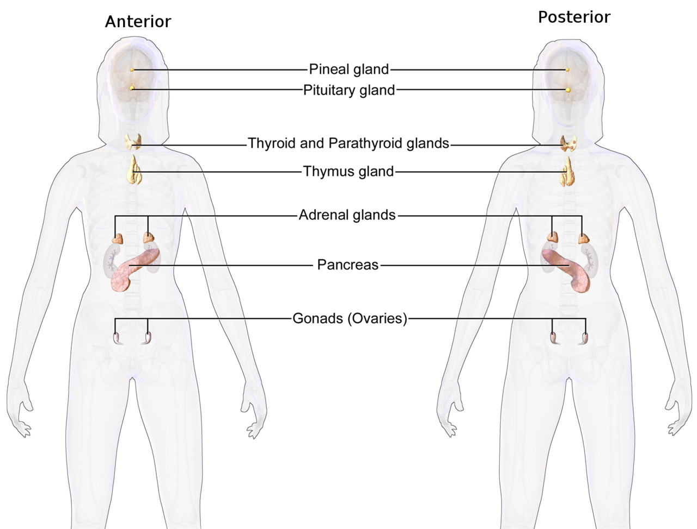

# The Endocrine System: Thyroid, Pancreas, Adrenals and Pituitary

*Status: Draft. A doctor has not reviewed it yet. Last checked: November 2026.*

This chapter explains how the glands normally work. For the diseases, see [Thyroid](../02-diseases/thyroid.md) and [Diabetes](../02-diseases/diabetes.md).

> [!NOTE]
> **Quick summary**
> - Hormones are chemical messengers. Glands release them into the blood, and only cells with the matching receptor respond.
> - The brain controls most glands in chains called **axes**: hypothalamus, then pituitary, then the target gland, with feedback back to the top.
> - Knowing the chain tells you what a report number means. A high TSH, for example, is the brain's signal and not the thyroid's output.

---

## 1. The big idea: hormones, receptors, feedback

A **hormone** is made by a gland, released into the blood, and carried everywhere, but it acts only on cells that have the right **receptor** (a lock that fits that hormone's key).

| Type | Examples | How it acts |
|---|---|---|
| **Peptide hormones** (chains of amino acids) | Insulin, glucagon, TSH, growth hormone | Dissolve in blood; bind receptors on the **cell surface** and trigger a fast signal inside |
| **Steroid hormones** (made from cholesterol) | Cortisol, aldosterone, oestrogen, testosterone | Pass into the cell and **switch genes on or off**; slower but longer-lasting |
| **Thyroid hormones** | T4, T3 | Travel bound to proteins; enter cells and act on genes like steroid hormones |

Control is by **negative feedback**: when the final hormone is high, it tells the top of the chain to ease off.



*Figure 1: The hormone glands. Image: Blausen.com staff, CC BY 3.0 (see [IMAGE-CREDITS](../IMAGE-CREDITS.md)).*

## 2. The control centre: hypothalamus and pituitary

The **hypothalamus** is a small region of the brain that senses the body's state (temperature, hunger, hormone levels). It sends signals to the **pituitary gland**, a pea-sized gland just below it, often called the master gland.

| Pituitary hormone | Target | Effect |
|---|---|---|
| **TSH** | Thyroid | Make thyroid hormone |
| **ACTH** | Adrenal cortex | Make cortisol |
| **LH and FSH** | Ovaries, testes | Egg and sperm development; sex hormones |
| **Growth hormone** | Liver, bone, muscle | Growth and repair |
| **Prolactin** | Breast | Milk production |
| **ADH** (stored here, made in the hypothalamus) | Kidney | Keep water (see [Kidneys](kidneys.md)) |

Three main **axes**:

```
 Thyroid axis : hypothalamus --TRH--> pituitary --TSH--> thyroid --T4,T3-->
 Adrenal axis : hypothalamus --CRH--> pituitary --ACTH--> adrenal --cortisol-->
 Gonad axis   : hypothalamus --GnRH--> pituitary --LH,FSH--> ovaries/testes
                                         ^
          the final hormone feeds back to the top and turns it down

 Figure 2: Three control axes.
```

## 3. The thyroid in detail

### Structure

A butterfly-shaped gland at the front of the neck, with two lobes joined by a bridge. It is made of millions of round sacs called **follicles**, each filled with a jelly-like store (**colloid**) of a protein called **thyroglobulin**.

### How it makes its hormones, step by step

1. The thyroid **traps iodide** from the blood (iodine from food and iodised salt), using a special pump (the sodium-iodide symporter).
2. An enzyme, **thyroid peroxidase (TPO)**, attaches the iodine onto building blocks (tyrosine) that sit on thyroglobulin. This makes **T3** (three iodine atoms) and **T4** (four iodine atoms), still attached to the thyroglobulin in the colloid store.
3. When the pituitary sends **TSH**, follicle cells take up some colloid and cut the hormones free.
4. **T4 and T3 are released into the blood.** The thyroid's main output is T4, with only a small share as T3. `⚠ verify`
5. In the body's tissues, enzymes remove one iodine from T4 to make the **more active T3**. Most circulating T3 is made this way. `⚠ verify`

Why this matters for reports:
- **Anti-TPO antibodies** are the immune system attacking that enzyme, which is how Hashimoto's thyroiditis is detected.
- **Iodine** deficiency or excess both disturb this process.
- **Over 99% of thyroid hormone in blood is attached to carrier proteins** and is inactive. Only the small **free** fraction acts, which is why **free T4** is measured instead of total T4. `⚠ verify`

### What thyroid hormone does

Free T3 enters cells, binds a receptor in the nucleus and turns genes up. The effect is to raise the body's **metabolic rate**: faster heartbeat, more heat, faster gut movement, alertness, and normal growth and brain development in children.

### Neighbours: parathyroid glands

Four tiny glands sit behind the thyroid. They make **parathyroid hormone (PTH)**, which raises blood calcium by acting on bone, kidney and gut (with vitamin D). Calcium balance is separate from thyroid function, although surgery on the thyroid can affect these glands.

## 4. The pancreas as an endocrine gland

The pancreas has two parts: the **exocrine** part makes digestive juices (covered in the digestive system chapter), and the **endocrine** part makes hormones. Scattered through the pancreas are clusters of cells called **islets of Langerhans**, about 1 to 2% of the organ. `⚠ verify`

| Islet cell | Hormone | Job |
|---|---|---|
| **Beta cell** | **Insulin** | Lowers blood sugar |
| **Alpha cell** | **Glucagon** | Raises blood sugar |
| **Delta cell** | Somatostatin | Puts a brake on both |

### How a beta cell senses sugar and releases insulin

1. Glucose enters the beta cell.
2. The cell uses it to make **ATP** (its energy currency), so ATP rises.
3. Rising ATP **closes potassium channels**; the cell's electrical charge changes.
4. **Calcium** floods in.
5. Calcium makes stored **insulin granules** fuse with the cell wall and release insulin.

Insulin comes out in two waves: a quick burst from stores, then a slower sustained release.

### The gut helps: incretins

When food reaches the gut, gut cells release **incretin hormones** (GLP-1 and GIP) that boost insulin release **only when glucose is high**. An enzyme, **DPP-4**, breaks incretins down quickly. **DPP-4 inhibitors** (diabetes tablets) block this enzyme; **GLP-1 drugs** copy the hormone. This is why meals taken by mouth raise insulin more than the same sugar given into a vein.

### What insulin does

- **Muscle and fat cells:** insulin moves glucose "doorways" (**GLUT4** transporters) to the cell surface so glucose can enter.
- **Liver:** store glucose as glycogen; stop making new glucose.
- **Fat tissue:** store fat; stop releasing it.

**Glucagon** does the opposite: it tells the liver to release glucose when blood sugar is low (fasting, between meals).

## 5. The adrenal glands

Two small glands, one on top of each kidney.

| Part | Hormones | Jobs |
|---|---|---|
| **Cortex** (outer) | **Cortisol** (stress and sugar hormone) | Raises blood sugar; dampens inflammation; follows a daily rhythm, highest in the morning |
| | **Aldosterone** | Makes the kidney keep salt and water (part of the RAAS) |
| | Small amounts of sex hormones | |
| **Medulla** (inner) | **Adrenaline and noradrenaline** | The "fight or flight" response: faster heart, more sugar, widened airways |

**Steroid tablets** (such as prednisolone) imitate cortisol. After long use the body stops making its own cortisol. **Do not stop long-term steroids suddenly. Ask your doctor how to reduce them.**

## 6. Sex hormones

The gonad axis controls the ovaries and testes. In women LH and FSH drive the monthly cycle of oestrogen and progesterone. In men LH drives testosterone from the testes. These hormones also affect bone, mood, fat distribution and the heart. Their detail is in the reproductive system chapter when written.

## 7. How hormones are tested

| Test | What it shows |
|---|---|
| **TSH** | The pituitary's signal (see [Thyroid](../02-diseases/thyroid.md)) |
| **Free T4, free T3** | Active thyroid hormone |
| **Anti-TPO** | Autoimmune thyroid disease |
| **Fasting glucose, HbA1c** | Sugar control |
| **C-peptide** | How much insulin the pancreas is **making** (it is released along with insulin) |
| **Cortisol** | Adrenal function; morning level matters |
| **Calcium, PTH** | Calcium and parathyroid balance |
| **LH, FSH, oestrogen, testosterone, prolactin** | Gonad and pituitary function |

## 8. Why this matters for your reports

- A hormone level is a **snapshot of a feedback loop**. Always ask which part of the chain the number belongs to: the top (TSH), the gland's output (T4) or the target.
- Because hormones follow daily rhythms (cortisol, TSH), **timing** of the blood draw matters.
- Because most hormone in blood is bound to carrier proteins, conditions that change those proteins (pregnancy, some medicines) can change **total** hormone numbers without changing function. This is why **free** hormone is the better test.

## Key terms

**Hormone** a chemical messenger · **Receptor** the lock a hormone fits · **Peptide / steroid hormone** amino-acid-chain / cholesterol-based hormones · **Hypothalamus** the brain's sensor and controller · **Pituitary** the master gland · **Axis** a control chain · **TSH / ACTH / LH / FSH** pituitary signals to thyroid / adrenal / gonads · **Follicle** a thyroid sac · **Thyroglobulin** the thyroid's hormone-storage protein · **TPO** the enzyme that attaches iodine · **Islets of Langerhans** the pancreas's hormone cell clusters · **Incretin** a gut hormone that boosts insulin after eating · **Cortisol** the adrenal stress hormone · **ATP** the cell's energy currency.

## Sources and not verified

1. OpenStax. *Anatomy and Physiology 2e* (openstax.org): the endocrine system.
2. Jonklaas J, et al. ATA guidelines for hypothyroidism, *Thyroid* 2014 (thyroid physiology background).
3. Guyton and Hall, *Textbook of Medical Physiology* (edition to be named). `⚠ verify`

**Not verified:** the T4:T3 output ratio, the share of T3 made in tissues, protein-bound fraction (over 99%), and the islet share of the pancreas are standard figures to confirm against the cited sources.
