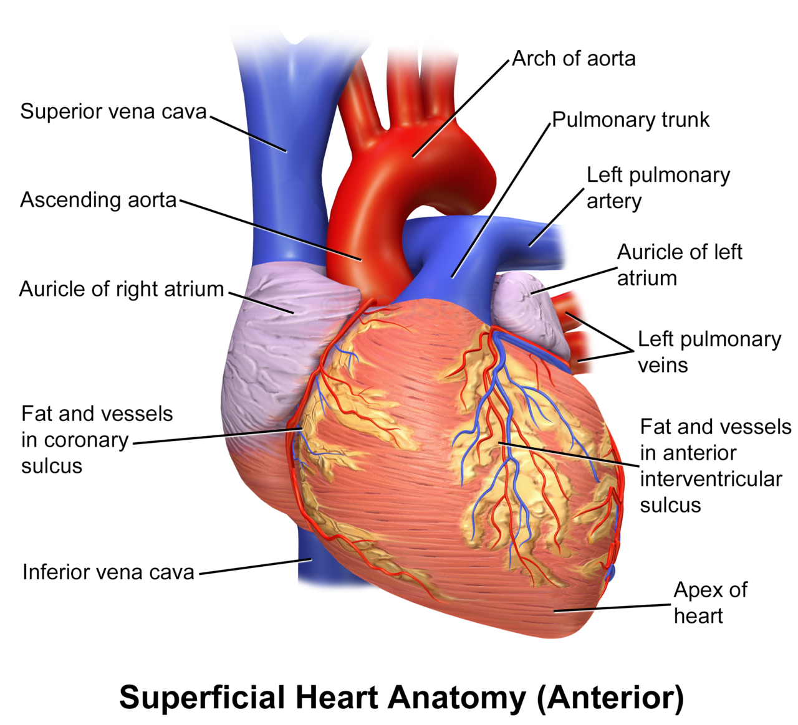

# The Heart and Circulation

*Status: Draft. A doctor has not reviewed it yet. Last checked: November 2026.*

> [!NOTE]
> **Quick summary**
> - The heart is two pumps side by side: the right pump sends blood to the lungs to pick up oxygen, the left pump sends it to the whole body.
> - Four valves keep blood moving one way. A built-in electrical system sets the rhythm.
> - Blood pressure = how much blood the heart pushes out each minute × how much the vessels resist it.
> - The heart muscle has its own blood supply (the coronary arteries). A blocked coronary artery is a heart attack.

---

## 1. Structure: what the heart is made of

The heart is a muscular pump about the size of your fist. It sits in the chest slightly left of centre, behind the breastbone, and weighs roughly 250 to 350 grams in an adult. `⚠ verify`



*Figure 1: The heart seen from the front. Image: Blausen.com staff, CC BY 3.0 (see [IMAGE-CREDITS](../IMAGE-CREDITS.md)).*

### Four chambers

| Chamber | Receives blood from | Sends blood to |
|---|---|---|
| Right atrium | The body (through the two large veins, the vena cavae) | Right ventricle |
| Right ventricle | Right atrium | The lungs (through the pulmonary artery) |
| Left atrium | The lungs (through the pulmonary veins) | Left ventricle |
| Left ventricle | Left atrium | The whole body (through the aorta, the largest artery) |

The **atria** (upper chambers) are collecting rooms. The **ventricles** (lower chambers) are the pumps. The left ventricle has the thickest wall, because it must push blood through the whole body. A wall (the **septum**) keeps right-side blood and left-side blood apart.

### Four valves (one-way doors)

| Valve | Between | Opens to let blood go |
|---|---|---|
| Tricuspid | Right atrium and right ventricle | Right atrium to right ventricle |
| Pulmonary | Right ventricle and pulmonary artery | Right ventricle to lungs |
| Mitral | Left atrium and left ventricle | Left atrium to left ventricle |
| Aortic | Left ventricle and aorta | Left ventricle to body |

If a valve is **narrow** (stenosis) the heart works harder to push blood through. If a valve **leaks** (regurgitation) some blood flows backwards. Both can be heard as a **murmur** (an extra whooshing sound through a stethoscope) and are confirmed by an echocardiogram.

### Layers

The inner lining is the **endocardium**, the muscle is the **myocardium** (this is the part that contracts and the part that dies in a heart attack), and the outer covering is the **epicardium**. The whole heart sits in a thin sac, the **pericardium**.

### The heart's own blood supply

The heart muscle cannot take oxygen from the blood inside its chambers. It has its own arteries, the **coronary arteries**, which start from the aorta just above the aortic valve and wrap around the heart. The left coronary artery splits into two main branches, so doctors speak of three main vessels. The heart muscle is fed mostly while the heart is relaxing between beats.

## 2. How it works, step by step

### Two loops, one pump

```
 BODY --veins--> right atrium --> right ventricle --> LUNGS
                  (low oxygen)                      (pick up oxygen,
                                                     release CO2)
 BODY <--arteries-- left ventricle <-- left atrium <-- LUNGS
                  (rich in oxygen)

 Figure 2: The two loops. Lungs loop = pulmonary circulation.
 Body loop = systemic circulation.
```

1. Oxygen-poor blood returns from the body into the **right atrium**.
2. It passes the tricuspid valve into the **right ventricle**.
3. The right ventricle pumps it through the pulmonary valve to the **lungs**, where it picks up oxygen and gives off carbon dioxide.
4. Oxygen-rich blood returns to the **left atrium**.
5. It passes the mitral valve into the **left ventricle**.
6. The left ventricle pumps it through the aortic valve into the **aorta**, and on to every organ.

### One heartbeat (the cardiac cycle)

| Phase | What happens | Sound |
|---|---|---|
| Diastole (relaxing and filling) | Valves between atria and ventricles are open; ventricles fill | — |
| Systole (contracting) | Ventricles squeeze; the inlet valves snap shut, outlet valves open; blood leaves | The first heart sound ("lub") is the inlet valves closing. The second ("dub") is the outlet valves closing. |

At rest the heart spends about two-thirds of each beat in diastole. A typical resting heart rate for a healthy adult is roughly 60 to 100 beats a minute. `⚠ verify`

### The heart's electrical system

The heart does not need the brain to beat. It has its own pacemaker.

1. The **SA node** (sinoatrial node, a small patch of cells in the right atrium) fires regularly. It is the natural pacemaker.
2. The signal spreads across both atria, which contract.
3. The **AV node** (atrioventricular node) holds the signal for a fraction of a second, so the ventricles fill before they squeeze.
4. The signal then races down special fibres (**bundle of His** and **Purkinje fibres**) to the ventricles, which contract almost together, from the bottom up.

An **ECG** (electrocardiogram) records this electrical activity from the skin:
- P wave: the atria activating.
- QRS complex: the ventricles activating (the tall spike).
- T wave: the ventricles recovering.

An ECG shows rhythm and electrical problems. It can be normal in someone who still has a blockage, so a normal ECG does not rule out heart disease.

### Output of the pump

- Stroke volume: blood pushed out by one beat (roughly 70 mL at rest). `⚠ verify`
- Cardiac output: stroke volume × heart rate. At rest about 5 litres a minute, roughly the whole blood volume every minute. `⚠ verify`
- Ejection fraction (EF): the share of blood in the left ventricle that is pushed out with each beat. A commonly quoted normal is about 55 to 70%. `⚠ verify` A low EF means the pump is weak (heart failure).

## 3. The blood vessels

| Vessel | Structure | Job |
|---|---|---|
| Arteries | Thick, elastic walls | Carry blood away from the heart under high pressure; stretch with each beat |
| Arterioles | Small, muscular | Act as taps: they widen or narrow to control blood pressure and how much blood each organ gets |
| Capillaries | One cell thick, microscopic | Where oxygen, sugar and waste actually cross between blood and tissue |
| Venules and veins | Thin walls, one-way valves | Return blood to the heart at low pressure; leg veins have valves so blood does not fall back |

The **endothelium**, a one-cell-thick lining inside all vessels, is not just a pipe wall. It releases chemicals that relax or tighten vessels and keep blood from clotting. Damage to it (from high sugar, smoking, high blood pressure, high LDL cholesterol) is where **atherosclerosis** starts.

## 4. Blood pressure

**Blood pressure** is the force of blood against the artery walls.

- **Systolic** (top number): pressure while the heart contracts.
- **Diastolic** (bottom number): pressure between beats.
- Shown as, for example, **120/80 mmHg** (millimetres of mercury, the unit).

Blood pressure = cardiac output × resistance of the vessels. Raise either one and pressure rises.

### What controls it

| Controller | How |
|---|---|
| Nervous system (autonomic) | The sympathetic side speeds the heart and narrows vessels. The parasympathetic side (the vagus nerve) slows the heart. Baroreceptors, pressure sensors in the neck and chest, report pressure to the brain, which corrects it within seconds. |
| Kidneys | Change how much salt and water the body keeps, and release renin (see [Kidneys](kidneys.md)) |
| Hormones | Adrenaline raises heart rate; angiotensin II narrows vessels; aldosterone retains salt and water |
| Vessel health | Stiff or narrowed arteries raise resistance |

### What counts as high?

Different guidelines draw different lines, for example 130/80 or 140/90 mmHg. The line also depends on the person's other risks. Use the line your own doctor and your own country's guideline apply. A **single** reading in a clinic can be high from stress ("white-coat" effect), so doctors confirm with repeat or home readings. Indian guidelines (IGH-IV, 2019) keep 140/90 mmHg as the office-reading line for diagnosis and for starting drugs in most people, while the US ACC/AHA guideline uses 130/80. `⚠ verify Indian guideline`

## 5. When the system fails (summary)

| Problem | What goes wrong |
|---|---|
| Atherosclerosis | Fatty plaque builds inside artery walls and narrows them |
| Angina | Chest discomfort when a narrowed coronary artery cannot supply enough oxygen during effort |
| Heart attack (myocardial infarction) | A plaque cracks, a clot forms, a coronary artery blocks and the heart muscle it feeds starts to die |
| Stroke | The same process in brain arteries (or a burst vessel) |
| Heart failure | The pump cannot meet the body's needs; fluid backs up (breathlessness, ankle swelling) |
| Arrhythmia | Abnormal rhythm, such as atrial fibrillation, a fast, irregular rhythm from the atria that raises stroke risk |
| Hypertension | Persistently high pressure, which strains the heart and damages vessels, kidneys, eyes and brain |

Time matters in a heart attack: heart muscle without blood begins to die within minutes to hours, so chest pain with sweating or breathlessness is an **emergency**.

## 6. How the heart is tested

| Test | What it tells you |
|---|---|
| Blood pressure | Pressure in the arteries |
| ECG | Heart rhythm; signs of a past or current heart attack |
| Echocardiogram ("echo") | An ultrasound of the heart: chamber size, valve function, ejection fraction |
| Troponin (blood test) | A protein released when heart muscle is injured; the key blood test for a heart attack |
| Lipid profile | LDL, HDL and triglycerides, which show cholesterol risk |
| Treadmill (stress) test | The ECG during exercise, to uncover narrowing that shows only on effort |
| Angiography | A dye test that shows the coronary arteries directly |

## 7. Why this matters for your reports

- A report that says **"sinus rhythm"** means the SA node is setting a normal rhythm.
- An **ejection fraction** number tells you how strong the pump is.
- Troponin is raised in heart muscle injury but can also rise in other conditions, so it is read with symptoms and the ECG.
- Blood pressure, sugar and cholesterol are three separate measurements that **add together** in heart risk. See [Hormones, metabolism and homeostasis](hormones-metabolism-homeostasis.md).

## Key terms

**Atrium / ventricle** collecting / pumping chamber · **Valve** one-way door · **Septum** wall between left and right · **Myocardium** heart muscle · **Coronary arteries** the heart's own blood supply · **SA node** natural pacemaker · **ECG** tracing of the heart's electrical activity · **Systolic / diastolic** pressure while contracting / relaxing · **Cardiac output** blood pumped per minute · **Ejection fraction** share of blood ejected per beat · **Endothelium** the vessel lining · **Atherosclerosis** plaque narrowing arteries · **Baroreceptor** pressure sensor · **Murmur** an extra sound from turbulent flow · **Troponin** a marker of heart muscle injury.

## Sources and not verified

1. OpenStax. *Anatomy and Physiology 2e* (openstax.org): the cardiovascular system.
2. Guyton and Hall, *Textbook of Medical Physiology* (edition to be named). `⚠ verify`
3. Blood-pressure thresholds: ESC/ESH and ACC/AHA hypertension guidelines; Hypertension Society of India, Indian Guidelines on Hypertension-IV (2019). `⚠ verify`

Not verified: heart weight, resting heart-rate range, stroke volume, cardiac output and normal ejection fraction are standard textbook figures that should be checked against the cited sources.
