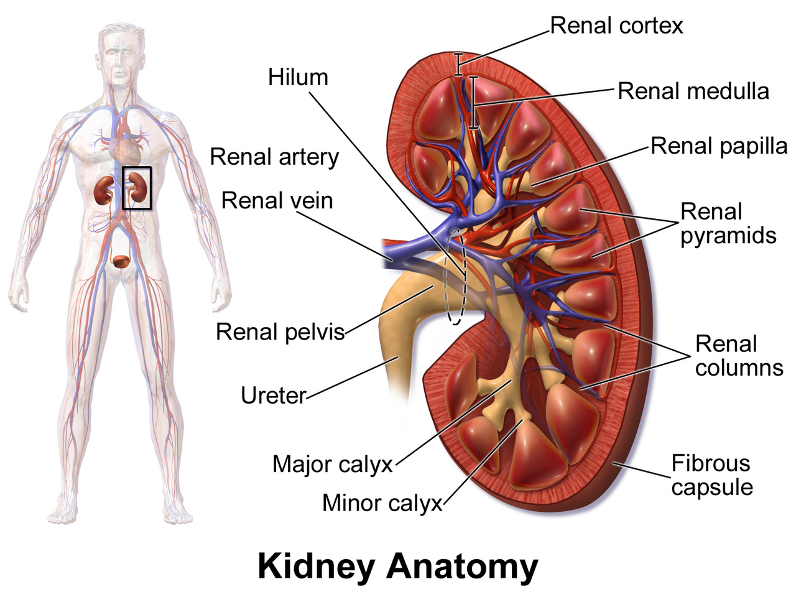

# The Kidneys and Urinary System

*Status: Draft. A doctor has not reviewed it yet. Last checked: November 2026.*

> [!NOTE]
> **Quick summary**
> - The kidneys are filters. Each of the million or so tiny filter units (nephrons) in each kidney first lets almost everything small pass out of the blood, then takes back what the body needs.
> - What is left becomes urine. In that process the kidneys also control water, salts, acidity and blood pressure, and make hormones.
> - Kidney damage is **silent** early: a lot of function can be lost before symptoms or a changed creatinine.
> - Protein in the urine and a falling eGFR are the early warning signs. Diabetes and high blood pressure are leading causes of kidney damage.

---

## 1. Structure

There are **two kidneys**, bean-shaped, each about the size of a fist (roughly 10 to 12 cm long), lying against the back wall of the belly, one on each side of the spine, just under the ribs. The right is slightly lower because the liver sits above it.



*Figure 1: A kidney. Image: Blausen.com staff, CC BY 3.0 (see [IMAGE-CREDITS](../IMAGE-CREDITS.md)).*

Cut a kidney open and you find:

| Part | What it is |
|---|---|
| Cortex | The outer layer; contains the filters (glomeruli) |
| Medulla | The inner layer, arranged in cone-shaped pyramids; contains the long tubes that concentrate urine |
| Calyces and renal pelvis | A funnel that collects urine |
| Ureter | A tube carrying urine from each kidney to the bladder |

Then the **bladder** stores urine, and the **urethra** carries it out.

### The nephron: the working unit

Each kidney holds roughly one million **nephrons**. `⚠ verify` Every nephron is a filter plus a tube:

```
 Blood in --> GLOMERULUS (a tuft of tiny capillaries)
                 | water and small molecules are pushed out
                 v
              BOWMAN'S CAPSULE (a cup around the tuft)
                 v
              PROXIMAL TUBULE   (reclaims most water, salt, sugar)
                 v
              LOOP OF HENLE     (builds a salt gradient to concentrate urine)
                 v
              DISTAL TUBULE     (fine-tunes salt, potassium, acid)
                 v
              COLLECTING DUCT   (final water adjustment) --> urine

 Figure 2: One nephron, in the order the fluid passes through it.
```

Blood supply is huge: the kidneys, though tiny, receive roughly a fifth of the heart's output. `⚠ verify` This is why they are so exposed to anything in the blood and so sensitive to a fall in blood pressure.

## 2. How it works, step by step

Three processes make urine.

### Step 1: Filtration (in the glomerulus)

Blood pressure pushes fluid through the thin walls of the glomerular capillaries. The filter lets through water, salts, glucose, amino acids, urea and creatinine. It holds back blood cells and large proteins such as albumin.

The volume filtered is enormous, around 150 to 180 litres of fluid a day (about 125 mL a minute in men and somewhat less in women). `⚠ verify` This rate is the **GFR (glomerular filtration rate)**, the single best measure of kidney function.

### Step 2: Reabsorption (in the tubules)

Filtering 180 litres and losing it all would be fatal, so the tubules **take back** what the body needs:

| Part of tube | What it does |
|---|---|
| Proximal tubule | Reclaims most of the water and sodium, and almost all the glucose and amino acids |
| Loop of Henle | Pumps salt out to create a salty region in the medulla, so water can later be pulled out of the urine |
| Distal tubule | Fine-tunes sodium and potassium, under the hormone aldosterone; adjusts acid |
| Collecting duct | Final control of water, under the hormone ADH (antidiuretic hormone, from the pituitary): more ADH, more water kept, more concentrated urine |

Glucose spill: the tubules can only reclaim glucose up to a limit. When blood sugar is very high (above roughly 180 mg/dL), glucose spills into urine. `⚠ verify` That is why untreated diabetes causes sugar in urine and a lot of urine. SGLT2 inhibitor diabetes drugs deliberately block glucose reclaim to lower blood sugar.

### Step 3: Secretion

The tubules also **add** substances from the blood into the urine: hydrogen ions (acid), potassium, and many drugs. This is one reason kidney disease changes how medicines behave.

### The result

Of the 180 litres filtered, about 1 to 2 litres leave as urine: water, **urea** (waste from protein breakdown), **creatinine** (waste from muscle), and excess salts.

## 3. What else the kidneys do

| Job | How |
|---|---|
| Water balance | ADH and the tubules adjust how much water to keep |
| Electrolyte balance | Control sodium, potassium, calcium, phosphate and magnesium (see [Hormones, metabolism and homeostasis](hormones-metabolism-homeostasis.md)) |
| Acid-base balance | Remove acid and rebuild bicarbonate, keeping blood acidity in a very narrow range |
| Blood pressure | The renin-angiotensin-aldosterone system (RAAS), below |
| Red blood cell production | The kidney releases erythropoietin (EPO) when oxygen is low; EPO tells the bone marrow to make red cells |
| Vitamin D activation | The kidney converts vitamin D into its active form, which helps absorb calcium |

### The RAAS in four steps

1. Blood pressure or salt in the kidney falls.
2. Special kidney cells release **renin**.
3. Renin starts a chain that makes **angiotensin II** (with help from **ACE**, angiotensin-converting enzyme, mostly in the lungs).
4. Angiotensin II **narrows vessels** and triggers **aldosterone**, so the kidney keeps salt and water. Pressure rises.

Common blood-pressure medicine classes, **ACE inhibitors** and **ARBs** (angiotensin receptor blockers), act on this chain. Your doctor monitors kidney function and potassium when starting them.

### Why advanced kidney disease causes anaemia and weak bones

Damaged kidneys make less EPO, so red cell production falls (**anaemia of kidney disease**). They also cannot activate vitamin D, so calcium absorption and bones suffer. These are not extra diseases; they follow directly from lost jobs.

## 4. How the kidneys are tested

| Test | What it measures | Notes |
|---|---|---|
| Creatinine (blood) | A waste product of muscle | Rises only after a good deal of function is lost. Depends on muscle mass: a thin or elderly person can have "normal" creatinine with reduced function. |
| eGFR (estimated GFR) | A calculated filtering estimate from creatinine, age and sex | The usual way to stage kidney disease. It is an estimate, not a direct measurement. |
| Urea / BUN (blood) | A waste from protein breakdown | Also rises with dehydration, a high-protein diet and some drugs, so it is less specific |
| Urine albumin-creatinine ratio (ACR) or urine protein | Leakage of albumin into urine | An early marker of damage, often before eGFR falls |
| Urine routine | Protein, blood, sugar, cells | A screening look |
| Electrolytes (sodium, potassium) | Salt balance | Potassium matters for heart rhythm |
| Ultrasound | Size and shape; stones, blockage | |

### Staging chronic kidney disease (CKD)

Doctors stage CKD by eGFR (in mL/min/1.73 m²): **G1** 90 or more (with other signs of damage), **G2** 60 to 89, **G3a** 45 to 59, **G3b** 30 to 44, **G4** 15 to 29, **G5** below 15 (kidney failure). Damage persisting for more than 3 months defines "chronic". `⚠ verify against KDIGO`

## 5. When the system fails (summary)

| Problem | What goes wrong |
|---|---|
| Acute kidney injury | A sudden fall in function (severe dehydration, infection, certain drugs, blocked urine flow); often reversible if treated early |
| Chronic kidney disease | A slow, long-term loss of nephrons. Diabetes and high blood pressure are among the commonest causes. `⚠ verify India` |
| Kidney stones | Crystals form in urine, causing severe pain and sometimes blockage |
| Urinary tract infection | Bacteria in the bladder (or kidney); needs the right antibiotic |

Why early disease is silent: when some nephrons die, the rest filter harder to compensate. Total filtration stays near normal for a long time. By the time symptoms appear, much function is gone. That is why people with diabetes or high blood pressure need yearly urine and eGFR checks.

Painkillers matter: NSAIDs (such as ibuprofen and diclofenac) narrow the vessels that supply the glomerulus. In dehydrated people or those with existing kidney disease they can cause kidney injury. Ask before taking them regularly.

## 6. Why this matters for your reports

- A "normal" creatinine does not mean normal kidneys in a low-muscle person. Ask for the **eGFR** and a **urine ACR**.
- **Protein in urine** is the earliest sign of kidney damage in diabetes.
- A raised **potassium** needs attention because it can disturb heart rhythm.
- Dehydration can raise creatinine and urea temporarily. Repeat after fluids before labelling kidney disease.

## Key terms

**Nephron** the kidney's filter-and-tube unit · **Glomerulus** the filtering capillary tuft · **GFR / eGFR** filtration rate / its estimate · **Filtrate** the fluid pushed out of the blood · **Reabsorption** taking useful things back · **Creatinine** a muscle waste product · **Urea** a protein-breakdown waste · **ADH** the hormone that makes the kidney keep water · **Aldosterone** the hormone that makes the kidney keep salt · **Renin / RAAS** the pressure-control chain · **EPO** the red-cell hormone · **ACR** albumin-creatinine ratio · **CKD / AKI** chronic / acute kidney disease or injury · **ACE inhibitor / ARB** blood-pressure drug classes.

## Sources and not verified

1. OpenStax. *Anatomy and Physiology 2e* (openstax.org): the urinary system.
2. KDIGO 2012 (updated 2024) Clinical Practice Guideline for the Evaluation and Management of CKD: staging by eGFR and albuminuria. `⚠ verify`
3. Guyton and Hall, *Textbook of Medical Physiology* (edition to be named). `⚠ verify`

Not verified: nephron count, 20% cardiac output, GFR and daily filtrate volume, the glucose-spill threshold, and the Indian causes of CKD are standard figures to confirm against the cited sources.
