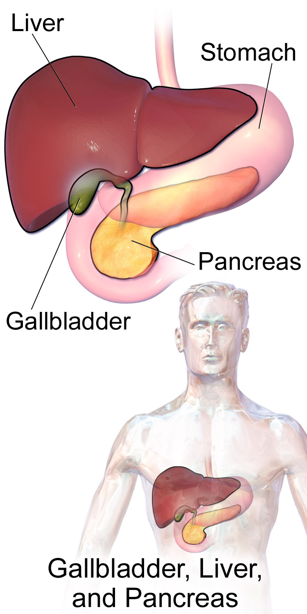

# The Liver and Gallbladder: How They Work

*Status: Draft. A doctor has not reviewed it yet. Last checked: November 2026.*

This chapter explains the normal working of the liver. For disease, tests and treatment, see [Liver and fatty liver](../02-diseases/liver.md).

> [!NOTE]
> **Quick summary**
> - Blood from the gut goes to the liver first, so the liver sees every nutrient, drug and toxin before the rest of the body does.
> - It does five big jobs: manage sugar, make and handle fats and cholesterol, make proteins, clear waste (bilirubin, ammonia, drugs), and make bile.
> - Each liver blood test points to one of those jobs. Knowing the job explains the number.

---

## 1. Structure

The liver is the body's largest internal organ, about 1.4 to 1.5 kg. `⚠ verify` It lies in the upper right belly under the ribs and is divided into a large right lobe, a smaller left lobe and two small lobes. Surgeons divide it into **eight segments**, each with its own blood supply and bile drainage.



*Figure 1: Liver, gallbladder, stomach and pancreas. Image: Blausen.com staff, CC BY 3.0 (see [IMAGE-CREDITS](../IMAGE-CREDITS.md)).*

### A double blood supply (unique in the body)

| Vessel | Brings | Share of liver blood |
|---|---|---|
| Portal vein | Blood from the gut and spleen, rich in nutrients and also in anything swallowed, including drugs and alcohol | About two-thirds to three-quarters `⚠ verify` |
| Hepatic artery | Oxygen-rich blood from the heart | About one-quarter to one-third of the flow, but about half of the oxygen |

Blood leaves through the **hepatic veins** to the heart.

### The lobule: the working unit

The liver is built from a very large number of tiny hexagon-shaped **lobules**. At each corner of a hexagon runs a trio of vessels: a branch of the portal vein, a branch of the hepatic artery and a **bile duct**. In the centre is a **central vein**. Blood flows from the corners to the centre through leaky channels called **sinusoids**, passing between rows of liver cells.

| Cell | What it does |
|---|---|
| Hepatocytes | The main liver cells (about 80%); do almost all the metabolic work |
| Kupffer cells | Immune cells lining the sinusoids; catch bacteria arriving from the gut |
| Stellate cells | Store vitamin A; when the liver is injured over a long time they make scar tissue, which is how fibrosis begins |
| Bile duct cells | Line the ducts that carry bile away |

### Bile pathway

Hepatocytes pass bile into tiny channels (**canaliculi**), which join into ducts, then into the **common bile duct**. The **gallbladder**, a small pouch under the liver, stores and concentrates bile between meals. After a fatty meal it squeezes bile through the duct into the first part of the small intestine (the **duodenum**).

## 2. How it works: the five big jobs

### Job 1: Sugar control

| When | What the liver does |
|---|---|
| After a meal (insulin high) | Takes in glucose and stores it as glycogen |
| Between meals | Breaks glycogen down and releases glucose to keep blood sugar steady (glycogenolysis) |
| Long fasting | Makes new glucose from amino acids and other raw materials (gluconeogenesis) |

Insulin tells the liver to stop releasing sugar. In **insulin resistance** the liver ignores that signal and keeps releasing glucose, which is one reason fasting blood sugar is high in type 2 diabetes. **Metformin** works partly by reducing this release. See [Diabetes](../02-diseases/diabetes.md).

### Job 2: Fats and cholesterol

The liver makes a large part of the body's cholesterol, builds the fat-carrying packages (lipoproteins) that circulate in blood, and turns cholesterol into **bile acids**. When more fat arrives or is made than the liver can package and send out, fat piles up inside the cells: **fatty liver**.

### Job 3: Proteins

The liver makes:
- **Albumin**, which keeps fluid inside blood vessels and carries many substances.
- **Most clotting factors**, the proteins that make blood clot. Several need **vitamin K** to be made.
- Carrier proteins and many others.

It also handles **ammonia**, a poisonous waste from protein breakdown. The liver converts ammonia into **urea** (the urea cycle), which the kidneys remove. When the liver fails, ammonia builds up and affects the brain, causing confusion (**hepatic encephalopathy**).

### Job 4: Bilirubin and waste

Old red blood cells are broken down in the spleen. Their haemoglobin releases **haem**, which becomes **bilirubin**, a yellow pigment.

```
 Old red cells --> BILIRUBIN (unconjugated: not water-soluble,
                  travels attached to albumin)
        v
   LIVER attaches a sugar group ("conjugation"): now water-soluble
        v
   Bile --> intestine --> bacteria change it --> brown colour of stool
        (a little is reabsorbed and leaves in urine, giving it its yellow)

 Figure 2: The path of bilirubin.
```

**Jaundice** (yellow skin and eyes) occurs when bilirubin builds up. Where the problem sits explains the pattern:

| Type | Problem | Typical clues |
|---|---|---|
| Before the liver | Too many red cells breaking down | Mostly unconjugated bilirubin |
| In the liver | Liver cells cannot process bilirubin | Both types raised; enzymes (ALT/AST) often raised |
| After the liver | Bile duct blocked (a stone, a tumour) | Dark urine, pale stools, itching; ALP and GGT high |

### Job 5: Drugs, alcohol and toxins

Almost everything you swallow goes to the liver before the rest of the body (the **first-pass effect**).

- Phase 1: a family of enzymes (**cytochrome P450**) chemically changes the molecule.
- Phase 2: the liver attaches a water-soluble group (**conjugation**) so the kidney or bile can remove it.

Consequences worth knowing:
- Some drugs are **inactivated** on first pass, so they have to be taken in higher amounts or by injection. Others are **activated** (a **prodrug**).
- Two drugs competing for the same enzyme cause **interactions**. Some drugs (and grapefruit juice) block an enzyme so another drug builds up; others speed enzymes up so a drug is cleared too fast. This is why you must tell every doctor every medicine you take.
- **Alcohol** is broken down in steps: alcohol to **acetaldehyde** (toxic) to acetate. The liver can only process so much at a time.
- **Paracetamol** is normally made safe by conjugation. A large overdose overwhelms this route and the leftover goes down a path that makes a toxic by-product, which is what injures the liver.

### Other roles

- Storage: glycogen, iron (as ferritin), vitamins A, D, B12.
- Filter: Kupffer cells clear bacteria from gut blood.
- Hormone clearance: breaks down used hormones.
- Regeneration: a healthy liver can regrow after part is removed. `⚠ verify`

## 3. How the liver is controlled

- **Insulin and glucagon** tell it whether to store or release sugar.
- **Hormones** (thyroid, cortisol, sex hormones) change how fast it works.
- **The gut** sends signals (bile acids, hormones) that adjust bile and fat handling.

## 4. Tests: which job does each number show?

| Test | Which job it points to |
|---|---|
| ALT, AST (enzymes inside liver cells) | Injury: cells leaking |
| ALP, GGT (in bile duct cells) | Bile flow problems |
| Bilirubin (total, direct) | Job 4: waste handling and bile flow |
| Albumin | Job 3: protein making. It lasts about 3 weeks in blood, so it falls only after long-standing problems. `⚠ verify` |
| PT / INR (clotting time) | Job 3: clotting factors. Some have a very short life, so INR shifts quickly, a sign of recent severe problems. `⚠ verify` |
| Ammonia (blood, special tests only) | Job 3: urea cycle |
| Glucose | Job 1, indirectly |

The key distinction: ALT/AST show injury; albumin and INR show how well the liver is working. (Albumin and INR can also change for other reasons, such as poor nutrition, protein loss through the kidney, warfarin or low vitamin K.) A person can have very high enzymes and a liver that still works fine, or normal enzymes and a badly scarred liver that no longer works well.

## 5. Why this matters

- Liver disease is **quiet** because the liver has huge reserve and few pain nerves.
- A "mildly high" enzyme is a **leak signal**, not a verdict. Look at the other numbers.
- Any medicine, herb or supplement passes the liver, which is why "natural" products can injure it.
- Fatty liver is a **metabolic** disease: it links to sugar, weight and cholesterol.

## Key terms

**Hepatocyte** a main liver cell · **Lobule** the hexagonal working unit · **Sinusoid** a leaky blood channel between liver cells · **Portal vein** the vein from gut to liver · **Glycogen** stored glucose · **Gluconeogenesis** making new glucose · **Albumin** the main blood protein made by the liver · **Bilirubin** the yellow waste from old red cells · **Conjugation** attaching a water-soluble group · **Bile** fat-digesting fluid · **First-pass effect** the liver changing a swallowed drug before it reaches the body · **Cytochrome P450** the main drug-processing enzyme family · **Prodrug** a drug that the body activates · **Hepatic encephalopathy** confusion from a failing liver · **Kupffer cell** the liver's immune cell.

## Sources and not verified

1. OpenStax. *Anatomy and Physiology 2e* (openstax.org): the digestive system and liver.
2. Guyton and Hall, *Textbook of Medical Physiology* (edition to be named). `⚠ verify`
3. LiverTox (US NIH): drug metabolism and liver injury. `⚠ verify`

Not verified: liver weight, the share of blood from the portal vein, albumin and clotting-factor half-lives, and the regeneration statement are standard figures to confirm against the cited sources.
