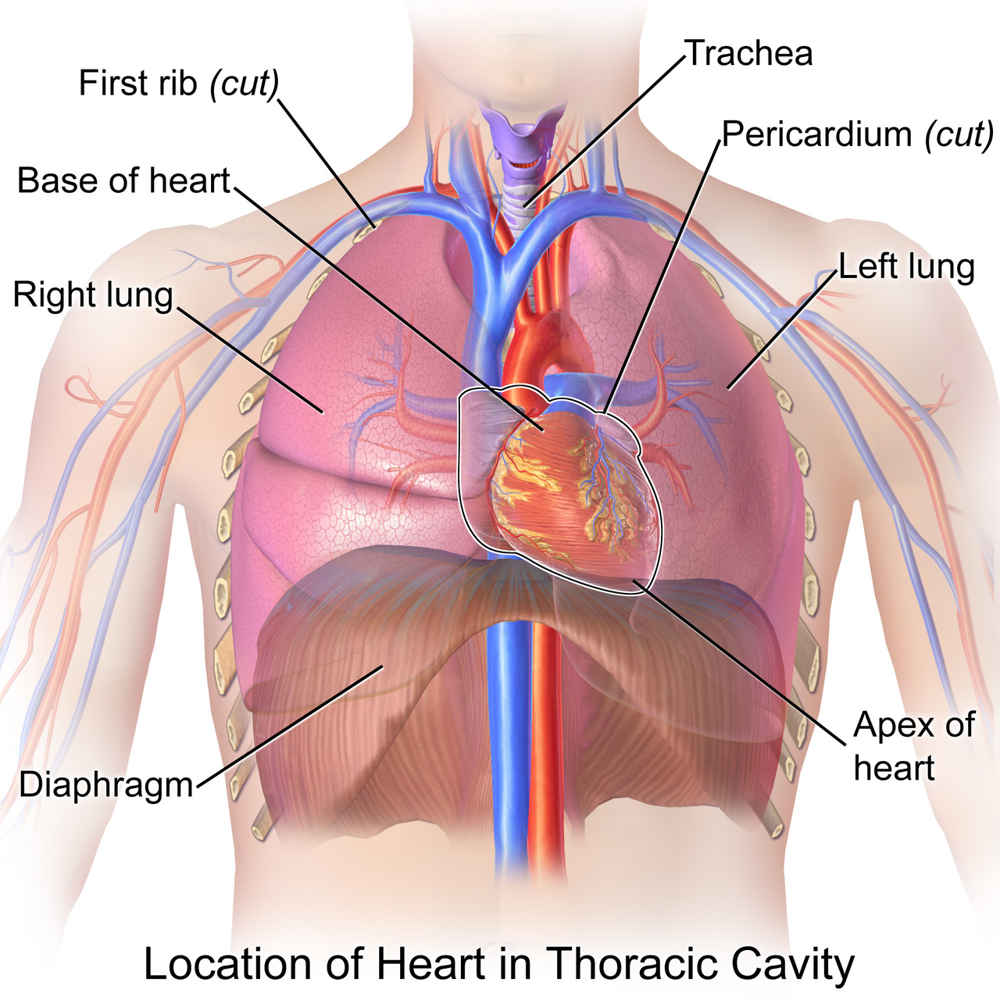

# The Lungs and Breathing

*Status: Draft. A doctor has not reviewed it yet. Last checked: November 2026.*

> [!NOTE]
> **Quick summary**
> - The lungs bring oxygen into the blood and take carbon dioxide out. The exchange happens across walls one cell thick in hundreds of millions of tiny air sacs (alveoli).
> - Breathing in is active (the diaphragm contracts). Breathing out is mostly passive (the lungs spring back).
> - The brain controls breathing mainly by sensing **carbon dioxide and acidity**, not low oxygen.
> - Lung tests ask two questions: how well does air move (spirometry) and how well does oxygen cross (oxygen saturation, blood gases).

---

## 1. Structure: the airway tree

*Figure 1: The heart and lungs in the chest. Image: Blausen.com staff, CC BY 3.0 (see [IMAGE-CREDITS](../IMAGE-CREDITS.md)).*

Air travels down a branching tube system, like an upside-down tree.

| Part | What it does |
|---|---|
| Nose | Warms, moistens and filters air with hairs and mucus |
| Pharynx (throat) and larynx (voice box) | Shared passage; the larynx holds the vocal cords, and a flap (epiglottis) covers it when you swallow so food does not enter the airway |
| Trachea (windpipe) | A tube kept open by C-shaped rings of cartilage |
| Bronchi | The trachea splits into a right and a left bronchus. The right is wider and straighter, so inhaled objects more often go right. |
| Bronchioles | Smaller branches with no cartilage but a layer of smooth muscle that can tighten. This tightening is what happens in asthma. |
| Alveoli | Clusters of tiny air sacs at the ends. Roughly 300 to 500 million in total, giving a gas-exchange surface of tens of square metres. `⚠ verify` |

The right lung has three lobes and the **left has two** (making room for the heart).

Each lung sits in a thin double-layered bag, the **pleura**, with a film of fluid between the layers so they glide. Air in this space (**pneumothorax**, collapsed lung) or too much fluid (**pleural effusion**) squeezes the lung.

### Why the alveolus is built the way it is

An alveolus is a thin-walled sac wrapped in capillaries. The wall between air and blood is only **one cell thick** on each side, so oxygen and carbon dioxide cross by simple diffusion. The inner surface is coated with **surfactant**, a soapy fluid that stops the sacs from collapsing. Babies born very early may lack it, causing breathing difficulty.

## 2. How it works, step by step

### Breathing in and out

Air moves because of **pressure differences**. The chest is a sealed box; when its volume grows, the pressure inside falls below the outside air, and air flows in.

1. **Breathing in (inspiration, active).** The **diaphragm** (a dome of muscle under the lungs) contracts and flattens, and muscles between the ribs lift the rib cage. The chest gets bigger, pressure falls, and air flows in.
2. Breathing out (expiration, usually passive). The muscles relax, the elastic lungs recoil and the chest shrinks. Pressure rises and air flows out. In exercise or when the airways are narrowed, abdominal and rib muscles help.

At rest an adult breathes roughly 12 to 20 times a minute. `⚠ verify`

### Gas exchange

Gases move from where their pressure is higher to where it is lower.

| Gas | Direction in the lung | Why |
|---|---|---|
| Oxygen | Alveolar air to blood | Oxygen pressure is higher in the air sac than in the incoming blood |
| Carbon dioxide | Blood to alveolar air | It is higher in the incoming blood than in the air sac |

Carrying oxygen: about 98% travels attached to **haemoglobin** in red cells (see [Blood](blood.md)). Only a little dissolves in plasma. The **pulse oximeter** (the clip on your finger) estimates what percentage of haemoglobin is carrying oxygen (**SpO2**). A healthy person usually reads about 95% or more. `⚠ verify`

Carrying carbon dioxide: most is carried in plasma as **bicarbonate** (a form of dissolved carbon dioxide); the rest on haemoglobin or dissolved.

### Matching air and blood

A lung works well only when air and blood reach the same alveoli. A blocked airway (no air) or blocked blood vessel (no blood, as in a **pulmonary embolism**, a clot in the lung) wastes the exchange. Doctors call this **ventilation-perfusion mismatch**. Pneumonia, asthma, COPD and clots all cause low oxygen through such mismatches.

### Defence

Every breath brings dust, germs and smoke. Defences:
- **Mucus** traps particles, and tiny hairs (**cilia**) lining the airway wave it upward like an escalator (the **mucociliary escalator**).
- **Cough and sneeze** blast out irritants.
- **Macrophages** (immune cells) in the alveoli eat germs.

Smoking paralyses cilia and damages alveoli, which is why smokers cough and get infections more easily. Indoor smoke from cooking fires and outdoor air pollution do similar harm.

## 3. How breathing is controlled

- The **breathing centre** is in the **brainstem** (the lowest part of the brain). It sets the rhythm automatically, sleeping or awake.
- **Chemoreceptors** (chemical sensors) measure the blood. The strongest breathing signal is a rise in carbon dioxide (which makes the blood more acidic). Low oxygen is a weaker, backup signal sensed by receptors in the neck and aorta.
- You can hold your breath briefly, but when carbon dioxide rises enough, the urge to breathe overrides you.

**Breathing also controls acidity.** Breathing faster blows off carbon dioxide and makes blood less acidic. Breathing slower does the opposite. The kidneys also help (see [Kidneys](kidneys.md)).

## 4. Measuring lung function

### Lung volumes

| Term | Meaning |
|---|---|
| Tidal volume | The air in one normal breath (roughly 500 mL) |
| Vital capacity (FVC) | The most air you can blow out after a deep breath in |
| FEV1 | The amount you can blow out in the first second |

### Spirometry

**Spirometry** is a breathing test in which you take a deep breath and blow out hard into a tube. It gives **FVC** and **FEV1**, and the **FEV1/FVC ratio**.

| Pattern | What it means | FEV1/FVC | Typical conditions |
|---|---|---|---|
| Normal | Airways open, lungs expand | Normal | |
| Obstructive | Air is hard to get out: airways narrowed | Low (a ratio under about 0.70 after a reliever medicine is used as the cut-off for COPD) `⚠ verify` | Asthma, COPD |
| Restrictive | Lungs cannot expand fully | Normal or high, with a low FVC | Lung scarring, chest wall problems |

In **asthma** the narrowing improves with a reliever (bronchodilator) inhaler or comes and goes. In **COPD** it is persistent.

### Other lung tests

| Test | What it tells you |
|---|---|
| SpO2 | Oxygen saturation, non-invasively |
| Arterial blood gas (ABG) | A blood sample from an artery that measures oxygen, carbon dioxide and acidity directly |
| Chest X-ray | Pneumonia, fluid, collapsed lung, masses, TB scars |
| CT scan | Detailed picture of the lung tissue |
| Sputum tests | Germs in coughed-up mucus. For TB, rapid molecular tests (such as Xpert/CBNAAT) are widely used in India. `⚠ verify` |

## 5. When the system fails (summary)

| Problem | What goes wrong |
|---|---|
| Asthma | The airways become inflamed and twitchy and narrow (reversible): wheeze, cough, breathlessness |
| COPD | Long-term airway and alveolar damage, usually from smoke: persistent breathlessness and cough |
| Pneumonia | Infection fills the alveoli with fluid and cells |
| Tuberculosis (TB) | Infection by a slow-growing bacterium, *Mycobacterium tuberculosis*. India has the largest share of the world's TB cases, about a quarter of the global total. `⚠ verify` |
| Pulmonary embolism | A clot blocks a lung blood vessel |
| Lung cancer | Abnormal cell growth in the airways or lung |

Details of each will be in the disease chapters.

## 6. Red flags

Go to a hospital emergency department for: severe breathlessness, speech limited to a few words, blue lips, chest pain with breathlessness, coughing blood, or an oxygen reading that is falling.

## 7. Why this matters for your reports

- **"Obstructive pattern" on spirometry** means air is hard to exhale. The cause (asthma or COPD) is decided by whether it reverses and by history.
- A **normal chest X-ray** does not rule out asthma, because asthma is a problem of airway function, not shape.
- A low **oxygen saturation** is serious; a mildly low reading can be a poor finger signal (cold hands, nail polish), so confirm.

## Key terms

**Trachea** windpipe · **Bronchus / bronchiole** large / small airway · **Alveolus** tiny air sac · **Surfactant** soapy fluid keeping sacs open · **Pleura** the double bag around the lung · **Diaphragm** the main breathing muscle · **Diffusion** movement from high to low concentration · **SpO2** oxygen saturation · **Cilia** tiny sweeping hairs · **FVC / FEV1** the total / first-second breath-out volumes · **Spirometry** the breath-out test · **ABG** arterial blood gas · **Embolism** a clot or object blocking a vessel · **COPD** chronic obstructive pulmonary disease.

## Sources and not verified

1. OpenStax. *Anatomy and Physiology 2e* (openstax.org): the respiratory system.
2. GOLD (Global Initiative for Chronic Obstructive Lung Disease) report: spirometric definition of COPD. `⚠ verify`
3. Guyton and Hall, *Textbook of Medical Physiology* (edition to be named). `⚠ verify`

Not verified: alveoli count and surface area, resting breathing rate, normal SpO2, the 0.70 ratio, India's TB burden and the Xpert statement are standard figures to confirm against the cited sources.
