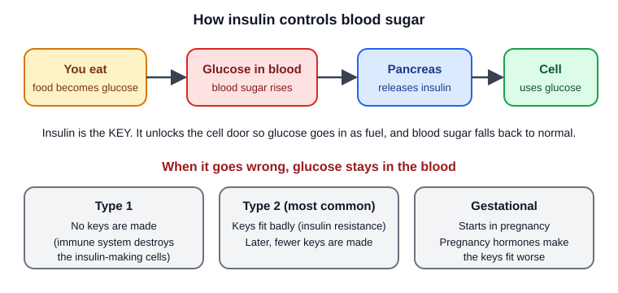
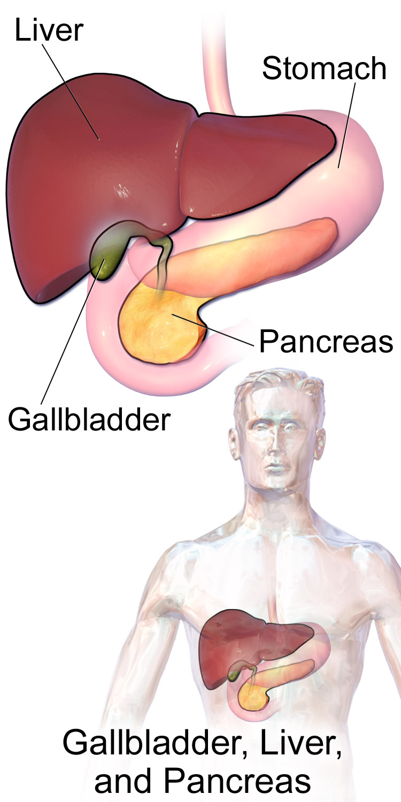
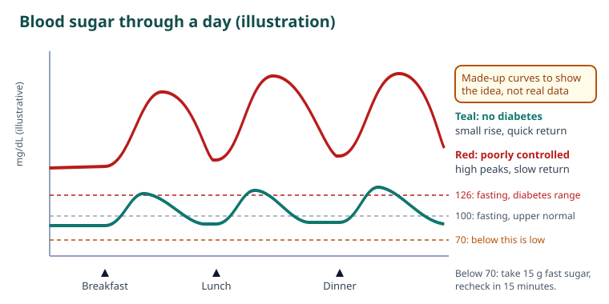

# Diabetes and Blood Sugar

*Status: Draft. A doctor has not reviewed it yet. Last checked: November 2026.*

Read [How to judge medical advice](../00-start-here/01-how-to-judge-medical-advice.md) and [How lab reports work](../03-tests/01-how-lab-reports-work.md) first.

> [!NOTE]
> **Quick summary**
> - Diabetes means too much sugar (glucose) stays in the blood because insulin is missing or not working well.
> - Early type 2 diabetes often has no symptoms, so tests matter. One high reading is not enough: the result must be confirmed.
> - HbA1c can be wrong in anaemia and some inherited blood conditions, which are common in India.
> - Diabetes is controlled, not cured, by medicines. Never stop or change them on your own.

---

## 1. What is it?

Your body runs on **glucose**, a simple sugar made from the food you eat. Glucose travels in the blood and fuels every cell.

Cells cannot just take glucose in. They need a "key": a hormone called **insulin**. (A hormone is a chemical messenger in the blood.) Insulin is made by the **pancreas**, an organ behind the stomach.

**Diabetes** means the system fails and glucose stays too high in the blood.

| Kind | What goes wrong | The "key" picture |
|---|---|---|
| **Type 1** | The immune system destroys the cells that make insulin | No keys are made |
| **Type 2** (most common) | Cells respond poorly to insulin (**insulin resistance**) and later the pancreas makes less | Keys exist but fit badly; later, fewer keys |
| **Gestational** | High sugar that starts in pregnancy | Pregnancy hormones make keys fit worse |

**Prediabetes** is sugar above normal but below the diabetes line. It is a warning stage and can often be reversed.

India has very large numbers: an ICMR-INDIAB study estimated about 101 million people (11.4%) with diabetes and about 136 million (15.3%) with prediabetes in 2021. These are estimates extrapolated from a survey of 113,043 adults. [2] `⚠ verify`

## 2. The normal body

*Figure 1: How blood sugar is kept steady, and where each type of diabetes goes wrong.*

*Figure 2: Where the pancreas sits, behind the stomach. It makes insulin. Image: Blausen.com staff, CC BY 3.0 (see [IMAGE-CREDITS](../IMAGE-CREDITS.md)).*

Blood sugar rises after a meal and falls over the next hours. Muscle activity pulls glucose out of the blood without needing much insulin, which is why exercise helps.

## 3. What goes wrong

Glucose stays high. Over years, high glucose damages **small blood vessels and nerves**, harming the eyes, kidneys, feet and heart (see Complications).

## 4. Causes and risk factors

- **Type 2:** extra belly fat, little activity, family history, age, previous gestational diabetes, polycystic ovary syndrome (PCOS), high blood pressure and cholesterol.
- **Type 1:** an autoimmune process (the immune system attacks the body's own cells). It is not caused by sugar intake.
- Many Indians develop type 2 diabetes at a **lower body weight than people in Western countries**, because more of the fat sits inside the belly (**visceral fat**). [3]
- Diets heavy in refined carbohydrate (white rice, maida, sugar, sweets) raise the risk.

## 5. Symptoms

Early type 2 often causes **none**. When sugar is high: a lot of urine, extreme thirst, tiredness, blurred vision, slow-healing wounds, repeated infections, weight loss without trying.

## 6. Diagnosis and tests

### Marker cards

#### Fasting plasma glucose (FPG)
| | |
|---|---|
| What it measures | Blood sugar after no food (no calories) for at least 8 hours |
| Why the body needs it | Glucose is the body's fuel; the level shows how well insulin is working |
| Can be raised by | Diabetes, prediabetes, eating before the test, illness, steroids |
| Can be lowered by | Too much diabetes medicine, a long delay before the sample is processed (blood cells keep eating the sugar) |
| What else you need | A repeat test, HbA1c, symptoms |
| Example cut-offs | Normal below 100; prediabetes 100 to 125; diabetes 126 or more (in mg/dL, milligrams of glucose per decilitre of blood, from the American Diabetes Association, ADA). [1] `⚠ verify against current table` The WHO draws the prediabetes line at 110. [4] |

#### 2-hour post-meal glucose and OGTT
| | |
|---|---|
| What it measures | Sugar 2 hours after a meal, or 2 hours after a measured sugar drink (OGTT: oral glucose tolerance test, usually 75 g glucose) |
| Example cut-offs (OGTT) | Normal below 140; prediabetes 140 to 199; diabetes 200 or more (mg/dL, ADA). [1] `⚠ verify` |
| Notes | OGTT is the main test for gestational diabetes. Eating a normal meal is not the same as an OGTT. |

#### HbA1c
| | |
|---|---|
| What it measures | Average blood sugar over about the last 2 to 3 months. Glucose sticks to **haemoglobin** (the oxygen-carrying protein in red blood cells). Red cells live about 120 days. |
| Why it is useful | One number that is not affected by what you ate today |
| Can be raised by | Poorly controlled sugar; **iron-deficiency anaemia** `⚠ verify` |
| Can be lowered by | **Blood loss, recent transfusion, red cells breaking down**; some medicines. [1] |
| Can be unreliable with | **Haemoglobin variants** (abnormal inherited haemoglobin, common in India, such as HbE and HbS) and thalassaemia can read falsely high or falsely low depending on the variant and lab method `⚠ verify`, kidney disease, pregnancy |
| Example cut-offs | Normal below 5.7%; prediabetes 5.7 to 6.4%; diabetes 6.5% or more. [1] `⚠ verify` |
| Example meaning | 7% matches an average blood sugar of about 154 mg/dL (formula: 28.7 × HbA1c − 46.7). [5] |

> [!IMPORTANT]
> Diagnosis normally needs an abnormal result **confirmed** by a repeat, or two different abnormal tests, unless you have clear symptoms with a very high random sugar. [1] One high number is not enough.

Anaemia and thalassaemia trait are common in India. If your HbA1c does not match your sugar readings, ask whether glucose tests should be used instead.

### Home sugar meters (glucometers)

- Meters need only be within 15 mg/dL of a lab value below 100 mg/dL, or within 15% at 100 mg/dL and above, for 95 out of 100 readings. A single reading can be further off. [6]
- **Wash and dry your hands first.** Sugar or fruit juice on the finger gives a false high.
- Check strip expiry dates and keep the box closed.
- Write each reading with the time and meal. Patterns matter more than one number.

## 7. Treatment

> [!WARNING]
> No doses here. Never stop or change diabetes medicines on your own. Never adjust insulin without being taught how.

Food, activity and weight loss are the base of treatment. [1] Targets: for many adults the HbA1c goal is **below about 7%**, but it is **your doctor's** decision. A looser target is often safer for older or frail people. [1]

| Group (examples) | What it does | Worth knowing |
|---|---|---|
| **Metformin** | Reduces sugar release from the liver; helps insulin work. Usually first | Can upset the stomach. Long use can lower vitamin B12, so periodic B12 testing is advised. [1] The doctor checks kidney function. |
| **Sulfonylureas** (glimepiride, gliclazide) | Push the pancreas to release more insulin | Can cause **low sugar** and weight gain |
| **DPP-4 inhibitors** (teneligliptin, sitagliptin, vildagliptin) | Gently raise the body's own insulin response after meals | Low risk of low sugar; often costlier |
| **SGLT2 inhibitors** (dapagliflozin, empagliflozin) | Kidneys pass sugar out in urine | May protect heart and kidneys; can cause genital infections and dehydration; rare ketoacidosis |
| **Pioglitazone** | Makes cells respond better to insulin | Can cause fluid retention |
| **Insulin** | Replaces or adds the "key". Needed in type 1 and in many with type 2 over time | Needs a doctor's teaching. Insulin does not cause complications. High sugar does. |

Metformin and glimepiride are cheap generics in India. Whether each is on the National List of Essential Medicines 2022 should be checked in the NLEM document. `⚠ verify` Newer is not always better: ask what a newer drug adds for **you** and what it costs a month.

## 8. Complications

- **Eyes:** retina damage, found early only by an eye exam.
- **Kidneys:** protein leaking into urine first, later falling filtering ability.
- **Nerves:** numb or burning feet, leading to unnoticed wounds.
- **Heart and vessels:** heart attack and stroke.
- **Feet:** a small cut can become a serious infection.
- **Emergencies:** low sugar (hypoglycaemia) and diabetic ketoacidosis (DKA: the body, short of insulin, burns fat and makes acids; mainly type 1).

**Yearly checks for everyone with diabetes:** eye exam, urine albumin-creatinine ratio (protein in urine), kidney blood test (eGFR, an estimate of kidney filtering), foot exam, blood pressure, cholesterol. [1]

## 9. Prevention and self-management

- **Weight loss and activity** reduce the risk of getting type 2 diabetes from prediabetes and improve control. [1]
- Prefer whole grains, pulses and vegetables over refined carbohydrate and sugary drinks.
- Check sugar as your doctor advises and bring the log to visits.
- Keep a **fast sugar source** at hand if you take insulin or sulfonylureas.
- **Remission:** a supervised, intensive weight-loss programme (DiRECT trial) put 46% of participants into type 2 diabetes remission at 12 months compared with 4% on usual care. [7] Remission may not last: at 5 years about 13% of the diet-programme group were still in remission, against 5% of usual care. This needs medical supervision. `⚠ verify long-term figure`

## 10. Misinformation and how you get misled (India)

| What happens | What to do instead |
|---|---|
| "Sugar cured in 30 days" products | Diabetes is **controlled**, not cured, by tablets or herbs. Supervised weight loss can cause remission, but not through supplements. |
| Stopping tablets because a herbal product or good reading "cured" you | Ask your doctor first. The number is good *because* of treatment. |
| "Diabetic" biscuits, sweets and flours | Often not better for sugar and more costly. Read the label. |
| Herbal "sugar" products | Case reports and a Hong Kong series found some herbal diabetes products secretly contained real tablets such as glibenclamide, causing dangerous lows. One Indian study of 40 brands found none. So it has happened, but is not shown to be common in India. [8] Tell your doctor about every product you take. |
| "Insulin is the last stage and causes blindness or kidney damage" | A myth. High sugar causes the damage. Delaying insulin you need allows more damage. |
| Judging control by urine sugar | Urine sugar is a poor guide. Blood tests are used. |
| HbA1c every month | It reflects about 3 months. Ask how often you really need it. |
| A pill with three or four drugs ("fixed-dose combination") | Ask whether each is needed and what happens when one must be changed. |

## 11. Ask your doctor

1. Which test confirmed this, and was it repeated?
2. Could anaemia or an inherited haemoglobin variant be affecting my HbA1c?
3. What is **my** HbA1c target, and why?
4. For each medicine: what does it do, what are the risks (especially low sugar), what does it cost a month?
5. How and when should I check at home, and what numbers should make me call you?
6. When are my yearly eye, kidney and foot checks?
7. Should my vitamin B12 be checked (if on metformin)?
8. What food and activity plan fits my life?

## 12. Red flags

**Low sugar** (shaking, sweating, hunger, confusion). If you can swallow and your meter reads **below 70 mg/dL**, the usual first step is **15 grams of fast sugar** (for example glucose tablets or about half a glass of juice), then **recheck after 15 minutes** and repeat if still low. [1] **If the person cannot swallow or is very drowsy or unconscious: call emergency help. Do not put food in their mouth.**

**Go to a hospital** for: vomiting with belly pain and deep fast breathing, extreme thirst with drowsiness, very high readings with illness, a foot wound with redness or fever, sudden vision loss, chest pain.

## Key terms

**Glucose** blood sugar, the body's fuel · **Insulin** the hormone that lets glucose into cells · **Pancreas** organ that makes insulin · **Insulin resistance** cells respond poorly to insulin · **Prediabetes** above normal, below diabetes · **Gestational** starting in pregnancy · **HbA1c** 2–3 month average sugar marker · **Haemoglobin** oxygen-carrying protein in red cells · **OGTT** timed sugar-drink test · **Visceral fat** fat inside the belly · **Hypoglycaemia** low blood sugar · **DKA** diabetic ketoacidosis · **eGFR** estimate of kidney filtering · **Remission** sugar normal without diabetes medicine · **Fixed-dose combination** several drugs in one tablet.

## Sources and not verified

1. American Diabetes Association. *Standards of Care in Diabetes* (annual; use the latest, e.g. *Diabetes Care* 2025;48 Suppl 1).
2. ICMR-INDIAB: Anjana RM, et al. (author list to be confirmed against the DOI). *Lancet Diabetes Endocrinol* 2023;11(7):474-489.
3. Chawla R, et al. RSSDI-ESI clinical practice recommendations for type 2 diabetes. *Indian J Endocrinol Metab* 2020;24(1):1-122. ICMR 2018 guidelines (not yet checked).
4. WHO. Definition and diagnosis of diabetes mellitus and intermediate hyperglycaemia, 2006.
5. Nathan DM, et al. A1c-derived average glucose (ADAG) study. *Diabetes Care* 2008.
6. ISO 15197:2013, as described in the open literature (PMC4525642).
7. Lean MEJ, et al. DiRECT trial. *Lancet* 2018;391:541-551.
8. Case reports in *Exp Clin Endocrinol Diabetes* 2009; Hong Kong series; Indian brand study in *AYU* 2019;40(4).

**Not verified:** exact ADA prediabetes and OGTT table; the direction of effect of iron deficiency on HbA1c; thalassaemia effect on HbA1c; NLEM 2022 listing; the long-term DiRECT remission figure; the INDIAB author list. Marked `⚠ verify`.
