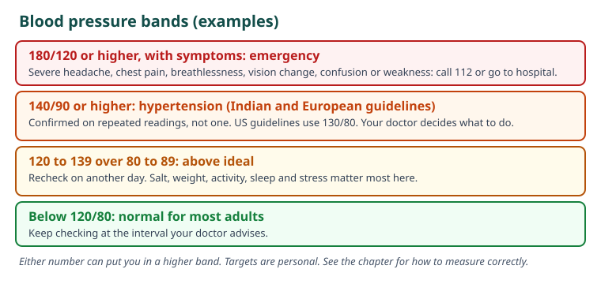

# High Blood Pressure (Hypertension)

*Status: Draft. A doctor has not reviewed it yet. Last checked: November 2026.*

Read [The heart and circulation](../01-body/heart-and-circulation.md) first, especially the section on blood pressure.

> [!NOTE]
> **Quick summary**
> - High blood pressure usually causes **no symptoms** but quietly damages the heart, brain, kidneys and eyes over years.
> - One high clinic reading is not a diagnosis. Diagnosis needs **correctly measured readings on more than one occasion**, often with a home monitor.
> - Salt, weight, activity and alcohol matter. Most people also need medicine, usually for life.
> - Never stop blood pressure tablets because the reading is normal. It is normal *because* of the tablets.

---

## 1. What is it?

**Blood pressure** is the force of blood against artery walls. **Hypertension** means it stays too high. Two numbers are written, for example **140/90 mmHg**:
- **Systolic** (top): pressure when the heart squeezes.
- **Diastolic** (bottom): pressure between beats.

Different guidelines draw the line in different places:

| Guideline | Hypertension if clinic BP is |
|---|---|
| Indian Guidelines on Hypertension (IGH-IV, 2019) and European guidelines | 140/90 or above |
| US (ACC/AHA 2017, kept in the 2025 update) | 130/80 or above |

Indian guidelines also diagnose hypertension if the home average is 135/85 or above, the 24-hour ambulatory average is 130/80 or above, the daytime average is 135/85 or above, or the night-time average is 120/70 or above. The line is a tool, not a cliff. The higher the pressure, the higher the risk, and the right target depends on your age, diabetes, kidney disease and other risks. `⚠ verify the home and 24-hour thresholds`

In the ICMR-INDIAB survey (2023), about one in three Indian adults (35.5%) had hypertension; other surveys such as NFHS-5 give lower figures (about 21 to 24%). Many people do not know they have it. `⚠ verify`

## 2. The normal body

Pressure = how much blood the heart pumps per minute × how much the vessels resist. The brain, kidneys and hormones keep it in a narrow range (see [Heart and circulation](../01-body/heart-and-circulation.md) and [Kidneys](../01-body/kidneys.md)).

## 3. What goes wrong

In most people (about nine in ten) no single cause is found: **primary (essential) hypertension**. Vessels slowly stiffen and the kidneys and nerves reset to a higher pressure. In a smaller group there is a **secondary cause** that can sometimes be treated:

| Secondary cause | Clue |
|---|---|
| **Kidney disease** | Abnormal urine tests, high creatinine |
| **Narrowed kidney artery** | Sudden onset, hard to control |
| **Hormone excess** (for example **primary aldosteronism**, thyroid disease, **phaeochromocytoma**) | Low potassium, sweating and palpitations in attacks |
| **Sleep apnoea** (breathing stops in sleep) | Loud snoring, daytime sleepiness |
| **Medicines** | NSAID painkillers, steroids, some cold remedies (decongestants), some contraceptive pills, some herbal products |
| **Pregnancy** | Pre-eclampsia (see your obstetrician) |

Young people with hypertension and people whose pressure is very high or hard to control are checked for secondary causes.

## 4. Causes and risk factors

- Too much **salt**; low **potassium** from food (fruits, vegetables, pulses)
- **Overweight**, especially belly fat; **inactivity**
- **Alcohol**; **tobacco**; **stress and poor sleep**
- **Age** and **family history**
- **Diabetes** and **kidney disease**
- Indian diets are often high in salt (pickles, papad, namkeen, processed food) and ICMR surveys estimate an average intake of roughly 8 to 11 g a day, above the WHO limit of **less than 5 g of salt a day** (about a teaspoon). `⚠ verify`

## 5. Symptoms

Usually **none**. That is why it is called the "silent" condition. Headache, dizziness or nosebleeds are **not reliable signs**. Very high pressure with severe headache, chest pain, breathlessness, vision change or confusion is an **emergency**.

## 6. Diagnosis and tests

### How to measure it properly

A wrong technique can change the reading by 10 mmHg or more.

- Sit quietly for **5 minutes**, back supported, feet flat, **arm resting at heart level**.
- No caffeine, smoking or exercise for 30 minutes before.
- Use the **right cuff size** (a cuff that is too small reads too high).
- Do not talk. Take **two readings a minute apart** and average.
- At the first visit measure **both arms**.

### Confirming the diagnosis

| Method | Use |
|---|---|
| **Clinic readings on separate visits** | Standard confirmation |
| **Home blood pressure monitor** (a validated upper-arm device) | Confirms and tracks; avoids the "white-coat effect" (high only in the clinic) and finds **masked hypertension** (normal in clinic, high at home) |
| **24-hour ambulatory monitoring** | A wearable cuff taking readings through the day and night; the most complete test |

Home monitoring: use a **validated upper-arm** device, measure at the same times (morning and evening) for about a week before a visit, and write the numbers down. Wrist and finger devices are less reliable. `⚠ verify`

### Tests after diagnosis

| Test | What it looks for |
|---|---|
| **Urine albumin-creatinine ratio, creatinine, eGFR** | Kidney damage (see [Urine tests](../03-tests/urine-tests.md), [Liver and kidney tests](../03-tests/liver-and-kidney-tests.md)) |
| **Sodium and potassium** | Hormone causes, medicine effects |
| **Blood sugar, lipid profile** | Other heart risks (see [Diabetes](diabetes.md), [Lipid profile](../03-tests/lipid-profile.md)) |
| **ECG, sometimes echo** | Heart strain |
| **Eye examination** | Retina damage |

## 7. Treatment

> [!WARNING]
> No doses here. Do not stop or change blood pressure medicines on your own.

### Lifestyle (it works, and it makes tablets work better)

| Step | Notes |
|---|---|
| **Cut salt** | Aim for less than 5 g a day; limit pickles, papad, packaged snacks, instant noodles and restaurant food. Using less iodised salt is fine; do not avoid iodised salt altogether. |
| **More potassium from food** | Fruit, vegetables, pulses. Ask first if you have kidney disease |
| **DASH-style eating** | Fruit, vegetables, pulses, whole grains, low-fat dairy, little processed food |
| **Weight loss** | A loss of a few kilograms lowers pressure |
| **Activity** | Regular brisk activity, roughly 150 minutes a week |
| **Alcohol and tobacco** | Limit alcohol; stop tobacco |
| **Sleep and stress** | Treat sleep apnoea; enough sleep |

### Medicines

Most people need one to three medicines. The common classes (see [Common drug classes](../04-medicines/common-drug-classes.md)): **ACE inhibitors, ARBs, calcium channel blockers, thiazide-like water tablets**, and sometimes beta-blockers or others. Single tablets that combine two or three drugs are common and reasonable.

Points to know:
- Tablets are **not addictive** and do **not** harm the kidneys when used properly. In people with diabetes or kidney disease, some actually protect the kidneys.
- Targets are individual. Targets differ between guidelines: many aim for about 130/80 or a little lower if tolerated, and older or frail people have looser targets. `⚠ verify`
- If a medicine causes side effects (a cough on an ACE inhibitor, ankle swelling on amlodipine), tell your doctor. There are alternatives.
- **Taking tablets regularly** matters more than which brand.
- If pressure stays high on three drugs, a specialist looks for a secondary cause (**resistant hypertension**).

## 8. Complications

Stroke, heart attack, heart failure, kidney disease, eye damage, damage to the main artery (aortic aneurysm), irregular heartbeat (atrial fibrillation), vascular dementia, and pregnancy complications. In adults aged 40 to 89, each rise of 20 mmHg in systolic pressure (10 in diastolic) above about 115/75 roughly doubles the risk of death from stroke and from heart disease. `⚠ verify`

## 9. Prevention and self-management

- Check your pressure regularly (many advise at least once a year in adults, and more often if it has been high).
- Keep a **home log** and bring it to visits.
- Take medicines at the same time each day. Do not run out; refill before they finish.
- Avoid NSAID painkillers where possible, and check cold remedies.
- Know your numbers and your target.

## 10. Misinformation and how you get misled (India)

| What happens | What to do |
|---|---|
| "BP tablets are habit-forming" or "once you start you cannot stop" | They are not addictive. Pressure rises again if stopped. Ask about options if you want fewer pills |
| Stopping tablets because the reading is normal | Normal because of treatment. Ask your doctor first |
| "Natural cures" (garlic, herbal capsules, "BP-balancing" products) instead of treatment | Not proven to replace medicines; some interact or contain hidden drugs |
| Treating a single high reading as hypertension | Confirm with correct, repeated or home readings |
| Treating a single mild reading with "emergency" injections or placing a tablet under the tongue | Not advised for high readings without symptoms; see a doctor |
| "Low BP is dangerous" panic | Low readings with symptoms (fainting) need review; low readings without symptoms are usually fine |
| Pharmacy or mall machines for diagnosis | Often inaccurate. Use a validated home monitor and check it against your doctor's machine |
| Cutting out all salt, including iodised salt | Use less salt; avoid iodine deficiency |

## 11. Ask your doctor

1. What is my average pressure, and what is my target?
2. Have you checked for a secondary cause and for damage to my kidneys, heart and eyes?
3. Which medicines do I take, why, and what side effects should I report?
4. Is my home monitor accurate? How often should I measure?
5. Which painkillers and cold remedies should I avoid?
6. What should I do on a sick day when I cannot eat or drink?
7. When should I come back?

## 12. Red flags

**Emergency:** pressure 180/120 or higher **with** severe headache, chest pain, breathlessness, vision change, confusion, weakness, or trouble speaking; or sudden severe symptoms of any kind. If the reading is very high but you feel well, rest, repeat after a few minutes, and contact your doctor the same day. Do not take extra tablets unless your doctor has told you to.

## Key terms

**Systolic / diastolic** the top / bottom number · **mmHg** millimetres of mercury, the pressure unit · **Primary (essential) hypertension** high pressure with no single cause · **Secondary hypertension** caused by another condition or medicine · **White-coat hypertension** high only in the clinic · **Masked hypertension** normal in clinic, high at home · **Ambulatory monitoring** a 24-hour wearable cuff · **Resistant hypertension** high despite three medicines · **DASH diet** an eating pattern that lowers pressure · **Sleep apnoea** breathing pauses in sleep · **Aortic aneurysm** a bulge in the main artery.

## Sources and not verified

1. Shah SN, et al. Indian Guidelines on Hypertension-IV (2019). *J Hum Hypertens* 2020. `⚠ verify`
2. Williams B, et al. 2018 ESC/ESH guidelines for the management of arterial hypertension; 2023 ESH guidelines. `⚠ verify`
3. Whelton PK, et al. 2017 ACC/AHA hypertension guideline. `⚠ verify`
4. WHO. Guideline for the pharmacological treatment of hypertension in adults (2021); WHO salt-intake recommendation. `⚠ verify`
5. NFHS-5 and ICMR-INDIAB data on hypertension prevalence in India. `⚠ verify`

**Not verified:** the home and ambulatory thresholds, the prevalence and Indian salt-intake figures, the "doubles the risk per 20 mmHg" statement and the secondary-cause list are standard figures and claims to confirm against the cited sources.
