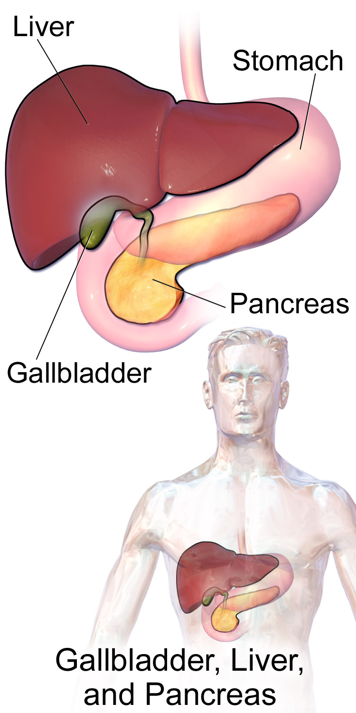
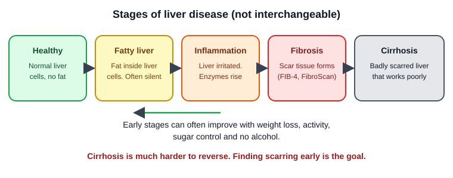

# Liver, Fatty Liver and Hepatitis

*Status: Draft. A doctor has not reviewed it yet.*

Read [How to judge medical advice](../00-start-here/01-how-to-judge-medical-advice.md) and [How lab reports work](../03-tests/01-how-lab-reports-work.md) first. Sugar and weight strongly affect the liver, so also see [Diabetes](diabetes.md). The normal liver is also described in [The liver and gallbladder](../01-body/liver-and-gallbladder.md), and the tests in [Liver and kidney tests](../03-tests/liver-and-kidney-tests.md).

> [!NOTE]
> **Quick summary**
> - The liver cleans the blood, makes bile and proteins, and processes medicines. It has few pain nerves, so problems are usually found by tests, not symptoms.
> - "Fatty liver grade 1" on an ultrasound is very common and often mild. The key question is whether there is scarring (fibrosis).
> - A mildly raised liver enzyme is common. Usually the first steps are to repeat it and review every medicine, herb and supplement.
> - "Liver detox" products and routine "liver protective" tablets are not proven. Treatment of fatty liver is weight, activity and sugar control.
> - Hepatitis (liver inflammation, often from a virus): hepatitis B can be prevented by vaccine and controlled; hepatitis C can be cured. Cirrhosis (permanent scarring) needs regular checks for swollen veins and for liver cancer (Sections 13 to 17).

---

## 1. What is it?

The **liver** is the body's main **factory and filter**. It sits in the upper right of the belly, under the ribs.

| Job | Picture |
|---|---|
| Cleans the blood and breaks down medicines, alcohol and other chemicals | A water filter plant |
| Makes **bile**, a fluid that helps digest fat | A soap for fats |
| Makes proteins, including **albumin** (keeps fluid inside blood vessels) and the proteins that make blood **clot** | A protein factory |
| Stores energy as a sugar store (glycogen) and releases it between meals | A fuel tank |



*Figure 1: The liver sits in the upper right of the belly, with the gallbladder beneath it and the pancreas behind the stomach. Image: Blausen.com staff, CC BY 3.0 (see [IMAGE-CREDITS](../IMAGE-CREDITS.md)).*

Two special facts: the liver can **repair and regrow** itself, and it has **very few pain nerves**, so it often hurts only when the problem is advanced.

## 2. The normal body

Everything you swallow, including medicines and alcohol, travels from the gut to the liver first. The liver changes it before it reaches the rest of the body. So the liver is exposed to every tablet, herb and drink.

Liver cells hold **enzymes**. (An enzyme is a protein that speeds up a chemical reaction.) When liver cells are injured, enzymes leak into the blood. The main liver blood test picks that up.

## 3. What goes wrong

| Stage or condition | Meaning |
|---|---|
| **Fatty liver** | Fat builds up inside liver cells |
| **Inflammation** | The liver is irritated; enzymes rise |
| **Fibrosis** | Scar tissue forms |
| **Cirrhosis** | The liver is badly scarred and stops working well |
| **Hepatitis** | Inflammation of the liver, most often from a virus |
| **Jaundice** | Yellow eyes and skin, usually with dark urine |

These are **not interchangeable**. Fatty liver is not cirrhosis.



*Figure 2: Stages of liver disease.*

## 4. Causes and risk factors

### Fatty liver (commonest in India)

New name since 2023: **MASLD** (metabolic dysfunction-associated steatotic liver disease; "steatotic" means fatty). [2] The older name is **NAFLD** (non-alcoholic fatty liver disease).

Linked to **belly fat, high sugar, high cholesterol and high blood pressure**. About one in three Indian adults is estimated to have it (roughly 28% to 39%, depending on the group studied). [3] Most have no symptoms. In some, fat leads to inflammation, scarring and later cirrhosis. [4]

### Alcohol

Alcohol harms the liver in a dose-related way. Less is better. Tell your doctor honestly, because it changes how every report is read.

### Viral hepatitis (five viruses, A to E)

| Virus | How it spreads | Notes |
|---|---|---|
| **A and E** | Contaminated food and water | Usually a short illness that settles. Hepatitis E can be life-threatening in pregnancy, especially in the 2nd and 3rd trimester (three-month stages of pregnancy). [5] |
| **B** | Blood, sex, mother to baby | Can become long-lasting. A **vaccine** prevents it. |
| **C** | Mostly blood (unsafe needles, unscreened blood) | Can become long-lasting. **Modern tablets cure more than 95% of people. Treatment usually takes 12 to 24 weeks, depending on whether the liver is scarred; some people need only 8 to 12 weeks.** [6] |
| **D** | Only in people who have hepatitis B | |

India's **National Viral Hepatitis Control Programme** offers free screening, testing and treatment for hepatitis B and C at government centres "in a phased manner", so ask which centre near you treats it. [6]

### Medicines, herbs and supplements

**Paracetamol overdose** is a leading cause of sudden liver failure in the US and Europe. In India, viral hepatitis (hepatitis E most often, then A and B) is the commonest cause of sudden liver failure, with anti-TB drugs next, and paracetamol overdose is uncommon. `⚠ verify` Some anti-tuberculosis medicines also injure the liver. "Natural" does not mean safe: herbal products, including Ayurvedic ones, have caused serious liver injury in published reports. [7] Tell your doctor about **everything** you take, including herbal products and gym supplements.

## 5. Symptoms

Early disease usually causes none. Later: tiredness, loss of appetite, nausea, yellow eyes or skin, dark urine, pale stools, itching, a swollen belly or legs, easy bruising.

## 6. Diagnosis and tests

### Marker cards (a liver function test, LFT, is a **panel**, not one number)

#### ALT (SGPT)
| | |
|---|---|
| What it measures | An enzyme mostly in the liver. A rise points to liver cell injury |
| Why the body needs it | It helps cells make energy from amino acids |
| Can be raised by | Fatty liver, alcohol, viral hepatitis, medicines, herbs, supplements, dengue and other viral fevers |
| Can be lowered by | Rarely meaningful; very low levels have no usual cause for concern |
| What else you need | AST, bilirubin, albumin, history of drugs and alcohol, a repeat test |
| Example range | Many labs print an upper limit around 40 to 50 U/L `⚠ verify`. U/L means units per litre. The American College of Gastroenterology (ACG) suggests truly healthy levels are about 29 to 33 U/L for men and 19 to 25 U/L for women, though others say the evidence is weak. [8] |

#### AST (SGOT)
| | |
|---|---|
| What it measures | An enzyme in the liver **and** in muscle and heart |
| Can be raised by | Liver injury; also hard exercise, muscle injury, heart problems |
| What else you need | ALT. AST much higher than ALT can point to alcohol or advanced disease. |

#### ALP and GGT
| | |
|---|---|
| What they measure | Enzymes that rise when bile flow is blocked or bile ducts are irritated |
| Notes | ALP is also high in growing children and in bone disease. GGT is raised by alcohol. |

#### Bilirubin (total and direct)
| | |
|---|---|
| What it measures | A yellow pigment from the breakdown of old red blood cells, processed by the liver |
| Can be raised by | Liver disease, blocked bile ducts, or red cells breaking down. Raised levels cause jaundice. |

#### Albumin and PT/INR
| | |
|---|---|
| What they measure | Albumin: a protein made only by the liver. PT/INR (prothrombin time, international normalised ratio): how fast blood clots |
| Why they matter | They show how well the liver is **working**. Low albumin or slow clotting suggests reduced working ability. |

> [!IMPORTANT]
> **ALT/AST rising = injury** (cells leaking). **Albumin falling or INR rising = reduced working ability**, which is more serious. [1]

### A mildly raised enzyme

Common first steps: repeat the test in a few weeks, review every medicine, herb and supplement, check sugar, cholesterol and weight, and test for hepatitis B and C. [8] `⚠ verify` Things that change the numbers: hard exercise in the last 2 days, alcohol, medicines, a recent viral fever, weight.

### Is there scarring? FIB-4 and FibroScan

When fatty liver is found, the key next question is **fibrosis**.
- **FIB-4 score:** a simple formula using **age, AST, ALT and platelet count** (platelets are small blood cells that help clotting). A low score (below about 1.3) makes advanced scarring unlikely; a high score (above about 2.67) means see a liver specialist. [4]
- **FibroScan** (vibration-controlled transient elastography): a painless scan that measures liver **stiffness**. A stiffer liver means more scarring. [4]

Ask for these **instead of** assuming a mild fatty-liver report needs liver tablets.

## 7. Treatment

> [!WARNING]
> No doses here. Do not stop a needed medicine because you fear "liver damage". Ask your doctor.

- **Fatty liver:** no tablet cures it. What works is **gradual weight loss, regular activity, controlling sugar, cholesterol and blood pressure, and cutting alcohol**. Guidance says about 3 to 5% weight loss improves liver fat, and 10% or more is generally needed to improve inflammation and scarring. [4] `⚠ verify` (the 3 to 5% figure was not confirmed)
- **Hepatitis B:** prevented by vaccine. Treated with long-term tablets when needed.
- **Hepatitis C:** a short tablet course cures more than 95%. [6]
- **Painkillers:** keep to the doctor's or label's limit for **paracetamol**.
- **"Liver protective" tablets** (ursodeoxycholic acid, silymarin or "milk thistle"): widely prescribed in India. There is no strong evidence for routine add-on use with other medicines (UDCA does have proven uses, for example in primary biliary cholangitis, a long-term bile duct disease), and they add cost. `⚠ verify` Ask what each one is **for** and for how long.
- **Statins** (cholesterol tablets) are safe in people with fatty liver across the disease range, per AASLD (American Association for the Study of Liver Diseases) guidance. They are usually continued, with caution in advanced (decompensated, meaning with complications) cirrhosis. Do not stop them without asking. [4]

## 8. Complications

Cirrhosis; fluid in the belly (ascites); bleeding from swollen veins in the gullet; confusion from the liver failing to clear toxins (hepatic encephalopathy); liver cancer; liver failure. Fatty liver also raises heart-disease risk.

## 9. Prevention and self-management

- Keep a healthy weight; walk or exercise regularly; control sugar and cholesterol.
- Limit alcohol; if you have liver disease, ask whether to stop completely.
- Get the **hepatitis B vaccine**; use safe food and water; avoid sharing needles or razors.
- Avoid self-medicating with herbal or gym supplements.
- Keep your LFT reports in date order and note what you were taking at the time.

## 10. Misinformation and how you get misled (India)

| What happens | What to do instead |
|---|---|
| **"Liver detox"** products, juices and kits | The liver detoxifies itself. No product is proven to "cleanse" it. |
| **Herbal or Ayurvedic "liver tonics"** sold as safe for all | Some have injured the liver. Tell your doctor and check before starting. [7] |
| A **"liver protective"** tablet added to every prescription | Ask what it is for and whether it can be dropped. |
| Alarm over "grade 1 fatty liver" with a list of tablets | Ask for FIB-4 or FibroScan and a weight, sugar and activity plan. |
| An LFT every few weeks without a reason | Ask what the result will change. |
| Told to avoid all oil or all medicines | Ask which foods and medicines, and why. |
| Told hepatitis C or B is "untreatable" | Hepatitis C is curable in most. Hepatitis B can be controlled. See a liver specialist. |

## 11. Ask your doctor

1. Which test is abnormal and by how much? Is it injury (ALT/AST) or reduced function (albumin, INR)?
2. Should we repeat it? When?
3. Could my medicines, supplements, herbs, alcohol or recent exercise be the reason?
4. Have I been tested for hepatitis B and C? Should I get the hepatitis B vaccine?
5. If fatty liver: what is my FIB-4 or FibroScan result? Is there scarring?
6. What weight, food and activity targets should I aim for?
7. What does each "liver" tablet do? Do I really need it?
8. Which painkillers are safe for me?

## 12. Red flags

**Go to a hospital today** for: yellow eyes or skin with **confusion or drowsiness**, **vomiting blood** or **black tarry stools**, a **swollen belly** with fever or pain, **very dark urine with severe weakness**, or jaundice in a pregnant woman. Also seek care if you have taken **too much paracetamol**, even if you feel well, because damage can start before symptoms.

## 13. Hepatitis A, B, C and E: course and vaccines

Section 4 shows how each virus spreads. This table adds how long the illness lasts and whether a vaccine exists. **Acute** means short (under 6 months). **Chronic** means long (over 6 months).

| Virus | Usual course | Vaccine |
|---|---|---|
| **A** | Acute, usually clears | Yes. Available privately and advised by the Indian Academy of Pediatrics (IAP); not in the free national schedule |
| **B** | Can become chronic, especially if infected as a baby | Yes. The universal immunisation programme gives a birth dose (within 24 hours of birth) and later doses at 6, 10 and 14 weeks. See [Vaccines and immunisation](../07-prevention/vaccines-and-immunisation.md) |
| **C** | Often chronic and silent | **None**, but curable |
| **E** | Acute, usually clears. Can be severe in **pregnancy** | A recombinant vaccine (made in a lab from a single virus protein; brand Hevaxin) was reported approved in India in 2025 for adults 18 to 65, advised first for high-risk groups; ask your doctor `⚠ verify` |

Hepatitis A and E have no specific antiviral (a medicine that attacks a virus). Care is rest and fluids, and most people recover in weeks. Go to hospital for severe vomiting, drowsiness, bleeding, or if pregnant.

## 14. Hepatitis B and C: how they are found and treated

| Test | What it shows |
|---|---|
| **HBsAg, anti-HBs, anti-HBc** | Hepatitis B infection, immunity (a vaccine response) and past contact |
| **HBV DNA and HBeAg** | How active hepatitis B is (HBV is the hepatitis B virus; HBeAg is a protein it makes) |
| **Anti-HCV, then HCV RNA** | (HCV is the hepatitis C virus; RNA is its genetic material.) The first shows contact with C. The RNA test shows **current** infection |
| **IgM anti-HAV, IgM anti-HEV** | Recent A or E |

**Hepatitis B.**
- Many people with chronic hepatitis B need **no drug at first** but need **regular monitoring**. Doctors decide by HBV DNA, ALT and scarring.
- Medicines (for example tenofovir or entecavir; generics are available in India) **suppress** the virus. They usually do **not cure** it, and treatment can be long-term. **Stopping on your own can cause a dangerous flare.** `⚠ verify`
- **Pregnancy:** testing, extra medicine for high-risk mothers, and a newborn vaccine plus antibody injection protect the baby.
- **Chemotherapy (cancer drugs) or strong immune-suppressing drugs** can reactivate hepatitis B. Tell your doctor if you have ever had it.

**Hepatitis C.** The cure rate and the NVHCP free-treatment offer are in Section 4. **Cure** is checked by a negative HCV RNA test 12 weeks after treatment (called **SVR**, sustained virological response). You can be infected again, and cure does not remove cirrhosis already formed.

**Test once** if you had transfusions before the 1990s, have used injected drugs, or have a family member with B or C. Pregnant women should be tested.

## 15. Cirrhosis: stages and warning signs

**Cirrhosis** is the late stage of any long-lasting liver damage. Scar tissue replaces healthy liver. 
```
Normal liver -> Inflammation -> Fibrosis (scarring)
   -> Cirrhosis (hard, lumpy liver)
   -> Compensated: no symptoms yet, liver still copes
   -> Decompensated: jaundice, fluid, bleeding, confusion
   -> Liver failure or liver cancer
```

Scar tissue blocks blood flowing through the liver, so pressure rises in the **portal vein** (the vein that brings blood from the gut to the liver). This **portal hypertension** (high pressure) forces blood into small back-up veins and drives most complications.

**Warning signs:** itching, easy bruising, a swollen belly (**ascites**, fluid in the belly) and legs, weight and muscle loss, **vomiting blood or black stools**, drowsiness or confusion (**hepatic encephalopathy**), spider-like veins on the skin, and red palms. A falling platelet count is also a clue, because a large spleen (an organ under the left ribs) traps platelets.

| Problem | What happens | Care |
|---|---|---|
| **Varices** | Swollen veins in the food pipe or stomach that can **burst and bleed** | Endoscopy screening (a camera test of the food pipe); beta-blocker medicines (they lower pressure in the veins) or **banding** (rubber bands around the veins); bleeding is an emergency |
| **Ascites** | Fluid in the belly | Low-salt diet, water tablets, draining fluid when needed. Fluid infection (**SBP**) causes fever and belly pain |
| **Malnutrition** | Muscle loss | Regular meals, a late-night snack and enough protein. **Do not cut protein** |

Also: **vaccinate** against hepatitis A and B (if not immune), pneumococcus (a germ that causes pneumonia) and influenza. **Do not take NSAID painkillers** (anti-inflammatory painkillers, such as diclofenac or ibuprofen) in cirrhosis unless the liver doctor agrees. See [Painkillers, steroids, acidity and supplements](../04-medicines/painkillers-steroids-acidity-supplements.md). Liver transplant is an option for advanced disease. `⚠ verify`

## 16. Liver cancer surveillance

Cirrhosis raises the risk of liver cancer (**HCC**, hepatocellular carcinoma). **Surveillance** means regular checking before symptoms. It is an ultrasound about every 6 months, with or without a blood marker called AFP (alpha-fetoprotein), in people with cirrhosis, and in some people with hepatitis B even without cirrhosis (for example, a family history of liver cancer or older age). Your specialist decides. `⚠ verify`

## 17. Avoid unproven liver tonics

"Liver tonics", herbal "detox" powders and "liver cure" syrups have no proven benefit. Some contain toxic herbs, heavy metals or hidden drugs. Jaundice is a **sign**, not a disease, so a village healer's herbs do not replace finding the cause. Do not stop hepatitis B medicine "because the report looks normal". The report is normal **because of** the drug. Normal food is fine; strict bans on oil, turmeric or protein can cause malnutrition.

## Key terms

**Enzyme** a protein that speeds up a chemical reaction · **ALT/AST** liver enzymes (SGPT/SGOT) · **Bile** fat-digesting fluid · **Albumin** protein made by the liver · **INR** clotting-time measure · **Bilirubin** yellow pigment · **Jaundice** yellow eyes and skin · **MASLD/NAFLD** fatty liver disease (new/old name) · **Fibrosis** scarring · **Cirrhosis** severe scarring · **FIB-4** scarring score from age, AST, ALT, platelets · **FibroScan** liver stiffness scan · **Hepatitis** liver inflammation · **Platelets** clotting cells · **Statin** cholesterol-lowering tablet · **Acute / chronic** under / over 6 months · **Portal hypertension** high pressure in the vein feeding the liver · **Varices** swollen veins that can bleed · **Ascites** fluid in the belly · **Hepatic encephalopathy** confusion caused by liver failure · **SVR** sustained virological response, meaning hepatitis C cure · **HBsAg** a marker of hepatitis B infection · **HCC** liver cancer · **Surveillance** regular checking before symptoms · **NVHCP** India's viral hepatitis programme.

## Sources and not verified

1. Standard physiology and liver-test references (for example, Harrison's Principles of Internal Medicine; edition to be named). `⚠ verify`
2. NAFLD Nomenclature consensus group. A multisociety Delphi consensus statement on new fatty liver disease nomenclature. *Hepatology* 2023;78:1966-1986 and *J Hepatol* 2023;79:1542-1556.
3. Shalimar, et al. Prevalence of non-alcoholic fatty liver disease in India: systematic review and meta-analysis. *J Clin Exp Hepatol* 2022.
4. Rinella ME, et al. AASLD practice guidance on the clinical assessment and management of NAFLD. *Hepatology* 2023;77(5):1797-1835. EASL-EASD-EASO MASLD guidelines, *J Hepatol* 2024;81:492-542.
5. WHO fact sheet: Hepatitis E.
6. WHO fact sheet: Hepatitis C. India NVHCP operational guidelines 2024-26 (MoHFW), nvhcp.mohfw.gov.in.
7. LiverTox (US NIH): Herbal and dietary supplements chapter; published Indian series on Ayurvedic drug-induced liver injury.
8. Kwo PY, Cohen SM, Lim JK. ACG clinical guideline: evaluation of abnormal liver chemistries. *Am J Gastroenterol* 2017.
9. WHO fact sheets: hepatitis A, B and E; Global hepatitis report.
10. EASL guidelines on hepatitis B, hepatitis C, decompensated cirrhosis and hepatocellular carcinoma; AASLD hepatitis B guidance; Baveno VII; NICE NG50 and CG165.
11. ISG and INASL consensus guidelines; Lancet Gastroenterol Hepatol Commission on liver disease in India. `⚠ verify`

**Checked against official pages (this pass):** WHO hepatitis C (cure over 95%, 12 to 24 weeks, no vaccine); WHO hepatitis E (pregnancy risk); NVHCP "about us" (free screening, diagnosis and treatment of B and C "in a phased manner"); MoHFW immunisation schedule (hepatitis B birth dose, then 6, 10 and 14 weeks); AASLD 2023 (FIB-4 cut-offs, statins, 6-monthly ultrasound with or without AFP in cirrhosis, via summaries); WHO hepatitis B (tenofovir or entecavir, often for life).

**Not verified:** the usual Indian lab upper limit for ALT; paracetamol versus viral causes of acute liver failure in India; the evidence on ursodeoxycholic acid and silymarin; the "mildly raised enzyme" first steps; liver weight and general physiology; the 3 to 5% weight-loss figure; the "over 95%" cure rate in Indian patients; hepatitis E vaccine approval in India (only news reports found); the risk of a flare after stopping hepatitis B medicine; the surveillance rules for people with hepatitis B but no cirrhosis; transplant access and state schemes; and the advice about avoiding NSAIDs in cirrhosis. Marked `⚠ verify` where relevant.
