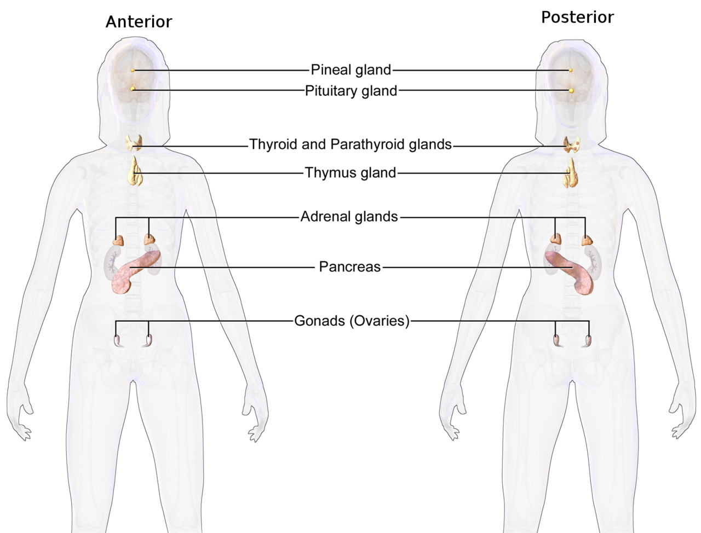
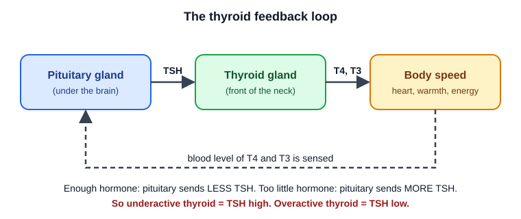
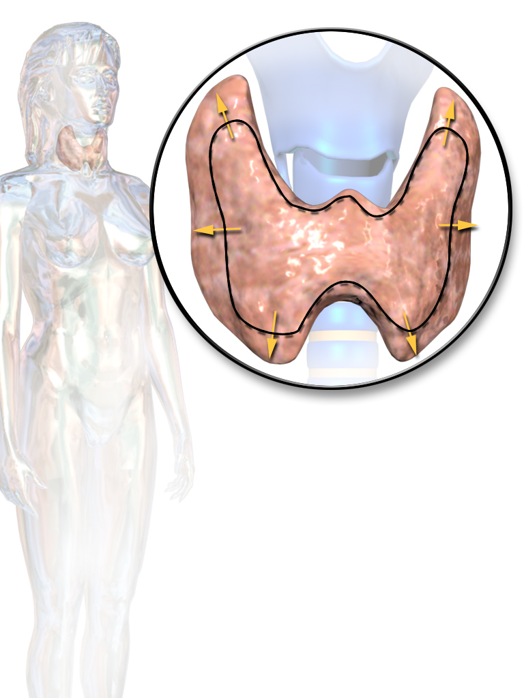

# Thyroid

*Status: Draft. A doctor has not reviewed it yet. Last checked: November 2026.*

Read [How to judge medical advice](../00-start-here/01-how-to-judge-medical-advice.md) and [How lab reports work](../03-tests/01-how-lab-reports-work.md) first.

> [!NOTE]
> **Quick summary**
> - The thyroid is a small gland in the neck that sets how fast your body runs.
> - The brain controls it with a signal called TSH. High TSH usually means the thyroid is underactive. Low TSH usually means it is overactive.
> - One mildly abnormal TSH is common and often goes back to normal. Repeat before labelling it.
> - Thyroid medicine is not a weight-loss tool, and it should never be stopped or changed without a doctor.

---

## 1. What is it?

The **thyroid** is a small butterfly-shaped **gland** at the front of your neck, just below the Adam's apple. (A gland is an organ that makes a chemical and releases it into the blood.)

It makes **thyroid hormones**. (A hormone is a chemical messenger that travels in the blood and tells organs how to behave.) These hormones set the **speed of your body**: heartbeat, warmth, digestion and energy.

Think of a room heater with a thermostat:
- Too little hormone: the whole body runs slow.
- Too much hormone: the whole body runs fast.

A **thyroid disorder** means the gland makes too little hormone, too much hormone, or has a lump or swelling.

*Figure 1: The hormone glands. The thyroid sits in the neck; the pituitary sits under the brain. Image: Blausen.com staff, CC BY 3.0 (see [IMAGE-CREDITS](../IMAGE-CREDITS.md)).*

## 2. The normal body

The thyroid is controlled by the brain:

*Figure 2: The thyroid feedback loop.*

| Name | What it is |
|---|---|
| TSH (thyroid-stimulating hormone) | The message from the brain telling the thyroid to work. The pituitary makes it, not the thyroid. |
| T4 (thyroxine) | The main hormone the thyroid releases. |
| T3 | The more active form. Most is made from T4 in the body's tissues. |

The thyroid needs **iodine**, a mineral from food and iodised salt, to make its hormones.

> [!IMPORTANT]
> TSH moves opposite to the thyroid's output. Underactive thyroid: the brain pushes harder, so TSH goes **up**. Overactive thyroid: the brain backs off, so TSH goes **down**.

Thyroid hormones act on almost every organ: the heart (rate and strength), the gut (speed of digestion), skin and hair, body temperature, mood, periods and fertility, and the growth and brain development of children.

## 3. What goes wrong

| Condition | Meaning |
|---|---|
| Hypothyroidism | Underactive thyroid. Too little hormone. |
| Hyperthyroidism | Overactive thyroid. Too much hormone. |
| Subclinical hypothyroidism | TSH is above the lab's range but T4 is normal. Often no clear symptoms. |
| Goitre | Swelling of the thyroid. |
| Thyroid nodule | A lump in the thyroid. |

*Figure 3: An enlarged thyroid (goitre). The arrows show the swelling. Image: Blausen.com staff, CC BY 3.0.*

## 4. Causes and risk factors

- **Hashimoto's thyroiditis** is the commonest cause of an underactive thyroid in places with enough iodine. [1] `⚠ verify for India` It is an **autoimmune** disease: the immune system (the body's defence army) mistakenly attacks the thyroid.
- **Graves' disease** is the commonest autoimmune cause of an overactive thyroid. [4]
- **Nodules** can overproduce hormone, or can be harmless lumps.
- Too little or too much iodine, some medicines, past neck radiation, pregnancy, and a family history raise the risk.
- Women get thyroid problems more often than men. In a survey of eight Indian cities, hypothyroidism was found in about 1 in 10 adults overall (10.95%), and more in women (15.9%) than in men (5.0%). That survey covered city dwellers only. [5]

## 5. Symptoms

| Underactive (slow body) | Overactive (fast body) |
|---|---|
| Tiredness, feeling cold | Weight loss despite eating well |
| Constipation, dry skin | Fast or pounding heartbeat |
| Hair thinning, modest weight gain | Sweating, feeling hot |
| Heavy periods, slow heartbeat | Shaky hands, anxiety, loose stools |

> [!TIP]
> Tiredness, hair fall and weight gain have many other causes: poor sleep, low iron, stress, low vitamin levels and ordinary ageing. A normal thyroid test is useful information too.

## 6. Diagnosis and tests

### Marker cards

#### TSH
| | |
|---|---|
| What it measures | The brain's signal telling the thyroid how hard to work |
| Why the body needs it | It keeps thyroid hormone at the right level |
| Can be raised by | Underactive thyroid; recovery after a severe illness; some medicines |
| Can be lowered by | Overactive thyroid; too much thyroid medicine; early pregnancy; severe illness; biotin interference (see below) |
| What else you need | Free T4, symptoms, age, pregnancy status, medicines, a repeat test |
| Example range (varies by lab) | Roughly 0.4 to 4.0–4.5 mIU/L. Some labs and Indian studies of people over 60 give a higher upper limit. Pregnancy needs its own ranges. [2][3] `⚠ verify` |

mIU/L means milli-international units per litre.

#### Free T4 (FT4)
| | |
|---|---|
| What it measures | The thyroid hormone that is "free" and active in the blood |
| Why the body needs it | It is the main output of the thyroid |
| Can be raised by | Overactive thyroid; taking thyroid tablets just before the blood test |
| Can be lowered by | Underactive thyroid; rarely a pituitary problem |
| What else you need | TSH |
| Example range | Varies by lab and method |

#### Free T3 (FT3), Anti-TPO antibodies, Ultrasound
- Free T3: mainly used when an overactive thyroid is suspected. Often not needed for an underactive one.
- Anti-TPO antibodies: show an autoimmune cause such as Hashimoto's. They do not by themselves mean you need treatment.
- Thyroid ultrasound: shows size and nodules. It does not tell you how well the gland works. Nodules are scored (often **TI-RADS**), and a high score may lead to **FNAC** (fine-needle aspiration cytology: a thin needle takes a few cells to look at).

### Common patterns (examples; your doctor interprets them)

| TSH | Free T4 | Usual meaning |
|---|---|---|
| High | Low | Underactive thyroid |
| High | Normal | Subclinical hypothyroidism (repeat before acting) |
| Low | High | Overactive thyroid |
| Low | Normal | Possible mild overactivity (repeat, look for cause) |
| Normal | Normal | Thyroid probably fine |

A rare pituitary problem can give a "normal" TSH with low T4. A doctor looks for this if the picture does not fit.

### What can change the result

- **Time of day.** TSH is highest at night and in the early hours and lowest in the daytime. [6] Repeat at a similar time.
- **Recent illness.** Wait until you have recovered, then repeat.
- **Biotin** (vitamin B7, found in hair, skin and nail tablets). In common thyroid tests it can make TSH read falsely low and T4/T3 falsely high, which looks like an overactive thyroid. [7] Tell the lab and ask your doctor whether to pause it first.
- Taking your thyroid tablet right before the test. Ask whether to take it after the blood draw.

### Subclinical hypothyroidism: the commonest confusion

- A single raised TSH is often **temporary**. European guidance advises repeating TSH, free T4 and antibodies after about 2 to 3 months. [3]
- Whether to treat depends on how high the TSH is, your age, symptoms, antibodies, and pregnancy or planning pregnancy. [3]
- In a large trial of 737 adults aged 65 and over with persistently mildly raised TSH, thyroid tablets gave **no benefit** for tiredness or hypothyroid symptoms compared with placebo (a dummy tablet) at one year. [8]

## 7. Treatment

> [!WARNING]
> No doses here. Doses are set by a doctor using blood tests.

### Underactive thyroid: levothyroxine

**Levothyroxine** is a manufactured copy of T4. It replaces what your thyroid is not making. Many people need it for a long time, but ask your doctor how long **you** will need it. `⚠ verify`

- Guidelines advise taking it consistently, with water, about 60 minutes before breakfast or at bedtime. Keep it apart from **iron and calcium tablets**, which can reduce absorption. [1] Soy foods can also interfere, so keep timing consistent. `⚠ verify`
- A TSH test about 6 to 8 weeks after any dose change shows whether the dose is right. Do not judge a dose before that. [9]
- **Stay on one brand** where possible, so the dose behaves consistently. If a chemist swaps the brand, tell your doctor. [1]
- **Too much** is not harmless. It can cause a racing heart, poor sleep and thinner bones. A TSH pushed very low by medicine needs review.
- **Never use thyroid tablets to lose weight.** It is dangerous.
- Do not stop because you "feel fine". Feeling fine is usually because of the tablet.

### Overactive thyroid

Options are antithyroid tablets (such as **carbimazole**, which the body converts to **methimazole**), **radioactive iodine**, or **surgery**. The choice depends on the cause. [4]

> [!CAUTION]
> On carbimazole or similar tablets, a **sore throat or fever** needs a call to your doctor **the same day**. Rarely (about 0.1 to 0.3% of people) these medicines lower the white blood cells that fight infection. [4][10]

### Pregnancy

Thyroid hormone matters for the baby's brain. If you are pregnant or planning to be and have any thyroid problem, **tell your doctor early**. Dose needs often change, and pregnancy has its own TSH ranges. [2]

## 8. Complications

- Untreated underactive thyroid: raised cholesterol, heart strain, infertility, problems in pregnancy; very rarely a life-threatening slowdown (myxoedema coma).
- Untreated overactive thyroid: irregular heartbeat (atrial fibrillation), thinner bones, and rarely a dangerous surge (thyroid storm).
- Too much treatment: the same problems as an overactive thyroid.
- Nodules: cancer is found in a minority, about 7 to 15% of nodules. Most are not cancer. [11]

## 9. Prevention and self-management

- Use iodised salt in normal amounts. Too much iodine (kelp tablets, "iodine boosters") can itself disturb the thyroid.
- Keep every thyroid report and note the lab, date and time of day.
- Take medicine at the same time each day. Repeat TSH on schedule.
- Tell your doctor about pregnancy plans, biotin, iron, calcium and any new medicine.

## 10. Misinformation and how you get misled (India)

| What happens | What to ask or do |
|---|---|
| Levothyroxine started after one slightly high TSH | "Can we repeat TSH with an FT4 in 2 to 3 months before starting?" |
| Treating mildly high TSH in an older person with no symptoms | Ask about the TRUST trial result. Ask what benefit is expected. |
| A "thyroid package" with many tests for everyone | Ask which tests you need. TSH is usually the start. |
| "Thyroid cure" with herbs or diets | No diet or herb has been shown to replace thyroid hormone. In one study, some "thyroid support" supplements made from animal thyroid ("glandular" products) contained measurable real thyroid hormone, which can harm you silently. [12] |
| Told to avoid cabbage, cauliflower and soy completely | These matter mainly with iodine deficiency or very large intakes. Ask before cutting out foods. `⚠ verify` |
| Blaming the thyroid for every symptom | Ask what else could cause it and which test would show it. |

## 11. Ask your doctor

1. Is my TSH high, low or normal? What is the range on *this* report?
2. Is my free T4 normal? What pattern is this?
3. Should we repeat before deciding? When?
4. Could biotin, a recent illness or the time of day have affected this?
5. Do I need antibody tests or an ultrasound? How will they change the plan?
6. If you advise a medicine: for how long, when do we recheck, and what signs mean too much?
7. I am (or may become) pregnant. What changes?
8. If a lump was found: what is its TI-RADS score? Do we need FNAC?

## 12. Red flags

See a doctor promptly: a lump that grows quickly, a hoarse voice that does not clear, or trouble swallowing or breathing with a neck swelling.

**Go to emergency care:** severe drowsiness, confusion or a very slow heartbeat with known underactive thyroid; or a very fast heartbeat, high fever, agitation or fainting with an overactive thyroid.

## Key terms

**Gland** an organ that releases a chemical into the blood · **Hormone** a chemical messenger · **Pituitary** a pea-sized gland under the brain · **TSH** the brain's signal to the thyroid · **T4, T3** thyroid hormones · **Autoimmune** the immune system attacks the body's own tissue · **Hashimoto's / Graves'** autoimmune thyroid diseases (underactive / overactive) · **Subclinical** abnormal test, normal hormone, few symptoms · **Goitre** swollen thyroid · **Nodule** lump · **TI-RADS** ultrasound score for how suspicious a nodule looks · **FNAC** needle sample of cells · **Levothyroxine** manufactured T4 · **Placebo** dummy tablet.

## Sources and not verified

1. Jonklaas J, et al. Guidelines for the treatment of hypothyroidism (ATA). *Thyroid* 2014;24(12):1670-1751.
2. Alexander EK, et al. 2017 ATA guidelines for thyroid disease in pregnancy. *Thyroid* 2017;27(3):315-389.
3. Pearce SHS, et al. ETA guideline: management of subclinical hypothyroidism. *Eur Thyroid J* 2013;2:215-228.
4. Ross DS, et al. ATA guidelines for hyperthyroidism. *Thyroid* 2016;26(10):1343-1421.
5. Unnikrishnan AG, et al. Prevalence of hypothyroidism in adults: eight cities of India. *Indian J Endocrinol Metab* 2013;17(4):647-652.
6. Daily rhythm of TSH: Frontiers in Endocrinology review, 2021 (doi 10.3389/fendo.2021.619568).
7. US FDA safety communications on biotin interference with lab tests, 28 Nov 2017 and 5 Nov 2019.
8. Stott DJ, et al. TRUST trial. *N Engl J Med* 2017;376:2534-2544.
9. ATA patient brochure on hypothyroidism and levothyroxine labelling (6 to 8 weeks).
10. ATA Clinical Thyroidology for the Public, 2016: antithyroid drug side effects.
11. Haugen BR, et al. 2015 ATA guidelines on thyroid nodules and thyroid cancer. *Thyroid* 2016;26(1):1-133.
12. Kang GY, et al. Thyroid hormone content of dietary supplements. *Thyroid* 2013. (A later letter noted the method may give false positives.)

Not verified: Hashimoto's as commonest cause in India; how long levothyroxine is needed; typical TSH range printed by Indian labs; the soy and goitrogen statements. Marked `⚠ verify`.
