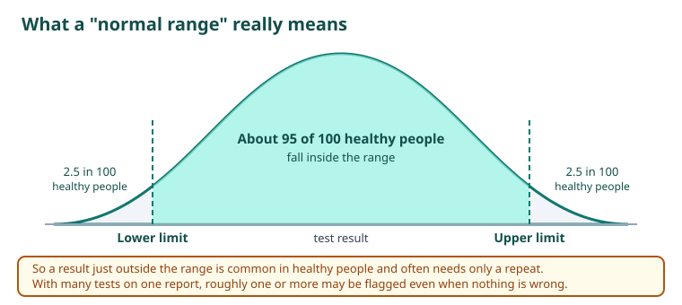

# Chapter 2: How Lab Reports Work (and Why They Mislead)

*Status: Draft. Not yet reviewed by a doctor. Last checked: November 2026.*

A lab report looks exact: a number, a range, a flag. But the number is the end of a long chain. Many steps can shift it. This chapter explains those steps, so you know when a result deserves a repeat.

---

## The Idea

Think of a lab test like a weighing scale in a shop. Three things decide whether the weight is right:

1. **Before weighing:** was the item prepared properly?
2. **During weighing:** is the scale accurate and used correctly?
3. **After weighing:** was the reading written down correctly and compared to the right standard?

Lab people call these the **pre-analytical** (before), **analytical** (during) and **post-analytical** (after) stages. Roughly half or more of lab errors happen in the first stage, **before** the sample reaches the machine. [1]

---

## How It Works

### Stage 1: Before the test (you and the sample)

| What | Why it can change the result |
|---|---|
| **Fasting** (nothing but water for about 8 to 12 hours, as the test requires) | Food raises sugar and fats in the blood. A tea with sugar counts as eating. |
| **Time of day** | Some hormones, such as TSH (Chapter 3), change through the day. |
| **Recent illness, hard exercise, alcohol** | Can raise liver enzymes, sugar or inflammation markers for days. |
| **Medicines and supplements** | Some change the result, or fool the test machine itself. Example: biotin (vitamin B7, found in hair and nail tablets) can make some hormone results falsely low and others falsely high. Always tell the lab what you take. |
| **How the sample is taken and stored** | A long tourniquet, a delay before the sample is spun, or heat during transport can shift results. For example, if blood for sugar is left too long, the blood cells keep eating the sugar, and the number drops. |

### Stage 2: In the machine

Labs use different **methods** and machines. The same blood tested in two labs can give slightly different numbers, and each lab prints its own range for its own method. Labs also check their machines against known samples. This is called **quality control**.

In India, look for a lab accredited by **NABL** (National Accreditation Board for Testing and Calibration Laboratories). Accreditation means the lab's quality system has been checked by an outside body. It does not make a lab perfect, but it is a useful sign. `⚠ verify the current NABL scheme details`

### Stage 3: After the test (the report)

- **Reference range:** the "normal" band, explained in Chapter 1. It depends on age, sex, and sometimes pregnancy. Read the range **printed on your report**, not a range from the internet.
- **Flags:** H (high), L (low). These only mean "outside this lab's range".
- **Units:** the same test can be written in different units, such as mg/dL or mmol/L. A number only makes sense with its unit. Never compare numbers from two reports without checking the units.
- **Critical values:** results so far out of range that a lab should phone the doctor.

---

## When It Goes Wrong

| Problem | Example (made up) | What to do |
|---|---|---|
| Result does not match how you feel | Report says "sugar very high", but you are fine and you ate before the "fasting" test | Ask whether the result fits your symptoms. Repeat under correct conditions. |
| Two labs give different numbers | 7.2 vs 6.9 on the same test | Small differences are normal. Compare to each lab's range. Use one lab for follow-up. |
| A single mildly abnormal result | One liver enzyme slightly above range | Usually repeat in a few weeks before acting. |
| Wrong patient or wrong sample | A report that shows a result impossible for you (a very different blood group, or a pregnancy test on a man) | Call the lab. Ask for a re-test. Labs expect this. |
| Test affected by a supplement | Hormone result that does not fit symptoms while taking hair tablets | Tell the doctor. Ask whether to stop the supplement and re-test. Do not stop prescribed medicines on your own. |

---

## Reading Your Report: a 6-step habit

1. **Check your details:** name, age, sex, date and time of the sample.
2. **Check the test and the unit.**
3. **Compare to the range printed on the same report.**
4. **Ask: was I fasting, ill, or on any supplement that day?**
5. **Look at the trend.** Is this number new, or similar to last year's? One value matters less than the direction over time.
6. **Never act on the number alone.** Take it to a doctor along with your symptoms.

> [!TIP]
> Keep every report in one folder, in date order, with the lab name. Trends are the most useful thing a report can give you. In this repo that folder is `my-reports/`, and it is never pushed to GitHub.

---

## How You Get Misled

- **Health packages with 60 to 100 tests.** More tests mean more chances of a false flag (Chapter 1). Ask your doctor which tests are needed for your age and risk.
- **"Immunity" or "full body" panels.** The names sound serious but have no fixed medical definition. Ask exactly which tests are inside.
- **Over-testing of vitamin D and B12 in people who feel fine.** Whether to test depends on symptoms and risk. `⚠ verify against Indian guidance`
- **Reports from a lab that is "on a commission".** Some doctors send patients to labs for a share of the fee. You are allowed to choose an accredited lab yourself. This practice is called "cut practice". Whether it is legal or banned is covered by Indian medical ethics rules. `⚠ verify the current NMC rule`
- **Alarming language.** "Borderline", "abnormal" and "high risk" on a report are labels, not diagnoses.

---

## Ask Your Doctor (or the lab)

1. Do I need this test? How will the result change what we do?
2. Do I need to fast, and for how long? Can I drink water and take my medicines?
3. Should I stop any supplement before the test?
4. Is this lab NABL accredited?
5. Is this result consistent with my symptoms, or should we repeat it?
6. When should I repeat it?

---

## Red Flags

Do not wait for a repeat test if the lab phones you about a **critical value**, or if you have symptoms that feel urgent, such as chest pain, severe breathlessness, confusion, or fainting. Go to a hospital.

---

## Sources and Not Verified

1. Plebani M. Errors in clinical laboratories or errors in laboratory medicine? *Clinical Chemistry and Laboratory Medicine*, 2006. (The majority of lab errors occur in the pre-analytical phase.) `⚠ verify exact claim`
- Biotin interference with immunoassays: US FDA safety communication, 2017 (updated 2019). `⚠ verify`
- Reference intervals cover the central 95% of a healthy reference population: IFCC / CLSI EP28-A3c guideline. `⚠ verify`
- NABL accreditation: NABL India website. `⚠ verify`
- Not verified: the "cut practice" rule and over-testing claims above are flagged `⚠ verify` and need a primary Indian source.
