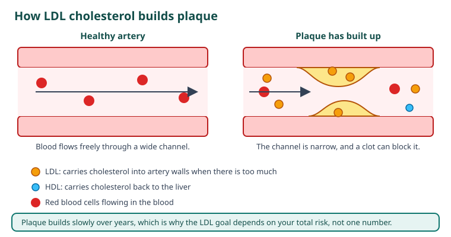

# The Lipid Profile (Cholesterol Test)

*Status: Draft. A doctor has not reviewed it yet.*

Read [How lab reports work](01-how-lab-reports-work.md) and the cholesterol section of [Metabolism, cholesterol and electrolytes](../01-body/hormones-metabolism-homeostasis.md) first.

> [!NOTE]
> **Quick summary**
> - A lipid profile reports cholesterol and blood fat: total, LDL, HDL, triglycerides, and often non-HDL.
> - **LDL is the main number to lower. The target depends on your overall heart risk, not on the lab's printed "normal".**
> - Before starting a lifelong cholesterol medicine, check for causes that can be treated (underactive thyroid, diabetes, kidney or liver problems, some drugs).
> - Do not stop a prescribed statin because of fear or social media advice. Talk to your doctor.
> - Inherited high cholesterol (familial hypercholesterolaemia) needs medicine whatever you eat. Most statin myths are wrong (Section 7).

---

## 1. What the test is

A blood test, usually from a vein in the arm. **Fasting** (8 to 12 hours, water allowed) was long standard and is still asked for by many labs, particularly if triglycerides are high. Several guidelines now accept a **non-fasting** sample for the first check. `⚠ verify` Ask your doctor which applies to you.

## 2. The markers

### LDL cholesterol: card

| | |
|---|---|
| What it measures | Cholesterol carried in LDL particles, the ones that deliver cholesterol to tissues and can enter artery walls |
| Why the body needs cholesterol | Cell walls, bile acids, vitamin D, hormones |
| Can be raised by | Saturated and trans fats, inherited high cholesterol (familial hypercholesterolaemia), **underactive thyroid**, **diabetes**, **kidney disease** (including nephrotic syndrome, where the kidneys leak protein), obesity, some medicines (steroids, some blood-pressure drugs), pregnancy |
| Can be lowered by | Statins and other lipid medicines, weight loss, less saturated fat, more fibre, hyperthyroidism (overactive thyroid), severe illness |
| What else you need | Age, blood pressure, diabetes, smoking, family history, other lipids |
| How reported | **Calculated** from total, HDL and triglycerides in most labs (the Friedewald formula, which becomes unreliable if triglycerides are above about 400 mg/dL), or measured **directly**. `⚠ verify` |

### HDL cholesterol: card

| | |
|---|---|
| What it measures | Cholesterol in HDL particles, which carry cholesterol back to the liver |
| Can be raised by | Exercise, moderate weight loss, stopping smoking, some inherited traits |
| Can be lowered by | Insulin resistance (the body responds poorly to insulin), obesity, smoking, a sedentary life, high triglycerides |
| Notes | Low HDL is a risk marker. **Raising HDL with medicines or supplements has not been shown to prevent heart attacks**, so it is not a treatment target by itself. `⚠ verify` |

### Triglycerides: card

| | |
|---|---|
| What it measures | Blood fat from food and from the liver |
| Can be raised by | A recent meal, **alcohol**, sugary drinks and refined carbohydrate, obesity, diabetes, an underactive thyroid, kidney disease, some medicines |
| Can be lowered by | Weight loss, less alcohol and sugar, controlling diabetes, exercise, some medicines |
| Why it matters | Moderately high levels travel with insulin resistance and fatty liver. **Very high levels can trigger pancreatitis** (an inflamed pancreas, with severe belly pain), which is an emergency. Treatment is usually started above about 500 mg/dL, and the risk of pancreatitis rises steeply above about 880 mg/dL (10 mmol/L, millimoles per litre, the unit used outside India). `⚠ verify` |

### Total and non-HDL cholesterol

- **Total cholesterol** adds all the particles together, including HDL, so it is the least informative on its own.
- **Non-HDL cholesterol** (total minus HDL) captures all the "bad" particles. It is useful when triglycerides are high.

### Other tests you may meet

| Test | What it is for |
|---|---|
| **ApoB** (apolipoprotein B, a protein carried on each "bad" particle) | Counts the number of "bad" particles; a refinement |
| **Lp(a)** (lipoprotein a) | An inherited particle; commonly measured **once in a lifetime** to find those with very high levels. `⚠ verify` |
| **hs-CRP** (high-sensitivity CRP) | A low-level inflammation marker sometimes added to risk assessment. It is a different test from ordinary CRP. |

## 3. Example numbers (not targets)

These are common reference values; **your personal target depends on your risk.** `⚠ verify`

| Marker | Often labelled "desirable" |
|---|---|
| Total cholesterol | Below about 200 mg/dL |
| LDL | Below about 100 mg/dL (lower for people at higher risk) |
| HDL | Above about 40 mg/dL in men and 50 mg/dL in women |
| Triglycerides | Below about 150 mg/dL |

**Why your target may be lower:** current guidelines ask your doctor to estimate your total cardiovascular risk (age, sex, blood pressure, diabetes, smoking, kidney disease, family history, existing heart or stroke disease) and then set an LDL goal. People who have already had a heart attack or stroke, or who have diabetes with other risks, are given much lower LDL goals. Indian expert groups also propose stricter targets for high-risk Indians. The Lipid Association of India 2020 statement suggests an LDL below 50 mg/dL for very-high-risk people (including those with existing heart disease) and 30 mg/dL or lower for the extreme-risk group. `⚠ verify`

## 4. Look for treatable causes first

Before labelling the cholesterol as inherited or diet-related:
- **TSH** (thyroid-stimulating hormone, the usual thyroid blood test; underactive thyroid raises LDL; see [Thyroid](../02-diseases/thyroid.md)).
- **Blood sugar / HbA1c** (the 3-month average sugar test; [Diabetes](../02-diseases/diabetes.md)).
- **Kidney tests and urine protein** ([Liver and kidney tests](liver-and-kidney-tests.md)).
- **Liver tests** and alcohol intake.
- **Medicines** that raise lipids.

## 5. Treatment overview (no doses)

| Approach | Notes |
|---|---|
| **Food and activity** | Less saturated and trans fat (some fried foods, bakery items, vanaspati/hydrogenated oils), more fibre, whole grains, pulses, nuts, vegetables, regular exercise, a healthy weight, no smoking. Lowers LDL modestly and improves triglycerides more. |
| **Statins** | The best-proven medicines for preventing heart attack and stroke in people at risk. They block cholesterol production in the liver, so the liver pulls more LDL from the blood. |
| **Ezetimibe** | Blocks cholesterol absorption in the gut; added to statins when needed |
| **Newer injections** (PCSK9 inhibitors, which help the liver remove more LDL, and others) | For very high risk or inherited high cholesterol; costly |
| **Fibrates, omega-3 prescription** (two kinds of fat-lowering medicine) | Mainly for very high triglycerides, chosen by the doctor |

### About statins

- Some people notice muscle aches. In large trials that compared a statin with a **placebo** (a dummy tablet), muscle pain or weakness was reported by 27.1% of people on a statin and 26.6% on placebo, so more than 90% of muscle symptoms in statin users were not caused by the drug. A small excess (about 11 per 1,000 people a year, roughly 1 in 100) appears in the first year only. A few people have real muscle problems. Report them; do not just stop. [4]
- **Serious muscle injury and liver injury are rare.** Statins slightly raise blood sugar in some people, but the heart-protective benefit in high-risk people generally outweighs this. `⚠ verify`
- A doctor may check liver tests and sometimes a muscle enzyme blood test (CK, creatine kinase) if symptoms occur.
- Statins are not for everyone with a mildly high number. Ask whether you are in a group that benefits.

## 6. Why the target depends on your risk

Damage adds up: it depends on how high LDL is **and for how many years**, so inherited high LDL is very dangerous.

1. **Work out your risk.** Doctors combine age, sex, blood pressure, diabetes, tobacco, family history, kidney disease and any past heart attack or stroke. A **risk score** turns this into low, moderate, high or very high risk. Indian guidance notes that standard Western calculators may **under-estimate** risk in South Asians. `⚠ verify`
2. **Set the goal by risk group.** These are guideline directions, not personal targets.

| Risk group | Example approach |
|---|---|
| **Low risk** | Lifestyle first; a moderate LDL is acceptable |
| **Moderate to high** (diabetes, high BP, kidney disease, strong family history) | Lower LDL goal; a statin is usually advised |
| **Very high** (past heart attack, stroke, stents) | **Lowest goals.** ESC/EAS (the European societies of cardiology and of atherosclerosis) aims below 55 mg/dL and a fall of at least 50% from baseline [1]; the Lipid Association of India (2020) sets below 50 mg/dL for very high risk and 30 mg/dL or lower for an "extreme risk" group `⚠ verify` |
| **Familial hypercholesterolaemia** | Treat from a young age, often with combination medicines |

**Lower is better** for LDL in people who already have artery disease. Studies so far have not shown clear harm at very low LDL, but your doctor decides your goal. `⚠ verify` For what this leads to, see [Coronary heart disease](../02-diseases/coronary-heart-disease.md) and [Stroke](../02-diseases/stroke.md).

## 7. Statin truths and myths

| Myth | What the evidence says |
|---|---|
| "Statins ruin the liver" | A mild, usually harmless rise in liver enzymes in a few people. Serious liver injury is very rare. Fatty liver is **not** a reason to avoid a statin you need. See [Liver](../02-diseases/liver.md) |
| "Statins cause diabetes" | A small rise in blood sugar in some people already near diabetes. The heart benefit is much larger |
| "Muscle pain is common" | See Section 5. In a blinded n-of-1 trial (each person took statin and dummy tablets in turn), muscle symptoms were mostly the same with a dummy tablet, called the **nocebo effect** (side effects caused by expecting harm). Report severe pain or dark urine at once |
| "Once on, never off" | The benefit lasts only while you take it, like a BP medicine. Stopping lets LDL rise again |
| "Natural products work as well" | Red yeast rice contains an uncontrolled statin-like substance. Other supplements lack proof of fewer heart attacks |
| "Only high cholesterol needs a statin" | In high-risk people a statin helps **even if LDL is near normal** |

Diet and activity cannot replace a statin in familial hypercholesterolaemia or after a heart attack. Use both. See [Common drug classes](../04-medicines/common-drug-classes.md).

## 8. Inherited high cholesterol and Lp(a)

**Familial hypercholesterolaemia (FH)** is an **inherited** condition: very high LDL from birth. Suspect it when LDL is very high (for example above about 190 mg/dL in an adult, an example cut-off) with a family history, yellowish lumps on the tendons or a **heart attack in the 30s to 50s**. It affects roughly 1 in 250 people worldwide and is **widely under-diagnosed in India**. `⚠ verify` **Test the children and siblings** (cascade screening).

**Lp(a)** is an LDL-like particle with an extra sticky protein. It is set almost entirely by genes and barely changes with diet or exercise. Statins do not lower it, and no widely available drug is proven yet. Many guidelines suggest **measuring it once** in adults, especially with early heart disease in the family. `⚠ verify` A high value means being **stricter about every other risk factor**. It is not a reason to panic or buy supplements.

## 9. How you get misled

| What happens | What to do |
|---|---|
| "Cholesterol 210, start a statin for life" without a risk assessment | Ask for your overall heart-risk estimate and the target |
| Repeating the lipid profile monthly | Not needed; changes take weeks to months. Ask when to repeat |
| "Natural" supplements instead of a statin after a heart attack | Not proven to replace it; stopping a prescribed statin after a heart attack raises risk |
| Over-the-counter fish-oil capsules marketed for "heart health" | Evidence for benefit in the general population is weak. Ask your doctor `⚠ verify` |
| "Cholesterol-free" labels on foods rich in refined oils and sugar | Cholesterol-free does not mean heart-healthy |
| Fear-based claims that "cholesterol is a myth" or "statins are poison" | The balance of evidence supports statins in people at risk; discuss personal concerns with your doctor |
| "Cholesterol test" combined with expensive "heart packages" | Ask which tests change your treatment |

## 10. Ask your doctor

1. What is my LDL, and what is **my** target, and why?
2. What is my overall heart-risk estimate?
3. Have we checked thyroid, sugar, kidney and liver for causes?
4. Do I need a medicine or can I try food and activity first, and for how long?
5. If a statin: what are the side effects to report, and when do we recheck?
6. Should I have Lp(a) or ApoB checked?
7. When should I repeat the test?

## 11. Red flags

**Emergency:** chest pressure or pain, pain spreading to the arm or jaw, breathlessness, sweating, or fainting. **Prompt review:** severe unexplained muscle pain or weakness with dark urine, or severe belly pain with a very high triglyceride result.

## Key terms

**Lipid profile** the cholesterol and blood-fat panel · **LDL / HDL** "bad" / "good" cholesterol carriers · **Triglyceride** blood fat · **Non-HDL** total minus HDL · **Friedewald formula** the usual calculation of LDL · **ApoB** a particle-count marker · **Lp(a)** an inherited cholesterol particle · **hs-CRP** a sensitive inflammation marker · **Statin** a cholesterol-lowering medicine · **Ezetimibe** a gut cholesterol-absorption blocker · **Familial hypercholesterolaemia** inherited very high cholesterol · **Cascade screening** testing relatives of a person with FH · **Nocebo effect** side effects caused by expecting harm · **Atherosclerosis** fatty narrowing of arteries · **Pancreatitis** inflammation of the pancreas · **Placebo** a dummy tablet.

## Sources and not verified

1. Mach F, et al. 2019 ESC/EAS guidelines for the management of dyslipidaemias. *Eur Heart J* 2020 (LDL goals checked via the ACC and ESC summaries).
2. Grundy SM, et al. 2018 AHA/ACC guideline on blood cholesterol management. `⚠ verify`
3. Lipid Association of India expert consensus statements. `⚠ verify`
4. Cholesterol Treatment Trialists' Collaboration. Effect of statin therapy on muscle symptoms: an individual participant data meta-analysis of large-scale, randomised, double-blind trials. *Lancet* 2022.
5. OpenStax. *Anatomy and Physiology 2e* (lipid transport).
7. Wood FA, et al. N-of-1 trial of statin muscle symptoms. *N Engl J Med* 2020.
8. Nordestgaard BG, et al. EAS consensus on lipoprotein(a). *Eur Heart J* 2022.
9. NICE guideline NG238 on cardiovascular disease risk and lipid modification.

**Confirmed this pass:** ESC/EAS LDL goal for very high risk (below 55 mg/dL and a 50% fall); statin muscle-symptom figures (CTT, *Lancet* 2022).

**Not verified:** example "desirable" thresholds, the Friedewald limit, the triglyceride pancreatitis threshold, non-fasting sampling, the HDL statement, statin liver and sugar statements, and the Lipid Association of India goals (found only in summaries of the 2020 statement, which has since been updated). Also unverified: the FH frequency and cut-off, the Lp(a) once-in-life advice, fish-oil evidence, and the Western risk-calculator under-estimation in South Asians. ACC/AHA 2018 was not opened.
