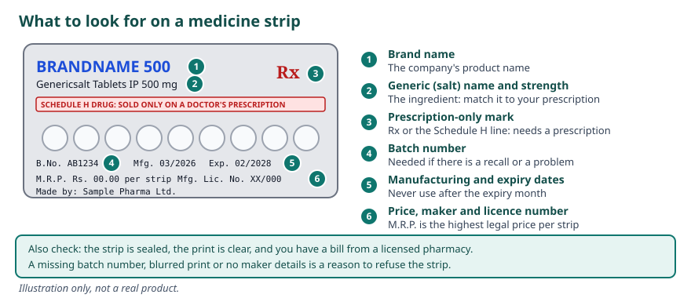

# Reading a Prescription

*Status: Draft. A doctor has not reviewed it yet. Last checked: November 2026.*

> [!WARNING]
> This chapter helps you **understand and check** a prescription. It does not replace your doctor's or pharmacist's advice. If something looks wrong, **ask** before taking it. Do not change a prescription on your own.

> [!NOTE]
> **Quick summary**
> - A prescription is a written order with your details, the medicines (name, strength, form, how often, how long) and the doctor's signature and registration number.
> - Learn the shorthand: **OD, BD, TDS, HS, SOS, AC, PC**, and the "1-0-1" pattern.
> - For every medicine on your list you should be able to say **what it is for**. If you cannot, ask.
> - Check for **duplicate ingredients** and **medicines without a clear purpose**.

---

## 1. The parts of a prescription

| Part | What to look for |
|---|---|
| **Doctor's details** | Name, qualification, registration number (a doctor is registered with the medical council) |
| **Your details** | Name, age, weight (for children) and date. Wrong age or weight can mean a wrong dose |
| **Diagnosis or complaint** | Often missing. You can ask your doctor to write it |
| **Rx** | The symbol that begins the medicine list ("recipe", Latin for "take") |
| **Each medicine** | Name (brand or generic), **strength** (mg), **form** (tablet, syrup), **how often**, **for how long**, and any instructions |
| **Advice** | Diet, tests, review date |
| **Signature and stamp** | The doctor's sign |

Under the Indian Medical Council (Professional Conduct, Etiquette and Ethics) Regulations, 2002 (clause 1.5, amended 2016), doctors should write **generic names legibly, preferably in capital letters**. The NMC's 2023 regulations were put on hold in August 2023, so the 2002 rule is the one in force at the time of checking. Many doctors do not follow it. You can ask for the generic (salt) name. `⚠ verify the current NMC rule`

## 2. The shorthand

### How often

| Short form | Meaning | Latin or origin |
|---|---|---|
| **OD** | Once a day | *omni die* |
| **BD** or **BID** | Twice a day | *bis in die* |
| **TDS** or **TID** | Three times a day | *ter die sumendum* |
| **QID** or **QDS** | Four times a day | *quater in die* |
| **HS** | At bedtime | *hora somni* |
| **SOS** | Only if needed (for example, for pain or fever) | *si opus sit* |
| **PRN** | As needed | *pro re nata* |
| **STAT** | Immediately, once | |

### The "1-0-1" pattern

Common in India: three numbers for **morning, afternoon, night**.
- **1-0-1** = one in the morning, none in the afternoon, one at night.
- **1-1-1** = three times a day.
- **0-0-1** = at night only.
- **½-0-½** = half a tablet morning and night.

### Timing with food

| Short form | Meaning |
|---|---|
| **AC** | Before food (*ante cibum*) |
| **PC** | After food (*post cibum*) |
| **Empty stomach** | About 30 to 60 minutes before eating, or 2 hours after |
| **With food** | During or just after a meal |

### Forms and routes

| Short form | Meaning |
|---|---|
| **Tab** | Tablet |
| **Cap** | Capsule |
| **Syp** | Syrup |
| **Susp** | Suspension (shake well before use) |
| **Inj** | Injection |
| **Oint / Crm** | Ointment / cream |
| **Drops** | Eye, ear or nose drops (check which) |
| **PO** | By mouth |
| **IV / IM / SC** | Into a vein / muscle / under the skin |
| **SL** | Under the tongue |

### Units

| Short form | Meaning |
|---|---|
| **mg** | Milligram |
| **mcg** or µg | Microgram (one thousandth of a milligram) |
| **g** | Gram |
| **mL** | Millilitre |
| **IU** | International unit (for some vitamins and hormones) |

> [!IMPORTANT]
> **mg and mcg are very different.** A 1000-fold mix-up is dangerous. If a strength looks odd, check with the pharmacist.

## 3. Brand name versus generic name

Every medicine has:
- an **active ingredient** (also called the **generic** or **salt** name), for example *paracetamol*;
- one or more **brand names** made by companies, for example a name printed on a strip.

The generic name is the same across brands. A prescription may name only a brand. To find the ingredient, look at the strip: the **composition** is printed on it ("Each tablet contains ..."). See [Generic, brand and prices](generic-brand-and-prices.md).

## 4. Check each line (a five-step routine)

1. **What is it for?** Ask the doctor to name the purpose of each medicine.
2. **What is the active ingredient and strength?** Read the strip.
3. **How often and for how long?** Is there a stop date or review date?
4. **Any duplicates?** Two brands can contain the same ingredient (for example paracetamol in a "cold" tablet and in a painkiller). Add up what you take.
5. **Does it fit me?** Allergies, pregnancy, kidney or liver disease, other medicines, age.

## 5. Common patterns that deserve a question

| Pattern | Why ask |
|---|---|
| **Five or more medicines for a simple problem** | Each should have a clear purpose. Ask which are essential and which can wait. |
| **An antibiotic for a cold, cough or sore throat that is probably viral** | Antibiotics do not work on viruses (see [Antibiotics and resistance](antibiotics-and-resistance.md)). |
| **A steroid tablet or injection without a clear explanation** | Useful drugs, but with real risks (see [Painkillers, steroids, acidity pills and supplements](painkillers-steroids-acidity-supplements.md)). |
| **An acidity tablet added to everything** | Appropriate with some painkillers; otherwise ask whether and for how long it is needed. |
| **"Liver protective", "immunity", "multivitamin" or "energy" tablets added routinely** | Ask what each is for and whether it is needed. |
| **A fixed combination of several drugs in one tablet** | See [Fixed-dose combinations and spurious drugs](fdc-and-spurious-drugs.md). |
| **A sedative or sleeping pill (benzodiazepine) started without a plan** | Dependence risk. Ask about the plan to stop. |
| **Long-term painkillers** | Risks to stomach, kidneys and heart. Ask for the cause and alternatives. |

## 6. India: how medicines are labelled

| Label | Meaning |
|---|---|
| **Rx on the strip** | Sold only on a doctor's prescription (Schedule H) |
| **Red line down the strip** | Prescription-only medicine, notably **antibiotics**. India's "Medicines with the Red Line" campaign (launched in 2016) warns against using these without a prescription. It may also cover some other prescription-only medicines. `⚠ verify` |
| **Schedule H1** | Certain strong antibiotics, anti-TB medicines and some psychotropic medicines; the pharmacy keeps a record of each sale |
| **Schedule X** | Strictly controlled (narcotic and psychotropic) medicines; needs a prescription and strict record-keeping |
| **Non-prescription (OTC)** | Simple remedies sold without a prescription |

The medicine **strip** should show the brand and generic name, strength, **batch number**, **manufacturing and expiry dates**, **manufacturer's licence number**. The price (**MRP**, maximum retail price, inclusive of taxes) is also printed, under the packaged-goods rules. `⚠ verify`

## 7. At the pharmacy

- Buy from a **licensed pharmacy** and **ask for a bill**.
- Show the prescription. A pharmacist can explain **how to take it** and check **interactions**.
- If a different brand is offered, check the **active ingredient and strength match**. For some medicines (thyroid, blood thinners, anti-seizure) stay on the **same brand** unless your doctor agrees.
- Check **expiry** and that the strip is **sealed** and the print is clear.
- Ask for the **full course**, not a partial strip, if the doctor said so.

## 8. Keep your own medicine list

Keep an up-to-date list (on paper or phone) with: **medicine name (brand and ingredient), what it is for, how and when you take it, the prescriber, the start date, and allergies.** Bring it to every visit, including to pharmacists and new doctors. It is one of the most effective safety habits.

## 9. Ask your doctor

1. What is the diagnosis, and what is each medicine for?
2. For how long should I take each? When do we review?
3. Are there cheaper generic options? Can you write the generic name?
4. Any interactions with my other medicines or herbs?
5. What side effects should make me call you?
6. Which medicines can I stop first when I improve, and which must I continue?

## 10. Red flags

Do not take a medicine and **ask first** if: the **strip is damaged or looks different**, the **name or strength is unclear**, you are **allergic** to something listed, you are **pregnant or breastfeeding** and the prescriber does not know, or a **child's weight-based dose** is not written. Seek urgent care for signs of allergy or severe reaction (see [How medicines work](how-medicines-work.md)).

## Key terms

**Rx** the sign for "take" that starts the medicine list · **Generic / salt name** the active ingredient · **Brand name** the company's product name · **OD, BD, TDS, QID, HS, SOS, PRN, STAT** frequency shorthand · **AC / PC** before / after food · **1-0-1** morning-afternoon-night pattern · **mg / mcg** milligram / microgram · **Composition** the ingredients listed on the strip · **Batch number** the production lot code · **Schedule H / H1 / X** prescription-only / controlled antibiotic / strictly controlled medicine classes · **MRP** maximum retail price.

## Sources and not verified

1. National Medical Commission / Indian Medical Council (Professional Conduct, Etiquette and Ethics) Regulations, 2002 and the 2023 regulations (generic prescribing). `⚠ verify current status`
2. Drugs and Cosmetics Rules, 1945, Schedules H, H1, X (CDSCO). `⚠ verify`
3. Ministry of Health and Family Welfare, "Medicines with the Red Line" campaign (2016). `⚠ verify`

**Not verified:** the current legal status of the generic-prescribing rule, the exact label requirements on strips, and the scope of the Red Line campaign should be checked against the cited sources.
