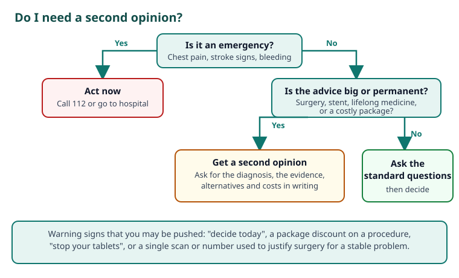

# Second Opinions and Treatment Decisions

*Status: Draft. A doctor has not reviewed it yet. Last checked: November 2026.*

Read [How to judge medical advice](../00-start-here/01-how-to-judge-medical-advice.md) first. This chapter builds on it.

> [!NOTE]
> **Quick summary**
> - You have the right to understand your diagnosis, your options and the risks, and to take time over non-emergency decisions.
> - Four questions cover almost every decision: What are the benefits? What are the risks? What are the alternatives? What happens if we do nothing for now?
> - A second opinion is normal. Doctors expect it, and it is most useful before surgery, a stent, cancer treatment, or any long-term medicine.
> - Evidence has levels. A single study, a testimonial or a forwarded message is the weakest kind.

---

## 1. Emergency or not?

The first question decides how much time you have.

| Situation | Time | What to do |
|---|---|---|
| True emergency (heart attack, stroke, severe bleeding, serious injury, breathing trouble, a very sick child) | Minutes to hours | Act first, ask later. See [First aid and emergencies](../10-practical/first-aid-and-emergencies.md) |
| Urgent (suspected cancer, a blocked artery with symptoms, a serious infection) | Days | Move quickly, but you can still ask for a short explanation and a rapid second opinion |
| Elective or planned (most surgery, a stent for stable disease, knee replacement, a new long-term medicine, a scan or test) | Weeks to months | Take time. Ask questions. Get a second opinion if the decision is big |

Ask your doctor directly: **"Is this an emergency? What happens if I wait a week? A month?"**

## 2. The four questions (BRAN)

Remember **BRAN**:

| Letter | Question |
|---|---|
| Benefits | What do I gain? How big is the gain, in numbers? |
| Risks | What can go wrong? How likely, and how serious? |
| Alternatives | What other options are there, including cheaper or less invasive ones? |
| Nothing | What happens if we do nothing, or wait and watch? |

Add two more: "What would you do if this were your family member?" and "What does it cost, in total?"

## 3. Understanding the numbers

### Absolute versus relative risk

A medicine that "reduces risk by 50%" sounds huge. What matters is **how many people benefit**.

*Example (made up):* a disease affects 2 in 1,000 people. A medicine cuts this to 1 in 1,000.
- **Relative** reduction: 50%.
- **Absolute** reduction: 1 in 1,000 (0.1 percentage points).
- Number needed to treat (NNT): 1,000 people must take the medicine for one to benefit.

Always ask: "Out of 100 (or 1,000) people like me, how many are helped, and how many are harmed?"

### Surrogate outcomes versus real outcomes

| Type | Example |
|---|---|
| Surrogate (a number that stands in for health) | Cholesterol, blood sugar, a scan finding, a blood marker |
| Real outcome (what you care about) | Fewer heart attacks, longer life, less pain, being able to walk |

A treatment that improves a number does not always improve outcomes. Ask: "Does this treatment reduce heart attacks, strokes or death, or just improve a test result?" Sometimes it does both (statins in people at risk), but not always.

### False alarms and overdiagnosis

- False positive: a test says "abnormal" when you are fine. Every test has them.
- Overdiagnosis: finding a "disease" that would never have caused you problems (for example some small thyroid or prostate cancers). The treatment then brings harm without benefit.
- Incidental findings: small harmless things found when scanning for something else (a kidney cyst, a small thyroid nodule). Ask: "Does this explain my symptoms? What happens if we leave it alone?"

More tests and more treatment are not automatically better. See [How lab reports work](../03-tests/01-how-lab-reports-work.md).

## 4. How strong is the evidence?

| Level | Description | How much to trust |
|---|---|---|
| Systematic review or meta-analysis of randomised trials | Combines many good trials | Strongest |
| Randomised controlled trial (RCT) | People randomly assigned to treatment or comparison; the best single study | Strong |
| Observational study (cohort, case-control) | Watches groups without assigning treatment | Moderate; can show association, not proof of cause |
| Case reports, small series | A few patients | Weak; raises questions |
| Expert opinion, tradition | "We have always done it this way" | Weak |
| Testimonials, WhatsApp forwards, social media posts | "It cured my uncle" | Not evidence |

Things that make a study less reliable: **very small size**, **no comparison group**, funded by the company selling the product without independent confirmation, only animal or cell experiments, **a surrogate outcome**, and **news headlines that exaggerate**.

Practical tip: when a news story says "study shows", ask who was studied (people like me?), how many, compared with what, what was measured, who paid, and has it been repeated?

## 5. Second opinions

### When to get one

- Before **surgery**, a **stent or bypass**, **joint replacement**, **spine surgery**, **hysterectomy**, or a planned **caesarean** for a non-urgent reason.
- A cancer diagnosis or treatment plan.
- A **long-term or costly medicine** or an unusual treatment.
- When you **do not understand** or **do not trust** the explanation.
- When two doctors **disagree**.

### How to get one

1. Collect everything: all reports, scans (the actual images or CD, not only the written report), the prescription, discharge summaries and a list of medicines.
2. Ask the first doctor for **copies of your records**. You are entitled to them. See [Patient rights and complaints](../09-indian-healthcare/patient-rights-and-complaints.md).
3. Choose a suitable second doctor: in a different hospital, ideally a teaching hospital or a recognised specialist with no link to the first. A government medical college is a reasonable choice.
4. **Do not tell the second doctor what the first one said** until they have given their own view. Then compare their **reasons**, not only conclusions.
5. If they disagree, ask each: "What is the evidence for your approach? What are the risks of the other?" A third opinion or a **multidisciplinary meeting** (several specialists discussing together, common in cancer) can break the tie.

A good doctor welcomes a second opinion. If a doctor becomes angry or pressures you to decide instantly (when it is not an emergency), that is a warning sign.

## 6. Choosing doctors and hospitals

- Check registration: a doctor of modern medicine must be registered with a State Medical Council, and registered doctors are listed in the **National Medical Register** run by the National Medical Commission. On nmc.org.in, look under the Information Desk for the Indian Medical Register and search by name, registration number or state council; a newly registered doctor may not appear yet, so ask the clinic or the council. `⚠ verify`
- Qualifications: MBBS is the basic degree; MD, MS, DNB, DM or MCh show specialist or super-specialist training. A clinic sign listing many letters does not prove expertise. Ask about experience with **your** condition.
- Hospital quality: look for **NABH** accreditation (National Accreditation Board for Hospitals and Healthcare Providers) and, for labs, **NABL** (see [How lab reports work](../03-tests/01-how-lab-reports-work.md)). Accreditation is a useful but imperfect sign. `⚠ verify`
- Volume and outcomes: for big procedures, ask how many the team does a year and what their results are.
- Government hospitals and medical colleges often have strong expertise and low cost, but may be crowded. They are a good place for a second opinion.
- Ask about conflicts: does the doctor own the lab, pharmacy or implant company? Are you being sent to a specific lab or shop?

## 7. What the doctor-patient conversation should include

A good conversation covers: **the diagnosis in plain words, why the test or treatment is needed, the options with pros and cons, the cost, what to expect, warning signs, and the follow-up plan.** If a doctor does not explain, ask. If you feel rushed, write your questions down beforehand, bring a family member, and ask to record the key points (or take notes).

**Shared decision-making** means you and the doctor decide together, using the doctor's knowledge and your values. For example: a person who values avoiding surgery at all costs may choose medicines first; another may prefer a single operation.

Informed consent: before a procedure or surgery you should be told about its nature, benefits, risks and alternatives, in a language you understand, and you sign only after understanding. You can refuse, and you can change your mind before it starts.

## 8. Treatment decisions with high stakes

### Surgery and procedures

Ask: Is it needed now? What is the success rate? What are the complication rates and what happens if it goes wrong? What are the non-surgical options? How long is recovery? What is the total cost, including follow-up and implants?

### Cancer

Ask for: a tissue diagnosis (biopsy), the stage, the intent of treatment (cure or control), a multidisciplinary plan, and a second opinion at a recognised cancer centre. See [Cells, genes and how cancer starts](../01-body/cells-and-cancer-basics.md). Do not start treatment on a scan or blood marker alone.

### Stopping or not starting treatment

It is valid to choose **less treatment** if it fits your goals, especially in older age or advanced illness, with **palliative care** (focused on comfort and quality of life, alongside other treatment) as an option. In India, the Supreme Court recognised the right to make a **living will (advance directive)** in 2018, and in January 2023 simplified the procedure: it is signed before two witnesses and attested by a notary or gazetted officer. `⚠ verify`

## 9. Warning signs of poor advice

| Warning sign | Why |
|---|---|
| Pressure to decide immediately when it is not an emergency | Good decisions need time |
| "Special offer" or "package discount" on a procedure | Medicine is not a sale |
| One option only, no alternatives mentioned | There are almost always choices |
| Refusing to give records or a second opinion | Your right |
| Exaggerated fear ("you will die if you do not do it today") with no evidence | Be careful |
| Very high costs with no itemisation | Ask for a written estimate |
| Same doctor owns the lab, pharmacy and implant source | Possible conflict of interest |
| Dismissing your questions | A good doctor answers them |
| Guaranteed cure | No honest doctor guarantees |

## 10. Ask your doctor

1. What is the diagnosis, and how sure are you?
2. Is this an emergency? What if I wait?
3. What are my options, including doing nothing for now?
4. For each: what are the benefits and risks, in numbers if possible?
5. What does each cost in total?
6. What would you advise for a member of your family?
7. Who else could give me a second opinion, and may I have copies of my records?

## 11. Red flags

**Act immediately** (do not wait for a second opinion) for: chest pain, breathing trouble, stroke signs, severe bleeding, serious injury, a very sick child, or any symptom that feels like an emergency to you. In those situations get to a hospital first; ask questions afterwards.

## Key terms

**Second opinion** another doctor's independent view · **BRAN** benefits, risks, alternatives, nothing · **Absolute / relative risk** the real change / the percentage change · **NNT** number needed to treat · **Surrogate outcome** a test result standing in for health · **False positive** an abnormal test in a healthy person · **Overdiagnosis** finding a disease that would never have harmed you · **Incidental finding** a harmless discovery made while looking for something else · **RCT** randomised controlled trial · **Meta-analysis** pooling many studies · **Shared decision-making** deciding together · **Informed consent** agreeing after understanding · **Multidisciplinary team (MDT)** several specialists planning together · **Palliative care** care focused on comfort · **Living will** a written statement of your wishes · **NABH / NABL** hospital / laboratory accreditation bodies.

## Sources and not verified

1. Stacey D, et al. Decision aids for people facing health treatment or screening decisions. *Cochrane Database Syst Rev* 2017. `⚠ verify`
2. Gigerenzer G, et al. Helping doctors and patients make sense of health statistics. *Psychol Sci Public Interest* 2007. `⚠ verify`
3. Welch HG, Schwartz L, Woloshin S. *Overdiagnosed* (2011). `⚠ verify`
4. National Medical Commission (nmc.org.in), National Medical Register; NABH (nabh.co). `⚠ verify`
5. Common Cause v Union of India (2018), Supreme Court of India, on advance medical directives. `⚠ verify`

Not verified: the National Medical Register lookup, the NABH description, and the living-will legal position are claims to confirm against the cited sources.
