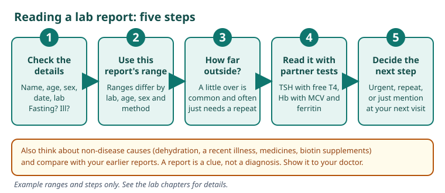

# Worked Examples and Your Health Records

*Status: Draft. A doctor has not reviewed it yet. Last checked: November 2026.*

> [!WARNING]
> **All reports and prescriptions below are made up** to show a way of thinking. They are not real patients. Use this method to **prepare questions for your doctor**, not to diagnose yourself or change treatment.

> [!NOTE]
> **Quick summary**
> - A repeatable routine turns a confusing report into **questions for your doctor**.
> - **Ten steps** for any report, **five checks** for any prescription, and **a checklist** for any health claim.
> - Keep your own records in one place. **Trends** across reports are more useful than any single number.

---

## 1. The ten-step routine for any lab report

1. **Check the details:** your name, age, sex, the date and time of the sample, the lab. (Wrong-patient reports exist.)
2. **Note the conditions:** were you fasting, ill, taking any supplement (biotin, vitamins), exercising hard, or on your period? (See [How lab reports work](../03-tests/01-how-lab-reports-work.md).)
3. **For each abnormal result, identify** the test, the unit and the **range printed on this report**.
4. **How far outside the range is it?** A tiny difference is very different from a large one.
5. **Read it with its partners.** Tests belong to groups: TSH with free T4; ALT with AST and bilirubin; haemoglobin with MCV and ferritin; creatinine with eGFR.
6. **Think about common non-disease causes:** dehydration, recent illness, exercise, medicines, supplements, time of day.
7. **Compare with earlier reports.** Is it new, stable or rising?
8. **Link to a symptom.** Does the result fit how you feel?
9. **Decide:** is it urgent (see doctor now), needing a repeat, or just to mention at the next visit?
10. **Write your questions** (see below) and bring all reports to your doctor.

## 2. Example A: a thyroid report (made up)

| Test | Result | Range on report |
|---|---|---|
| TSH | 6.8 mIU/L | 0.4 to 4.5 |
| Free T4 | 1.1 ng/dL | 0.8 to 1.8 |
| Anti-TPO | Not done | |

**Thinking:**
- TSH is above the range; free T4 is **normal**. This pattern is called **subclinical hypothyroidism** (see [Thyroid](../02-diseases/thyroid.md)).
- A single raised TSH is often temporary. **Was it done during or just after an illness? At what time of day? Was biotin taken?**
- Guidelines suggest **repeating TSH, free T4 and antibodies after about 2 to 3 months** before deciding.
- Age, symptoms and pregnancy plans affect whether treatment is needed.

**Questions to ask:** *"Can we repeat the test with an FT4 and anti-TPO, and when (guidelines suggest about 2 to 3 months)? Do my symptoms fit? Could biotin or a recent illness have affected it? What would make you start treatment, and what is the evidence in my age group?"*

**What not to do:** start or buy thyroid tablets yourself, or panic.

## 3. Example B: a blood count (made up)

| Test | Result | Range |
|---|---|---|
| Haemoglobin | 9.8 g/dL | 12 to 15 |
| MCV | 68 fL | 80 to 100 |
| RBC count | 5.4 million/µL | 4.1 to 5.1 |
| RDW | 14.0% | 11.5 to 14.5 |
| Platelets | 280,000/µL | 150,000 to 400,000 |
| Ferritin | 98 ng/mL | 15 to 150 |

**Thinking** (see [CBC](../03-tests/cbc.md), [Anaemia](../02-diseases/anaemia.md)):
- Haemoglobin is low (**anaemia**) and the cells are **small** (low MCV).
- Small cells are caused by **iron deficiency or thalassaemia trait**. Clues: RBC count is **high** (not low), RDW is **normal**, and **ferritin is normal**. That points toward **thalassaemia trait**, not iron deficiency. The **Mentzer index** (68 ÷ 5.4 = 12.6, below 13) also leans that way. This is only a screen.
- Iron is unlikely to fix the low haemoglobin if this is thalassaemia trait. Ferritin can read falsely normal in inflammation, and both conditions can coexist, so the doctor decides.

**Questions to ask:** *"Could this be thalassaemia trait? Do I need a haemoglobin analysis (HPLC)? Is my ferritin telling us iron is adequate? Should my partner be tested before pregnancy? Do I need iron at all?"*

## 4. Example C: a liver panel (made up)

| Test | Result | Upper limit |
|---|---|---|
| ALT (SGPT) | 78 U/L | 50 |
| AST (SGOT) | 52 U/L | 40 |
| ALP | 98 U/L | 130 |
| Total bilirubin | 0.8 mg/dL | 1.2 |
| Albumin | 4.4 g/dL | 3.5 to 5.0 |

**Thinking** (see [Liver and kidney function tests](../03-tests/liver-and-kidney-tests.md), [Liver and fatty liver](../02-diseases/liver.md)):
- ALT is about 1.5 times and AST about 1.3 times the upper limit; ALP, bilirubin and albumin are normal. This suggests **mild liver cell irritation** and **does not suggest reduced liver function** (an INR would also help).
- **Common causes:** fatty liver, medicines, supplements, alcohol, a recent hard workout, a viral illness. 
- Look at **weight, sugar, cholesterol, alcohol, and every medicine and supplement** (including gym products and herbal tonics).
- **Next steps** a doctor often considers: repeat in a few weeks, check hepatitis B and C, assess for scarring (FIB-4, FibroScan) if fatty liver is likely.

**Questions to ask:** *"Is this mild injury or reduced function? Could my medicines, supplements or exercise explain it? Should we repeat it? Do I have fatty liver, and how do we check for scarring? Do I need any 'liver tablets', and for what?"*

**What not to do:** take "liver detox" products or tonics without asking.

## 5. Example D: a prescription (made up)

> Dx: "Fever, body ache" (age 34, adult, no allergies)
> 1. Tab *Aceclofenac + Paracetamol* 1-0-1 × 5 days
> 2. Tab *Azithromycin* 500 mg 1-0-0 × 3 days
> 3. Tab *Pantoprazole* 40 mg 1-0-0 (empty stomach) × 10 days
> 4. Tab *Multivitamin* 0-1-0 × 15 days
> 5. Syp *Cough syrup (several ingredients)* 10 mL TDS × 5 days
> 6. Syp *Liver tonic* 10 mL BD × 10 days

**Apply the five checks** (see [Reading a prescription](../04-medicines/reading-a-prescription.md)):

| Check | Observations |
|---|---|
| **1. What is each for?** | Pain and fever; (antibiotic?); acid protection; "vitamins"; cough; "liver protection". Items 4 and 6 have no stated purpose (the acid tablet in item 3 has a plausible purpose: stomach protection alongside an NSAID) |
| **2. Ingredients and duplicates** | Aceclofenac is an NSAID plus paracetamol; the cough syrup may contain more paracetamol or other ingredients: **add up all paracetamol** |
| **3. How often and how long?** | PPI for 10 days, vitamins 15 days: is there a reason? |
| **4. Does it fit me?** | NSAID: stomach, kidney, blood pressure risk (see [Painkillers, steroids, acidity pills and supplements](../04-medicines/painkillers-steroids-acidity-supplements.md)); in fever, **dengue must be excluded before an NSAID** |
| **5. Is the evidence there?** | An **antibiotic for "fever, body ache" without a bacterial diagnosis** is the biggest question (see [Antibiotics and resistance](../04-medicines/antibiotics-and-resistance.md)). A multi-ingredient cough syrup may be an irrational combination (see [Fixed-dose combinations and spurious drugs](../04-medicines/fdc-and-spurious-drugs.md)) |

**Questions to ask:** *"What is my diagnosis? Is this bacterial? Why an antibiotic? Has dengue or malaria been ruled out? What is each of these six for? Which can I skip? Is the NSAID safe for me? How much total paracetamol am I getting? Do I need the acid tablet and the liver tonic?"*

**What not to do:** stop or start anything on your own; ask first, and ask a **pharmacist** to check interactions too.

## 6. Example E: a health claim (made up)

> WhatsApp forward: *"Dr. Sharma from AIIMS reveals: drink this herbal juice every morning and your diabetes will be cured in 30 days. Doctors hide this! Stop your tablets. Forward to 10 people."*

Apply the checklist from [Health misinformation](../09-indian-healthcare/health-misinformation.md):

| Question | Result |
|---|---|
| Who says so? | "Dr. Sharma from AIIMS": no full name, no proof |
| Evidence? | None cited |
| Who profits? | Probably the seller of the juice (a link or phone number may follow) |
| Too good to be true? | "Cured in 30 days" |
| Says doctors lie? | "Doctors hide this" |
| Asks you to stop treatment? | **Yes: a major red flag** |
| Urgency? | "Forward to 10 people" |
| On a reliable source? | No |

**Verdict:** very likely false and dangerous. **Do not stop medicines. Do not forward.** Tell the sender kindly, and show your doctor if you are curious. See [Diabetes](../02-diseases/diabetes.md).

## 7. A questions list to take to any visit

1. What is the diagnosis, in simple words?
2. Which test result supports it? What is the normal range and my value?
3. Is this an emergency? What if I wait?
4. What are all my options, including doing nothing for now?
5. For each medicine: what is it for, how long, what side effects, any interactions?
6. What will it cost, in total?
7. What warning signs should make me come back or go to hospital?
8. When is my next visit, and what will we check?
9. Is a second opinion reasonable?

## 8. Keep your own health record

A good personal record makes every visit safer and helps in emergencies.

### What to keep

| Item | Notes |
|---|---|
| **All reports** (blood, urine, scans, ECG), **with dates and lab names** | Keep the **images or CD** of scans as well as the written report |
| **Prescriptions and discharge summaries** | |
| **Vaccination record** | |
| **A current medicine list** | Name, ingredient, dose, purpose, prescriber, start date |
| **Allergies and past reactions** | |
| **Doctor names and contacts; insurance details** | |
| **A simple "trend sheet"** | A table or spreadsheet with dates and key numbers: weight, BP, sugar and HbA1c, TSH, haemoglobin, creatinine/eGFR, cholesterol, ALT |

### How

- **Scan or photograph** every paper, name the files like **`2026-03-12_thyroid_TSH.pdf`**, and keep them in **dated folders** on your phone and a cloud backup. Keep paper originals too.
- **Update the trend sheet** after each test; it shows the direction over time (more useful than a single value).
- **Protect privacy:** use a password-protected folder; **do not post reports publicly**; be careful which apps or websites you give them to. `⚠ verify`
- **Share when needed:** give your doctor the trend sheet and the recent reports. Ask for copies of everything at discharge.

### ABHA and digital health records

India's **Ayushman Bharat Digital Mission** offers an **ABHA** (Ayushman Bharat Health Account) number, a **14-digit health ID**, and apps that can link your records from participating hospitals and labs, so you can view and share them with your consent. `⚠ verify the current features` It is optional, and you can ask what data is being linked and who can see it.

### In an emergency

Carry a **card or phone lock-screen note** with your name, age, blood group, allergies, conditions, current medicines and an emergency contact. Many phones have a medical ID feature. `⚠ verify`

## 9. A personal action plan

Choose three things to do this month:
1. **Start a health folder** and a medicine list.
2. **Ask each doctor** the question "What is this medicine for?" once.
3. **Learn CPR** or save the emergency numbers, and **check your family's vaccinations**.

## Key terms

**Reference range** the printed "normal" band for that lab · **Trend** the direction of a value over time · **Subclinical** abnormal test with few symptoms · **Mentzer index** MCV divided by RBC count, a thalassaemia screen · **ABHA** Ayushman Bharat Health Account (health ID) · **ABDM** Ayushman Bharat Digital Mission · **Medicine list** your personal record of everything you take · **Discharge summary** the hospital's record of your stay and plan.

## Sources and not verified

1. The routine in this chapter is a teaching framework built from the other chapters of this handbook; the sources are listed in each linked chapter.
2. National Health Authority: Ayushman Bharat Digital Mission and ABHA (abdm.gov.in). `⚠ verify`
3. Indian Medical Association and medical-council guidance on patient records and confidentiality. `⚠ verify`

**Not verified:** all patient reports and prescriptions are invented examples. The ABHA features and the phone medical-ID statement are claims to confirm against the cited sources.
