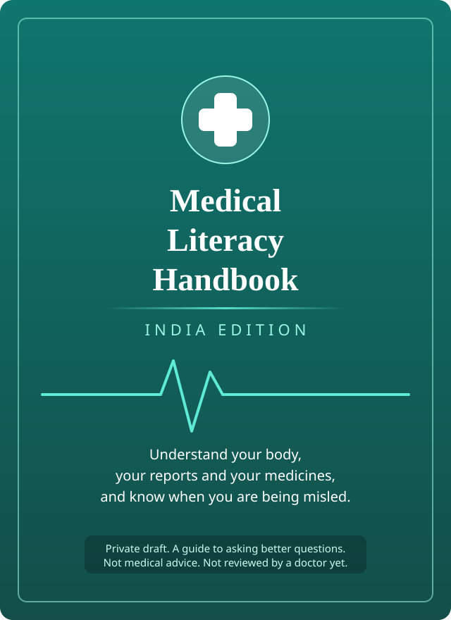

# Medical Literacy Handbook (India)

A beginner-friendly handbook to help you understand your body, common diseases, lab reports and medicines, and to notice when you are being misled.

> [!WARNING]
> This book teaches you what to **ask**. It does not diagnose you and it does not tell you which medicine to take or stop. Never change or stop a prescribed medicine without asking the doctor who prescribed it. In an emergency, go to a hospital.

> [!NOTE]
> Status: all chapters are **drafts**. A doctor has not reviewed them. Numbers marked `⚠ verify` are not yet checked against a primary source.

## How to use this handbook

0. New to biology? Read the chapters in "The body" first. Each explains one organ system in depth: structure, how it works step by step, how it is controlled, how it is tested.
1. Read [How to judge medical advice](00-start-here/01-how-to-judge-medical-advice.md) and [How lab reports work](03-tests/01-how-lab-reports-work.md) first. Every other chapter builds on them.
2. Look up the disease or test you care about. Every disease chapter has the same layout, so you can compare them.
3. Before a doctor visit, copy the "Ask your doctor" list from the chapter.
4. Keep your own reports in `my-reports/`. That folder is never pushed to GitHub.

## Available chapters

| Part | Chapter |
|---|---|
| Start here | [How to judge medical advice](00-start-here/01-how-to-judge-medical-advice.md) |
| Start here | [How to use this book, and how to look up anything else](00-start-here/02-how-to-use-this-book.md) |
| The body | [The heart and circulation](01-body/heart-and-circulation.md) |
| The body | [The kidneys and urinary system](01-body/kidneys.md) |
| The body | [The liver and gallbladder](01-body/liver-and-gallbladder.md) |
| The body | [The endocrine system](01-body/endocrine-system.md) |
| The body | [Blood](01-body/blood.md) |
| The body | [Lungs and breathing](01-body/lungs-and-breathing.md) |
| The body | [The digestive system](01-body/digestive-system.md) |
| The body | [The brain and nervous system](01-body/brain-and-nervous-system.md) |
| The body | [The immune system](01-body/immune-system.md) |
| The body | [Bones, joints, muscles and skin](01-body/bones-muscles-skin.md) |
| The body | [The reproductive system](01-body/reproductive-system.md) |
| The body | [Cells, genes and how cancer starts](01-body/cells-and-cancer-basics.md) |
| The body | [Metabolism, cholesterol, inflammation, electrolytes, acid-base](01-body/hormones-metabolism-homeostasis.md) |
| Tests | [How lab reports work](03-tests/01-how-lab-reports-work.md) |
| Tests | [Complete blood count (CBC)](03-tests/cbc.md) |
| Tests | [Liver and kidney function tests](03-tests/liver-and-kidney-tests.md) |
| Tests | [Lipid profile (cholesterol)](03-tests/lipid-profile.md) |
| Tests | [Urine tests](03-tests/urine-tests.md) |
| Tests | [Vitamin and iron tests](03-tests/vitamins-and-iron-studies.md) |
| Tests | [Inflammation, infection and heart marker tests](03-tests/inflammation-infection-and-heart-markers.md) |
| Tests | [Imaging and ECG reports: X-ray, ultrasound, CT, MRI, ECG, echo](03-tests/imaging-and-ecg-reports.md) |
| Tests | [Choosing a lab and spotting wrong reports](03-tests/choosing-a-lab-and-spotting-wrong-reports.md) |
| Medicines | [How medicines work](04-medicines/how-medicines-work.md) |
| Medicines | [Reading a prescription](04-medicines/reading-a-prescription.md) |
| Medicines | [Generic, brand and prices (India)](04-medicines/generic-brand-and-prices.md) |
| Medicines | [Antibiotics and resistance](04-medicines/antibiotics-and-resistance.md) |
| Medicines | [Painkillers, steroids, acidity pills and supplements](04-medicines/painkillers-steroids-acidity-supplements.md) |
| Medicines | [Fixed-dose combinations and spurious drugs](04-medicines/fdc-and-spurious-drugs.md) |
| Medicines | [Common drug classes for long-term conditions](04-medicines/common-drug-classes.md) |
| Medicines | [Interactions, pregnancy, children, older people](04-medicines/interactions-and-special-groups.md) |
| Nutrition | [Nutrition and the Indian diet](05-nutrition/nutrition-and-the-indian-diet.md) |
| Nutrition | [Diet myths and special diets](05-nutrition/diet-myths-and-special-diets.md) |
| Life stages | [Children's health](06-life-stages/childrens-health.md) |
| Life stages | [Pregnancy and childbirth](06-life-stages/pregnancy-and-childbirth.md) |
| Life stages | [Ageing and elderly care](06-life-stages/ageing-and-elderly-care.md) |
| Life stages | [Skin, eyes, ears and teeth](06-life-stages/skin-eyes-ears-and-teeth.md) |
| Prevention | [Vaccines and immunisation](07-prevention/vaccines-and-immunisation.md) |
| Prevention | [Screening and health check-ups](07-prevention/screening-and-checkups.md) |
| Prevention | [Lifestyle: activity, sleep, tobacco, alcohol, everyday safety](07-prevention/lifestyle-activity-sleep-tobacco-alcohol.md) |
| Decisions | [Second opinions and treatment decisions](08-decisions/second-opinions-and-treatment-decisions.md) |
| Indian healthcare | [Hospitals, bills and health insurance](09-indian-healthcare/hospitals-bills-and-insurance.md) |
| Indian healthcare | [Patient rights and how to complain](09-indian-healthcare/patient-rights-and-complaints.md) |
| Indian healthcare | [Health misinformation: WhatsApp, YouTube, "natural cures"](09-indian-healthcare/health-misinformation.md) |
| Practical | [First aid and emergencies](10-practical/first-aid-and-emergencies.md) |
| Practical | [Worked examples and your health records](10-practical/worked-examples.md) |
| Diseases | [Thyroid](02-diseases/thyroid.md) |
| Diseases | [Diabetes](02-diseases/diabetes.md) |
| Diseases | [Liver, fatty liver and hepatitis](02-diseases/liver.md) |
| Diseases | [High blood pressure](02-diseases/high-blood-pressure.md) |
| Diseases | [Coronary heart disease and heart attack](02-diseases/coronary-heart-disease.md) |
| Diseases | [Chronic kidney disease](02-diseases/chronic-kidney-disease.md) |
| Diseases | [Anaemia](02-diseases/anaemia.md) |
| Diseases | [Asthma, COPD and chest infections](02-diseases/asthma-and-copd.md) |
| Diseases | [Common fevers in India: dengue, malaria, typhoid](02-diseases/common-fevers-india.md) |
| Diseases | [Tuberculosis](02-diseases/tuberculosis.md) |
| Diseases | [Obesity and metabolic syndrome](02-diseases/obesity-and-metabolic-syndrome.md) |
| Diseases | [Stroke](02-diseases/stroke.md) |
| Diseases | [Kidney stones, urinary infections and acute kidney injury](02-diseases/kidney-stones-uti-and-aki.md) |
| Diseases | [Osteoporosis and arthritis](02-diseases/osteoporosis-and-arthritis.md) |
| Diseases | [Common cancers in India, treatment and misleading claims](02-diseases/common-cancers-in-india.md) |
| Diseases | [PCOS and common women's health problems](02-diseases/pcos-and-womens-health.md) |
| Diseases | [Mental health basics](02-diseases/mental-health-basics.md) |
| Diseases | [Common digestive diseases: acidity, ulcers, IBS, gallstones, piles](02-diseases/common-digestive-diseases.md) |

The full plan (body, diseases, tests, medicines, nutrition, infections, prevention, decisions, Indian healthcare, practical skills) is in [ROADMAP.md](ROADMAP.md).

## Other files

- [IMAGE-CREDITS.md](IMAGE-CREDITS.md): sources and licences of the pictures.
- [Glossary](appendix/GLOSSARY.md): plain-language definitions linked to chapters.
- [Pocket cards](appendix/POCKET-CARDS.md): one-page summaries to print or save.
- [FACT-CHECK-LOG.md](FACT-CHECK-LOG.md): what was checked, what changed, and what is still unverified.
- [CLAUDE.md](CLAUDE.md): the writing rules and chapter templates used to build this handbook.

For the reviewing doctor: [REVIEW-GUIDE.md](REVIEW-GUIDE.md).
